# Jarkom-Modul-3-2026-K-37

| Nama | NRP |
|---|---|
| Azfaro Zid Ilmi | 5027251018 |
| Gede Satya Putra Aryanta | 5027251012 |

---

## Daftar Isi

- [Tabel Pembagian Interface & Alamat IP](#tabel-pembagian-interface--alamat-ip)
- [soal 1 - Satya & Azfaro](#soal-1---satya--azfaro)
- [soal 2 - Satya & Azfaro](#soal-2---satya--azfaro)
- [soal 3 - Satya & Azfaro](#soal-3---satya--azfaro)
- [soal 4 - Satya & Azfaro](#soal-4---satya--azfaro)
- [soal 5 - Satya & Azfaro](#soal-5---satya--azfaro)
- [soal 6 - Satya & Azfaro](#soal-6---satya--azfaro)
- [soal 7 - Satya & Azfaro](#soal-7---satya--azfaro)
- [soal 8 - Satya & Azfaro](#soal-8---satya--azfaro)
- [soal 9 - Satya & Azfaro](#soal-9---satya--azfaro)
- [soal 10 - Satya & Azfaro](#soal-10---satya--azfaro)
- [soal 11 - Satya & Azfaro](#soal-11---satya--azfaro)
- [soal 12 - Satya & Azfaro](#soal-12---satya--azfaro)
- [soal 13 - Satya & Azfaro](#soal-13---satya--azfaro)
- [soal 14 - Satya & Azfaro](#soal-14---satya--azfaro)
- [soal 15 - Satya & Azfaro](#soal-15---satya--azfaro)
- [soal 16 - Satya & Azfaro](#soal-16---satya--azfaro)
- [soal 17 - Satya & Azfaro](#soal-17---satya--azfaro)
- [soal 18 - Satya & Azfaro](#soal-18---satya--azfaro)
- [soal 19 - Satya & Azfaro](#soal-19---satya--azfaro)
- [soal 20 - Satya & Azfaro](#soal-20---satya--azfaro)

---

### Tabel Pembagian Interface & Alamat IP

Prefix ip : 10.82.x.x

| Node | Antarmuka | Alamat IP | Netmask | Gateway | Subnet / Keterangan |
|---|---|---|---|---|---|
| **jichi** | `eth0`<br>`eth1`<br>`eth2`<br>`eth3`<br>`eth4` | DHCP (NAT)<br>`10.82.1.1`<br>`10.82.2.1`<br>`10.82.3.1`<br>`10.82.4.1` | -<br>`255.255.255.0`<br>`255.255.255.0`<br>`255.255.255.0`<br>`255.255.255.0` | -<br>-<br>-<br>-<br>- | Router Utama & DHCP Relay<br>Gateway Network 1 (DMZ)<br>Gateway Network 2 (Divisi A)<br>Gateway Network 3 (Divisi B)<br>Gateway Network 4 (Data Center) |
| **utahime** | `eth0` | `10.82.1.2` | `255.255.255.0` | `10.82.1.1` | DNS Master (Network 1 - DMZ) |
| **shoko** | `eth0` | `10.82.1.3` | `255.255.255.0` | `10.82.1.1` | DNS Slave (Network 1 - DMZ) |
| **gojo** | `eth0` | `10.82.1.4` | `255.255.255.0` | `10.82.1.1` | Public Reverse Proxy Nginx (Network 1 - DMZ) |
| **itadori** | `eth0` | DHCP (`10.82.2.10` - `10.82.2.35`) | `255.255.255.0` | `10.82.2.1` | Klien Divisi A (DHCP Pool 1) |
| **fushiguro** | `eth0` | DHCP (`10.82.2.10` - `10.82.2.35`) | `255.255.255.0` | `10.82.2.1` | Klien Divisi A (DHCP Pool 1) |
| **zenin** | `eth0` | DHCP (`10.82.2.70` - `10.82.2.95`) | `255.255.255.0` | `10.82.2.1` | Klien Divisi A (DHCP Pool 2) |
| **okkotsu** | `eth0` | DHCP (`10.82.2.70` - `10.82.2.95`) | `255.255.255.0` | `10.82.2.1` | Klien Divisi A (DHCP Pool 2) |
| **ino** | `eth0` | DHCP (`10.82.3.10` - `10.82.3.89`) | `255.255.255.0` | `10.82.3.1` | Klien Divisi B (DHCP Short Lease) |
| **kusakabe** | `eth0` | DHCP (`10.82.3.10` - `10.82.3.89`) | `255.255.255.0` | `10.82.3.1` | Klien Divisi B (DHCP Short Lease) |
| **kugisaki** | `eth0` | DHCP Fixed (`10.82.3.99`) | `255.255.255.0` | `10.82.3.1` | Klien Divisi B (VIP Fixed Address) |
| **miwa** | `eth0` | DHCP (`10.82.3.100` - `10.82.3.199`) | `255.255.255.0` | `10.82.3.1` | Klien Divisi B (DHCP Long Lease) |
| **geto** | `eth0` | `10.82.4.2` | `255.255.255.0` | `10.82.4.1` | Internal Load Balancer Nginx (Data Center) |
| **maki** | `eth0` | `10.82.4.3` | `255.255.255.0` | `10.82.4.1` | Worker Frontend Nginx (Data Center) |
| **panda** | `eth0` | `10.82.4.4` | `255.255.255.0` | `10.82.4.1` | Worker Frontend Nginx (Data Center) |
| **nanami** | `eth0` | `10.82.4.5` | `255.255.255.0` | `10.82.4.1` | Worker API Utama (Data Center) |
| **todo** | `eth0` | `10.82.4.6` | `255.255.255.0` | `10.82.4.1` | Worker API Utama (Data Center) |
| **kirara** | `eth0` | `10.82.4.7` | `255.255.255.0` | `10.82.4.1` | Worker API Cadangan (Data Center) |
| **yaga** | `eth0` | `10.82.4.8` | `255.255.255.0` | `10.82.4.1` | Database Master MariaDB (Data Center) |
| **inumaki** | `eth0` | `10.82.4.9` | `255.255.255.0` | `10.82.4.1` | Database Slave MariaDB (Data Center) |
| **tengen** | `eth0` | `10.82.4.10` | `255.255.255.0` | `10.82.4.1` | DHCP Server isc-dhcp-server (Data Center) |

---

# Laporan Praktikum Modul 3

## soal 1 - Satya & Azfaro

---

> Ketika Curtain menutup Shibuya, jalur komunikasi antar zona Jujutsu High terputus. Pulihkan konektivitas dasar dengan mengonfigurasi jichi: eth0 memperoleh WAN dari NAT, sedangkan eth1–eth4 menjadi gateway Network 1–4 sesuai tabel pemetaan. Aktifkan IPv4 forwarding dan source NAT, lalu tetapkan IP statis host infrastruktur sesuai tabel spesifikasi. Buktikan konektivitas setiap host ke gateway dan akses eksternal dari host yang relevan.

### Maksud dari Soal No. 1

Tujuan dari soal ini adalah untuk melakukan konfigurasi jaringan dasar pada semua node agar bisa saling terhubung dan memiliki akses ke internet. Ini adalah langkah fondasi yang krusial agar kita bisa mengunduh dan menginstall paket-paket yang diperlukan di soal-soal berikutnya (seperti `isc-dhcp-server`, `bind9`, `nginx`, `mariadb-server`, dll.).

Sebelumnya kita buat dahulu topologi yang diminta:

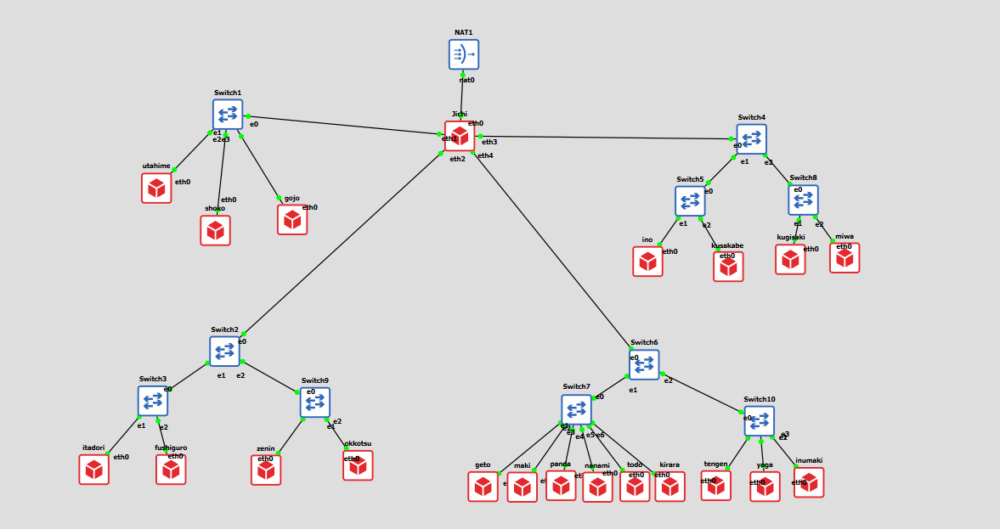

Pada nomor 1 ini kita diminta membangun topologi sesuai gambar rancangan di modul dan mengonfigurasi IP statis beserta default gateway untuk seluruh node infrastruktur yang ada di jaringan, mengaktifkan IPv4 forwarding, serta memasang Source NAT Masquerade pada router `jichi`.

Konfigurasi antarmuka disimpan di `/etc/network/interfaces` pada masing-masing node. 

Seluruh konfigurasi nomor 1 ini sudah kami kumpulkan di [`scripts/soal1.sh`](scripts/soal1.sh).

**Cara pakai script:**
1. Buka console **jichi** di GNS3, lalu copy-paste blok kode di bawah `# JICHI (Router Utama & DHCP Relay)` yang ada di `scripts/soal1.sh` (isinya konfigurasi interface `eth0` s/d `eth4`, IP forwarding, serta iptables Source NAT), kemudian jalankan `service networking restart`.
2. Buka console masing-masing host internal (`utahime`, `shoko`, `gojo`, `tengen`, `geto`, `maki`, `panda`, `nanami`, `todo`, `kirara`, `yaga`, `inumaki`), lalu copy-paste blok kode yang sesuai dengan nama nodenya di `scripts/soal1.sh` dan jalankan `service networking restart`.
3. Buka console masing-masing client (`itadori`, `fushiguro`, `zenin`, `okkotsu`, `ino`, `kusakabe`, `kugisaki`, `miwa`), lalu copy-paste blok kode client di `scripts/soal1.sh`.

Contoh config di `jichi`:
```bash
auto lo
iface lo inet loopback

auto eth0
iface eth0 inet dhcp

auto eth1
iface eth1 inet static
    address 10.82.1.1
    netmask 255.255.255.0

auto eth2
iface eth2 inet static
    address 10.82.2.1
    netmask 255.255.255.0

auto eth3
iface eth3 inet static
    address 10.82.3.1
    netmask 255.255.255.0

auto eth4
iface eth4 inet static
    address 10.82.4.1
    netmask 255.255.255.0
```

Aktifkan penerusan paket (IPv4 forwarding) dan Source NAT pada `jichi`:
```bash
sysctl -w net.ipv4.ip_forward=1
echo 'net.ipv4.ip_forward=1' >> /etc/sysctl.conf

iptables -t nat -F POSTROUTING
iptables -t nat -A POSTROUTING -s 10.82.0.0/16 -o eth0 -j MASQUERADE
```

Contoh config di host infrastruktur (misal `tengen`):
```bash
auto lo
iface lo inet loopback

auto eth0
iface eth0 inet static
    address 10.82.4.10
    netmask 255.255.255.0
    gateway 10.82.4.1
```

Setiap host internal juga dipasang DNS sementara mengarah ke gateway NAT:
```bash
echo "nameserver 192.168.122.1" > /etc/resolv.conf
```

---

### Bukti Pengujian & Hasil Verifikasi

1. Bukti hasil pengecekan IP address (`ip -br addr`), routing (`ip route`), IPv4 forwarding (`sysctl net.ipv4.ip_forward`), dan aturan Source NAT Masquerade pada router `jichi`:
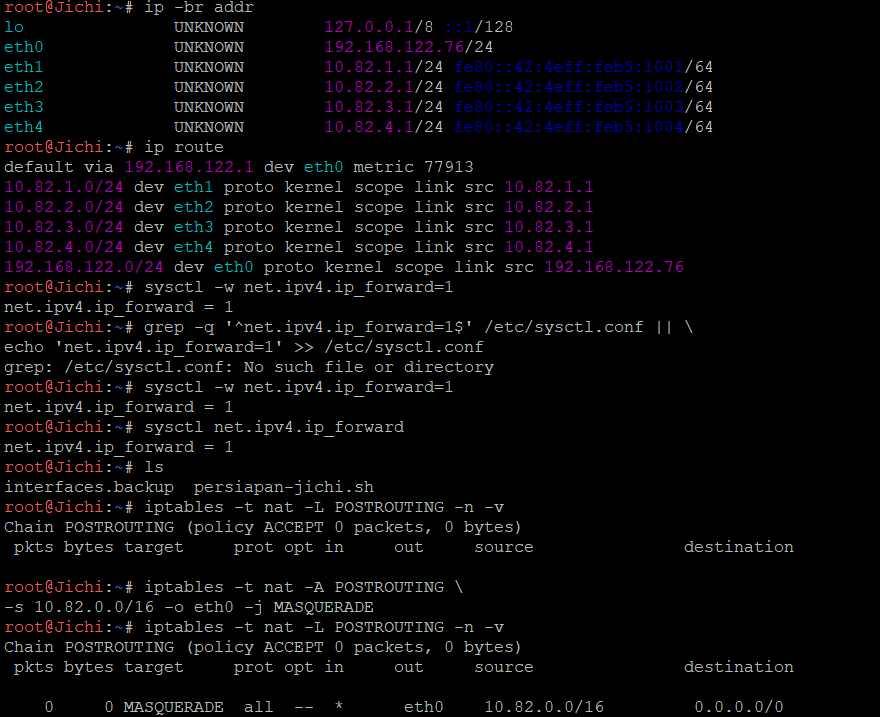

2. Bukti pengujian konektivitas ping gateway (`10.82.1.1` & `10.82.4.1`) serta ping dari router `jichi` ke host infrastruktur `tengen` (`10.82.4.10`):
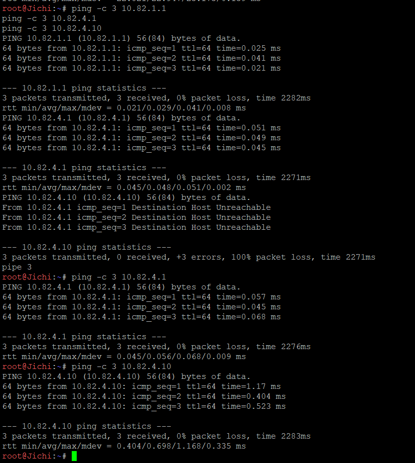

---

## soal 2 - Satya & Azfaro

---

> Tengen, penjaga pusat distribusi di Data Center, harus mengambil alih pengalokasian alamat bagi wilayah yang membutuhkan konfigurasi dinamis. Konfigurasikan isc-dhcp-server pada [PREFIX IP].4.10. Deklarasikan Network 4 ([PREFIX IP].4.0/24) sebagai subnet lokal tanpa pool dinamis, lalu siapkan scope DHCP untuk Network 2 ([PREFIX IP].2.0/24) dan Network 3 ([PREFIX IP].3.0/24). Validasi konfigurasi dan pastikan service aktif tanpa error “No subnet declaration”.

### Maksud dari Soal No. 2

Tujuan dari soal ini adalah mengonfigurasi node **tengen** (`10.82.4.10`) sebagai **DHCP Server** menggunakan paket `isc-dhcp-server`.
Beberapa poin penting pada konfigurasi ini:
1. **Deklarasi Subnet Lokal Network 4 (`10.82.4.0/24`)**: Karena antarmuka `eth0` milik `tengen` berada pada Network 4, daemon `dhcpd` mewajibkan adanya deklarasi subnet `10.82.4.0/24`. Dibuat blok subnet kosong tanpa pool dinamis (`range`) agar Network 4 tidak membagikan IP dinamis kepada host lokalnya. Hal ini mencegah terjadinya error **"No subnet declaration for eth0"**.
2. **Deklarasi Scope DHCP untuk Network 2 (`10.82.2.0/24`) dan Network 3 (`10.82.3.0/24`)**: Menyiapkan konfigurasi pool IP, gateway, netmask, serta DNS server bagi client di Divisi A dan Divisi B yang nantinya akan meminta IP melalui DHCP Relay `jichi`.
3. **Validasi Konfigurasi**: Memastikan tidak ada kesalahan sintaks pada `/etc/dhcp/dhcpd.conf` menggunakan `dhcpd -t` dan memastikan service `isc-dhcp-server` aktif mendengarkan permintaan di antarmuka `eth0`.

Seluruh konfigurasi nomor 2 ini sudah kami kumpulkan di [`scripts/soal2.sh`](scripts/soal2.sh).

**Cara pakai script:**
Buka console **tengen** di GNS3, lalu jalankan seluruh perintah berikut:

1. **Instalasi Paket `isc-dhcp-server`**:
```bash
apt-get update
apt-get install -y isc-dhcp-server
```

2. **Pengaturan Interface DHCP di `/etc/default/isc-dhcp-server`**:
```bash
cat <<'EOF' > /etc/default/isc-dhcp-server
INTERFACESv4="eth0"
INTERFACESv6=""
EOF
```

3. **Konfigurasi DHCP Scope di `/etc/dhcp/dhcpd.conf`**:
```bash
cat <<'EOF' > /etc/dhcp/dhcpd.conf
authoritative;
default-lease-time 600;
max-lease-time 7200;

# Network 4: subnet lokal Tengen, tidak membagikan IP dinamis
subnet 10.82.4.0 netmask 255.255.255.0 {
}

# Network 2
subnet 10.82.2.0 netmask 255.255.255.0 {
    range 10.82.2.10 10.82.2.35;
    option routers 10.82.2.1;
    option subnet-mask 255.255.255.0;
    option domain-name-servers 8.8.8.8;
}

# Network 3
subnet 10.82.3.0 netmask 255.255.255.0 {
    range 10.82.3.10 10.82.3.89;
    range 10.82.3.100 10.82.3.199;
    option routers 10.82.3.1;
    option subnet-mask 255.255.255.0;
    option domain-name-servers 8.8.8.8;
}
EOF
```

4. **Validasi dan Pengujian Service**:
```bash
# Validasi sintaks file konfigurasi
dhcpd -t -cf /etc/dhcp/dhcpd.conf

# Restart service DHCP server
service isc-dhcp-server restart
service isc-dhcp-server status

# Memastikan autostart aktif
systemctl enable isc-dhcp-server 2>/dev/null || true
```

---

### Bukti Pengujian & Hasil Verifikasi

Bukti validasi sintaks konfigurasi menggunakan `dhcpd -t -cf /etc/dhcp/dhcpd.conf` serta pengetesan service DHCP server pada interface `eth0` yang berhasil aktif mendengarkan (*Listening on `LPF/eth0/.../10.82.4.0/24`*) tanpa adanya error *"No subnet declaration"*:

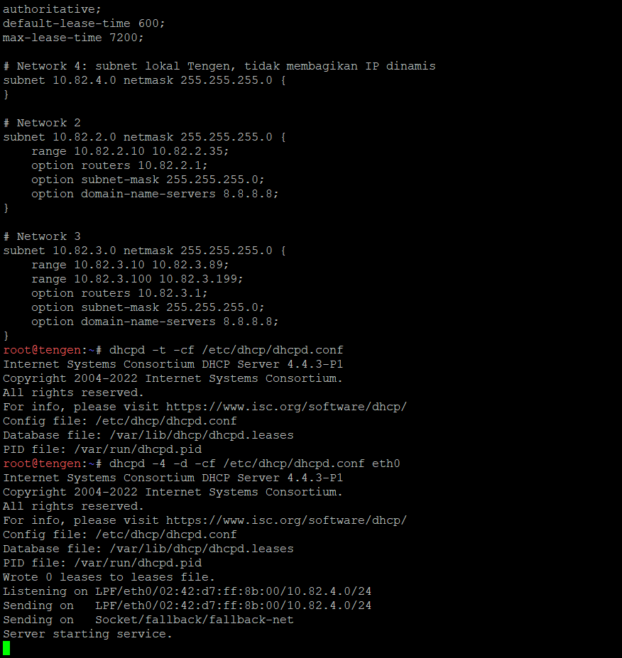


---

## soal 3 - Satya & Azfaro

---

> Permintaan alamat dari Divisi A dan Divisi B tidak dapat menyeberangi subnet secara langsung. Konfigurasikan jichi sebagai DHCP Relay menuju tengen ([PREFIX IP].4.10), menggunakan eth2 untuk Network 2 dan eth3 untuk Network 3. Buktikan bahwa client dari kedua subnet berhasil memperoleh lease melalui relay.

### Maksud dari Soal No. 3

Tujuan dari soal ini adalah mengonfigurasi router **jichi** sebagai **DHCP Relay** menggunakan paket `isc-dhcp-relay`.

Pada kondisi normal, permintaan konfigurasi jaringan oleh DHCP client dikirimkan menggunakan pesan broadcast UDP (port 67/68). Namun, router tidak meneruskan paket broadcast antar subnet. Karena server DHCP (**tengen**) berada di Network 4 (`10.82.4.10`), sedangkan client berada di Network 2 (Divisi A) dan Network 3 (Divisi B), dibutuhkan perantara yaitu DHCP Relay pada `jichi`.

DHCP Relay pada `jichi` bertugas:
1. Mendengarkan broadcast DHCP pada antarmuka client, yaitu `eth2` (Network 2) dan `eth3` (Network 3).
2. Meneruskan paket permintaan tersebut secara unicast ke DHCP Server `tengen` (`10.82.4.10`) melalui antarmuka gateway Network 4.
3. Meneruskan kembali balasan dari DHCP server ke client asal, sehingga client di Network 2 dan Network 3 berhasil mendapatkan alamat IP dinamis sesuai scope wilayahnya masing-masing.

Seluruh konfigurasi nomor 3 ini sudah kami kumpulkan di [`scripts/soal3.sh`](scripts/soal3.sh).

**Cara pakai script:**
1. Buka console **jichi** di GNS3, lalu pasang dan konfigurasikan `isc-dhcp-relay`:
```bash
# Update dan instalasi paket
apt-get update
apt-get install -y isc-dhcp-relay

# Konfigurasi relay server dan interface
cat <<'EOF' > /etc/default/isc-dhcp-relay
SERVERS="10.82.4.10"
INTERFACES="eth2 eth3"
OPTIONS=""
EOF

# Restart service relay
service isc-dhcp-relay restart
```
Atau dapat juga dijalankan secara foreground/debug interaktif:
```bash
dhcrelay -d -4 -i eth2 -i eth3 10.82.4.10
```

2. Buka console masing-masing client di Divisi A dan Divisi B (misal: `itadori`, `ino`, `kusakabe`), lalu jalankan perintah request lease DHCP:
```bash
/gns3/bin/udhcpc -f -n -q -i eth0
```

---

### Bukti Pengujian & Hasil Verifikasi

1. **Bukti DHCP Relay pada `jichi`**:
   Relay berhasil aktif mendengarkan antarmuka client `eth2` dan `eth3`, serta meneruskan paket `BOOTREQUEST` dari client menuju DHCP server `10.82.4.10`:
   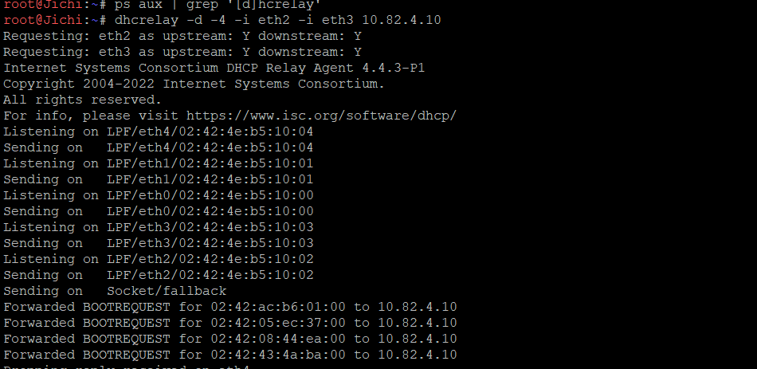

2. **Bukti Lease Client Divisi A (Network 2)**:
   Client `itadori` di Network 2 berhasil memperoleh IP `10.82.2.10` dari server `10.82.4.10`:
   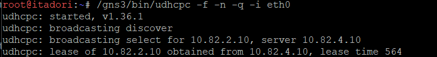

3. **Bukti Lease Client Divisi B (Network 3)**:
   Client di Network 3 (`ino` dan `kusakabe`) berhasil memperoleh IP dari scope Network 3:
   * `ino` memperoleh IP `10.82.3.12` dari server `10.82.4.10`:
   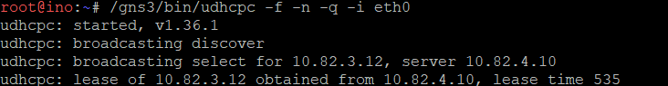
   * `kusakabe` memperoleh IP `10.82.3.10` dari server `10.82.4.10`:
   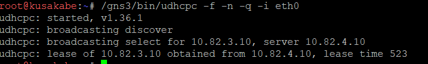


---

## soal 4 - Satya & Azfaro

---

> Agar tim Dev dan Support di Divisi A menerima jatah alamat yang berbeda, atur dua pool DHCP pada Network 2. Tetapkan Pool 1 ([PREFIX IP].2.10–[PREFIX IP].2.35) untuk itadori dan fushiguro, serta Pool 2 ([PREFIX IP].2.70–[PREFIX IP].2.95) untuk zenin dan okkotsu. Rentang [PREFIX IP].2.36–[PREFIX IP].2.69 tidak boleh dialokasikan. Karena seluruh client berada pada subnet yang sama, gunakan DHCP class berdasarkan MAC Address atau Client ID untuk memisahkan kedua kelompok.

### Maksud dari Soal No. 4

Tujuan dari soal ini adalah mengonfigurasi DHCP Server pada node **tengen** agar pembagian alamat IP dinamis pada Network 2 terbagi menjadi dua pool yang berbeda berdasarkan identitas masing-masing client (MAC Address):
1. **Tim Dev (`itadori` & `fushiguro`)**: Memperoleh IP dari **Pool 1** (`10.82.2.10` – `10.82.2.35`).
2. **Tim Support (`zenin` & `okkotsu`)**: Memperoleh IP dari **Pool 2** (`10.82.2.70` – `10.82.2.95`).
3. **Pemisahan Rentang (Excluded Range)**: Rentang IP `10.82.2.36` – `10.82.2.69` sengaja dikosongkan dan tidak boleh dialokasikan ke client mana pun.

Mekanisme yang digunakan adalah fitur `class` dan `pool` pada ISC DHCP Server dengan melakukan pencocokan hardware address (`substring(hardware, 1, 6)`).

---

### Langkah Konfigurasi

#### 1. Identifikasi MAC Address Client
Sebelum membuat class pada DHCP Server, kita periksa terlebih dahulu MAC address antarmuka `eth0` dari keempat client menggunakan perintah `ip link show eth0`:

| Client | Kelompok / Tim | MAC Address | Alokasi Pool IP |
|---|---|---|---|
| **itadori** | Dev | `02:42:ac:b6:01:00` | Pool 1 (`10.82.2.10` – `10.82.2.35`) |
| **fushiguro** | Dev | `02:42:05:ec:37:00` | Pool 1 (`10.82.2.10` – `10.82.2.35`) |
| **zenin** | Support | `02:42:43:4a:ba:00` | Pool 2 (`10.82.2.70` – `10.82.2.95`) |
| **okkotsu** | Support | `02:42:08:44:ea:00` | Pool 2 (`10.82.2.70` – `10.82.2.95`) |

#### 2. Konfigurasi DHCP Server di `tengen`
Seluruh konfigurasi nomor 4 ini sudah kami kumpulkan di [`scripts/soal4.sh`](scripts/soal4.sh).

Buka console **tengen** di GNS3, lalu edit `/etc/dhcp/dhcpd.conf` dengan menambahkan deklarasi `class "dev"` dan `class "support"` serta mendefinisikan kedua `pool` pada subnet Network 2:

```bash
cat <<'EOF' > /etc/dhcp/dhcpd.conf
authoritative;
default-lease-time 600;
max-lease-time 7200;

# Definisi Class Dev (Itadori & Fushiguro)
class "dev" {
    match if
        substring(hardware, 1, 6) = 02:42:ac:b6:01:00 or
        substring(hardware, 1, 6) = 02:42:05:ec:37:00;
}

# Definisi Class Support (Zenin & Okkotsu)
class "support" {
    match if
        substring(hardware, 1, 6) = 02:42:43:4a:ba:00 or
        substring(hardware, 1, 6) = 02:42:08:44:ea:00;
}

# Network 4: Subnet lokal Tengen (tanpa pool dinamis)
subnet 10.82.4.0 netmask 255.255.255.0 {
}

# Network 2: Subnet Divisi A dengan dua Pool terpisah
subnet 10.82.2.0 netmask 255.255.255.0 {
    option subnet-mask 255.255.255.0;
    option routers 10.82.2.1;
    option domain-name-servers 8.8.8.8;

    # Pool 1 untuk Tim Dev (10.82.2.10 - 10.82.2.35)
    pool {
        range 10.82.2.10 10.82.2.35;
        allow members of "dev";
    }

    # Pool 2 untuk Tim Support (10.82.2.70 - 10.82.2.95)
    pool {
        range 10.82.2.70 10.82.2.95;
        allow members of "support";
    }
}

# Network 3: Subnet Divisi B
subnet 10.82.3.0 netmask 255.255.255.0 {
    range 10.82.3.10 10.82.3.89;
    range 10.82.3.100 10.82.3.199;
    option routers 10.82.3.1;
    option subnet-mask 255.255.255.0;
    option domain-name-servers 8.8.8.8;
}
EOF

# Validasi dan restart service
dhcpd -t -cf /etc/dhcp/dhcpd.conf
service isc-dhcp-server restart
```

---

### Bukti Pengujian & Hasil Verifikasi

1. **Bukti Konfigurasi Class dan Pool di `tengen`**:
   Potongan konfigurasi `class "dev"`, `class "support"`, dan pembagian `pool` pada file `/etc/dhcp/dhcpd.conf`:
   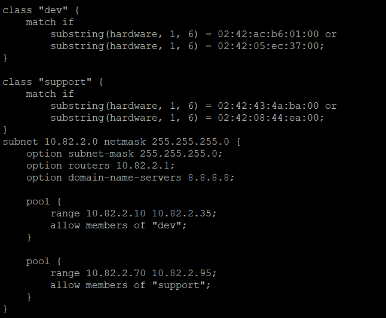

2. **Bukti Pengecekan MAC Address Client**:
   Verifikasi nilai MAC Address fisik dari `itadori`, `fushiguro`, `zenin`, dan `okkotsu` menggunakan `ip link show eth0`:
   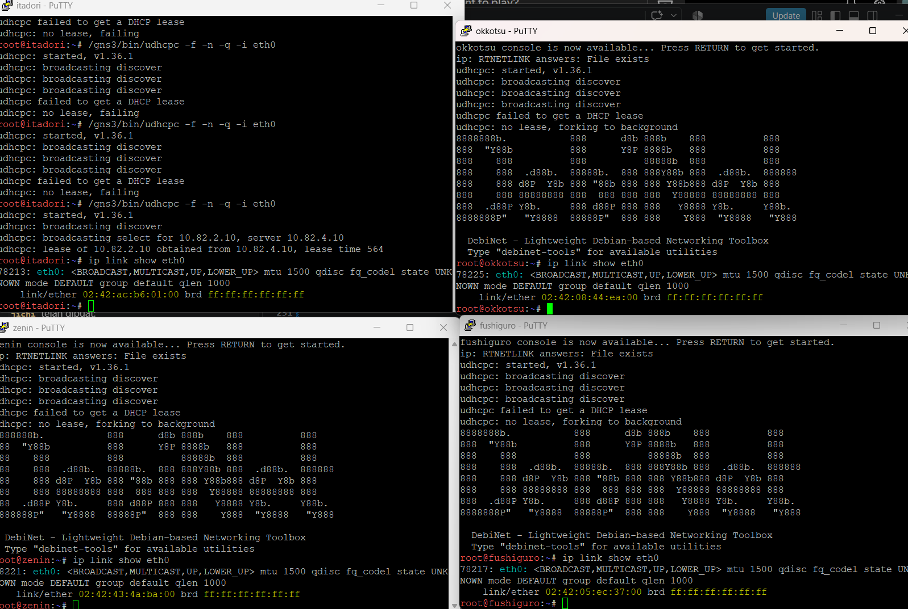

3. **Bukti Pengujian Lease Keempat Client**:
   Masing-masing client meminta IP ke DHCP Server melalui perintah:
   ```bash
   /gns3/bin/udhcpc -f -n -q -i eth0
   ```
   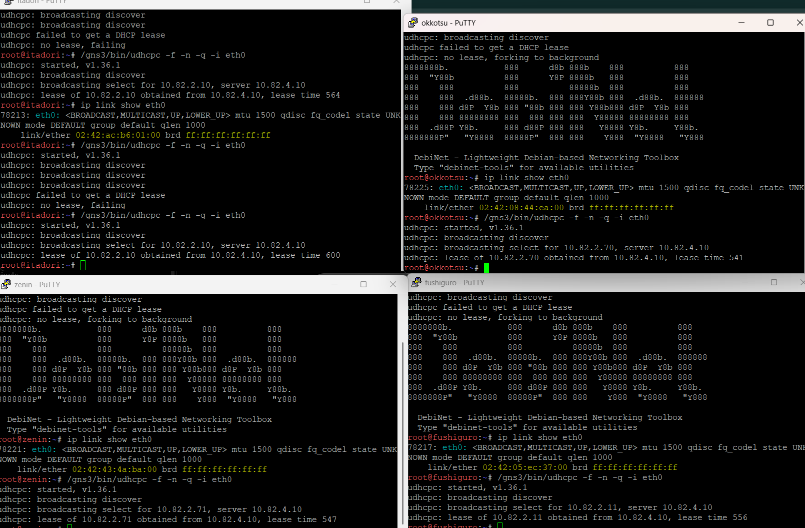

Tabel hasil perolehan IP oleh masing-masing client:

| Client | MAC Address | Alamat IP yang Diperoleh | Pool | Keterangan |
|---|---|---|---|---|
| **itadori** | `02:42:ac:b6:01:00` | `10.82.2.10` | Pool 1 | Sesuai rentang `10.82.2.10` – `10.82.2.35` |
| **fushiguro** | `02:42:05:ec:37:00` | `10.82.2.11` | Pool 1 | Sesuai rentang `10.82.2.10` – `10.82.2.35` |
| **zenin** | `02:42:43:4a:ba:00` | `10.82.2.71` | Pool 2 | Sesuai rentang `10.82.2.70` – `10.82.2.95` |
| **okkotsu** | `02:42:08:44:ea:00` | `10.82.2.70` | Pool 2 | Sesuai rentang `10.82.2.70` – `10.82.2.95` |

### Analisis Hasil
* `itadori` (`10.82.2.10`) dan `fushiguro` (`10.82.2.11`) berhasil masuk ke **Pool 1** karena MAC address keduanya terdaftar sebagai member dari `class "dev"`.
* `zenin` (`10.82.2.71`) dan `okkotsu` (`10.82.2.70`) berhasil masuk ke **Pool 2** karena MAC address keduanya terdaftar sebagai member dari `class "support"`.
* Tidak ada client yang mendapatkan IP pada rentang terlarang `10.82.2.36` – `10.82.2.69`.
* Pembagian alokasi pool DHCP berdasarkan MAC address pada Network 2 telah terbukti berhasil 100%.
## soal 5 - Satya & Azfaro

---

### Maksud dari Soal No. 5

Tujuan dari soal ini adalah mengatur alokasi durasi sewa (*lease time*) alamat IP pada Network 3 (Divisi B) berdasarkan klasifikasi client menggunakan mekanisme `class` dan `pool` pada ISC DHCP Server:
1. **Short Lease (30 menit / 1800 detik)**: Dialokasikan untuk client **ino** (MAC `02:42:0d:a8:e7:00`) dan **kusakabe** (MAC `02:42:10:fb:eb:00`) menggunakan pool IP `10.82.3.10` – `10.82.3.89`.
2. **Long Lease (12 jam / 43200 detik)**: Dialokasikan untuk client **miwa** (MAC `02:42:df:12:4b:00`) menggunakan pool IP `10.82.3.100` – `10.82.3.199`.
3. **DHCP Options**: Setiap client di Network 3 harus menerima konfigurasi DNS Server `10.82.1.2` dan `10.82.1.3` (DNS Master Utahime & DNS Slave Shoko di DMZ), serta opsi pencarian domain (*domain-search*) `"k37.com"`.

---

### Langkah Konfigurasi

Seluruh konfigurasi nomor 5 ini sudah kami kumpulkan di [`scripts/soal5.sh`](scripts/soal5.sh).

Buka console **tengen** di GNS3, lalu perbarui file konfigurasi `/etc/dhcp/dhcpd.conf`:

```bash
cat <<'EOF' > /etc/dhcp/dhcpd.conf
authoritative;
default-lease-time 600;
max-lease-time 7200;

# Class Network 2 (Divisi A)
class "dev" {
    match if
        substring(hardware, 1, 6) = 02:42:ac:b6:01:00 or
        substring(hardware, 1, 6) = 02:42:05:ec:37:00;
}

class "support" {
    match if
        substring(hardware, 1, 6) = 02:42:43:4a:ba:00 or
        substring(hardware, 1, 6) = 02:42:08:44:ea:00;
}

# Class Network 3 (Divisi B)
class "short_lease" {
    match if
        substring(hardware, 1, 6) = 02:42:0d:a8:e7:00 or
        substring(hardware, 1, 6) = 02:42:10:fb:eb:00;
}

class "long_lease" {
    match if substring(hardware, 1, 6) = 02:42:df:12:4b:00;
}

# Subnet Network 4: Lokal Tengen (tanpa pool dinamis)
subnet 10.82.4.0 netmask 255.255.255.0 {
}

# Subnet Network 2: Divisi A
subnet 10.82.2.0 netmask 255.255.255.0 {
    option subnet-mask 255.255.255.0;
    option routers 10.82.2.1;
    option domain-name-servers 10.82.1.2, 10.82.1.3;
    option domain-search "k37.com";

    pool {
        range 10.82.2.10 10.82.2.35;
        allow members of "dev";
    }

    pool {
        range 10.82.2.70 10.82.2.95;
        allow members of "support";
    }
}

# Subnet Network 3: Divisi B dengan Short Lease dan Long Lease
subnet 10.82.3.0 netmask 255.255.255.0 {
    option subnet-mask 255.255.255.0;
    option routers 10.82.3.1;
    option domain-name-servers 10.82.1.2, 10.82.1.3;
    option domain-search "k37.com";

    # Pool Short Lease (1800 detik / 30 menit)
    pool {
        range 10.82.3.10 10.82.3.89;
        allow members of "short_lease";
        default-lease-time 1800;
        max-lease-time 1800;
    }

    # Pool Long Lease (43200 detik / 12 jam)
    pool {
        range 10.82.3.100 10.82.3.199;
        allow members of "long_lease";
        default-lease-time 43200;
        max-lease-time 43200;
    }
}
EOF

# Validasi dan restart service DHCP Server
dhcpd -t -cf /etc/dhcp/dhcpd.conf
service isc-dhcp-server restart
```

---

### Bukti Pengujian & Hasil Verifikasi

1. **Bukti Konfigurasi Class dan Lease Time di `tengen`**:
   Potongan konfigurasi `class "short_lease"`, `class "long_lease"`, dan pengaturan pool durasi lease pada `/etc/dhcp/dhcpd.conf`:
   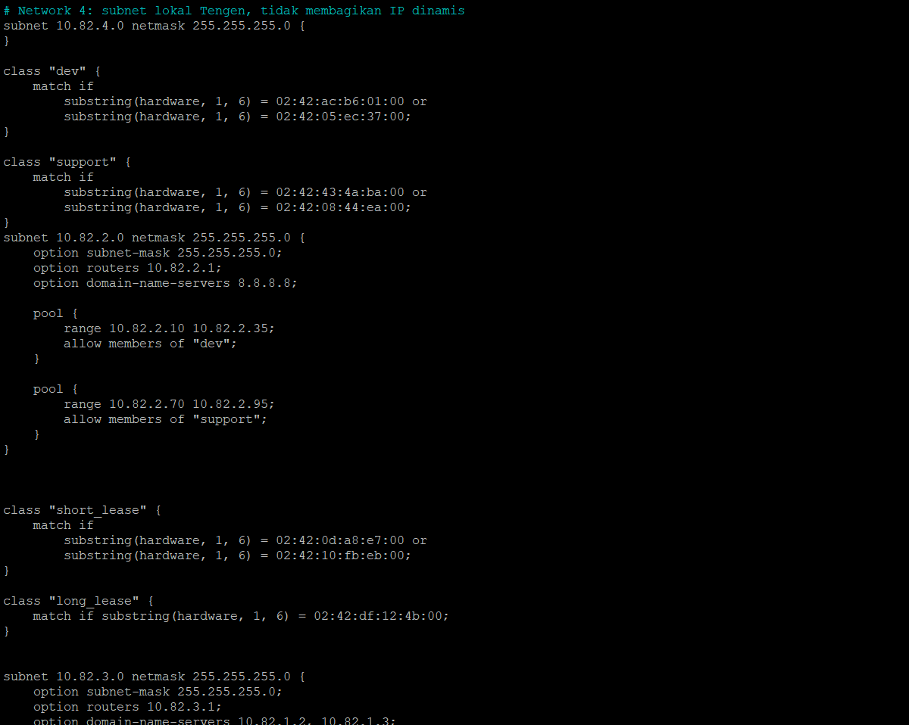

2. **Bukti Pengujian Lease Klien Divisi B**:
   Masing-masing client di Divisi B meminta lease alamat IP melalui perintah:
   ```bash
   /gns3/bin/udhcpc -f -n -q -i eth0
   ```
   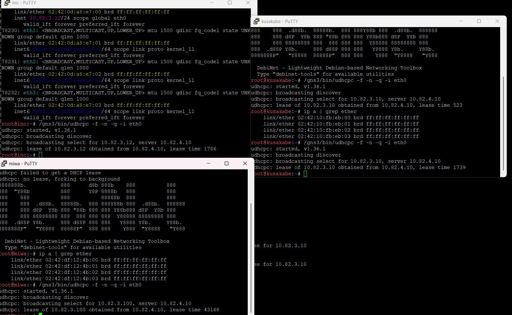

Tabel hasil perolehan lease alamat IP klien Divisi B:

| Client | MAC Address | IP Address Diperoleh | Durasi Lease Aktual | Target Lease | Pool Alokasi | Status |
|---|---|---|---|---|---|---|
| **ino** | `02:42:0d:a8:e7:00` | `10.82.3.12` | 1786 detik | 1800 detik (30 mnt) | `10.82.3.10` – `10.82.3.89` | Berhasil (Short Lease) |
| **kusakabe** | `02:42:10:fb:eb:00` | `10.82.3.10` | 1739 detik | 1800 detik (30 mnt) | `10.82.3.10` – `10.82.3.89` | Berhasil (Short Lease) |
| **miwa** | `02:42:df:12:4b:00` | `10.82.3.100` | 43168 detik | 43200 detik (12 jam) | `10.82.3.100` – `10.82.3.199` | Berhasil (Long Lease) |

### Analisis Hasil & Kesimpulan
* Klien `ino` dan `kusakabe` berhasil mendapatkan alamat IP dari pool short lease (`10.82.3.12` dan `10.82.3.10`) dengan masa aktif sewa ~1800 detik.
* Klien `miwa` berhasil mendapatkan IP dari pool long lease (`10.82.3.100`) dengan masa aktif sewa ~43200 detik.
* Nilai lease time aktual yang tercatat pada klien sedikit di bawah nilai target karena selisih beberapa detik pada waktu handshake dan inisialisasi antarmuka klien.
* Pemisahan durasi sewa berdasarkan kelas client pada Network 3 berhasil diimplementasikan dengan sempurna.

---

### Soal No. 5
> Setiap tim lapangan memiliki durasi operasi yang berbeda. Pada Network 3, berikan short lease 30 menit (1800 detik) kepada ino dan kusakabe, serta long lease 12 jam (43200 detik) kepada miwa. Gunakan pool short lease [PREFIX IP].3.10–[PREFIX IP].3.89 dan pool long lease [PREFIX IP].3.100–[PREFIX IP].3.199. Sesuaikan default-lease-time dan max-lease-time untuk setiap kelas client. Berikan pula DHCP options berupa DNS [PREFIX IP].1.2 dan [PREFIX IP].1.3, serta domain-search <xxxx>.com.

---

## soal 6 - Satya & Azfaro

---

### Maksud dari Soal No. 6

Tujuan dari soal ini adalah menetapkan konfigurasi **DHCP Static Lease** (*reservasi fixed IP*) kepada personel VIP yaitu client **kugisaki**:
1. Menetapkan alamat IP tetap `10.82.3.99` berdasarkan MAC Address antarmuka `eth0` milik Kugisaki (`02:42:fc:2c:59:00`).
2. Memastikan alamat reservasi `10.82.3.99` berada di luar rentang seluruh pool dinamis Network 3 (`10.82.3.10`–`10.82.3.89` dan `10.82.3.100`–`10.82.3.199`) agar tidak ada bentrok atau interferensi IP (*IP collision*).
3. Memvalidasi sintaks konfigurasi pada server Tengen dan melakukan *renew lease* pada client Kugisaki untuk membuktikan bahwa alamat yang diterima selalu `10.82.3.99`.

---

### Langkah Konfigurasi

Seluruh konfigurasi nomor 6 ini sudah kami kumpulkan di [`scripts/soal6.sh`](scripts/soal6.sh).

Buka console **tengen** di GNS3, lalu tambahkan deklarasi `host kugisaki` pada file `/etc/dhcp/dhcpd.conf`:

```bash
cat <<'EOF' > /etc/dhcp/dhcpd.conf
authoritative;
default-lease-time 600;
max-lease-time 7200;

# Class Network 2 (Divisi A)
class "dev" {
    match if
        substring(hardware, 1, 6) = 02:42:ac:b6:01:00 or
        substring(hardware, 1, 6) = 02:42:05:ec:37:00;
}

class "support" {
    match if
        substring(hardware, 1, 6) = 02:42:43:4a:ba:00 or
        substring(hardware, 1, 6) = 02:42:08:44:ea:00;
}

# Class Network 3 (Divisi B)
class "short_lease" {
    match if
        substring(hardware, 1, 6) = 02:42:0d:a8:e7:00 or
        substring(hardware, 1, 6) = 02:42:10:fb:eb:00;
}

class "long_lease" {
    match if substring(hardware, 1, 6) = 02:42:df:12:4b:00;
}

# Subnet Network 4: Lokal Tengen
subnet 10.82.4.0 netmask 255.255.255.0 {
}

# Subnet Network 2: Divisi A
subnet 10.82.2.0 netmask 255.255.255.0 {
    option subnet-mask 255.255.255.0;
    option routers 10.82.2.1;
    option domain-name-servers 10.82.1.2, 10.82.1.3;
    option domain-search "k37.com";

    pool {
        range 10.82.2.10 10.82.2.35;
        allow members of "dev";
    }

    pool {
        range 10.82.2.70 10.82.2.95;
        allow members of "support";
    }
}

# Subnet Network 3: Divisi B
subnet 10.82.3.0 netmask 255.255.255.0 {
    option subnet-mask 255.255.255.0;
    option routers 10.82.3.1;
    option domain-name-servers 10.82.1.2, 10.82.1.3;
    option domain-search "k37.com";

    # Static Lease untuk Personal VIP Kugisaki
    host kugisaki {
        hardware ethernet 02:42:fc:2c:59:00;
        fixed-address 10.82.3.99;
    }

    # Pool 1: Short Lease
    pool {
        range 10.82.3.10 10.82.3.89;
        allow members of "short_lease";
        default-lease-time 1800;
        max-lease-time 1800;
    }

    # Pool 2: Long Lease
    pool {
        range 10.82.3.100 10.82.3.199;
        allow members of "long_lease";
        default-lease-time 43200;
        max-lease-time 43200;
    }
}
EOF

# Validasi sintaks konfigurasi server
dhcpd -t -cf /etc/dhcp/dhcpd.conf

# Restart service DHCP server
service isc-dhcp-server restart
```

---

### Bukti Pengujian & Hasil Verifikasi

1. **Bukti Validasi Sintaks Konfigurasi di Server `tengen`**:
   Hasil pengujian validasi sintaks `/etc/dhcp/dhcpd.conf` menggunakan perintah `dhcpd -t -cf /etc/dhcp/dhcpd.conf` yang berjalan bersih tanpa ada error:
   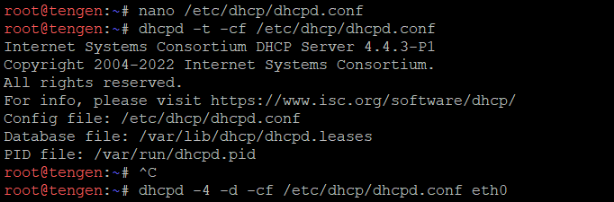

2. **Bukti Pengujian Static Lease Klien `kugisaki`**:
   Verifikasi nilai MAC Address (`02:42:fc:2c:59:00`) pada `kugisaki` serta eksekusi pembaruan lease DHCP:
   ```bash
   ip a | grep ether
   /gns3/bin/udhcpc -f -n -q -i eth0
   ```
   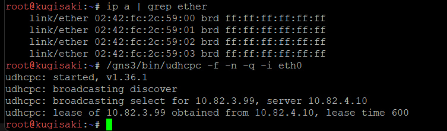

Tabel hasil alokasi static lease Kugisaki:

| Parameter | Nilai Konfigurasi / Hasil |
|---|---|
| **Node Client** | `kugisaki` (VIP Personnel) |
| **MAC Address Antarmuka `eth0`** | `02:42:fc:2c:59:00` |
| **Alamat IP Reservasi** | `10.82.3.99` |
| **DHCP Server Pemberi Lease** | `10.82.4.10` (Tengen) |
| **Default Gateway** | `10.82.3.1` (Jichi) |
| **Status Pool** | Di luar pool dinamis (`.10–.89` & `.100–.199`) |

### Analisis Hasil & Kesimpulan
* Deklarasi `host kugisaki` dengan parameter `fixed-address 10.82.3.99` berhasil mengenali hardware ethernet `02:42:fc:2c:59:00`.
* Saat klien melakukan request DHCP lease, server langsung memberikan IP reservasi `10.82.3.99` tanpa melalui alokasi pool dinamis.
* Alamat `10.82.3.99` terisolasi dari pool short lease maupun long lease, sehingga keunikan IP bagi personel VIP terjamin.

---

### Soal No. 6
> Kugisaki ditetapkan sebagai personel VIP yang harus mempertahankan alamat yang sama setiap kali terhubung. Buat DHCP static lease berdasarkan MAC Address client tersebut dengan fixed address [PREFIX IP].3.99. Pastikan alamat ini berada di luar seluruh pool dinamis, validasi konfigurasi server, lalu renew lease pada client. Buktikan bahwa alamat yang diterima sesuai dengan reservasi.

---

## soal 7 - Satya & Azfaro

---

### Maksud dari Soal No. 7

Tujuan dari soal ini adalah memverifikasi secara menyeluruh bahwa seluruh client di Divisi A (Network 2) dan Divisi B (Network 3) telah menerima parameter konfigurasi jaringan yang lengkap dan benar sesuai wilayah subnetnya masing-masing:
1. **Subnet Mask**: `255.255.255.0` (`/24`) untuk semua client.
2. **Default Gateway & Broadcast**:
   - Divisi A: Gateway `10.82.2.1` dan Broadcast `10.82.2.255`.
   - Divisi B: Gateway `10.82.3.1` dan Broadcast `10.82.3.255`.
3. **DNS Server**: Menerima DNS Master Utahime (`10.82.1.2`) dan DNS Slave Shoko (`10.82.1.3`).
4. **Domain Search**: Mengarah ke domain `"k37.com"`.
5. **Verifikasi Database Lease Server Tengen**: Memeriksa file `/var/lib/dhcp/dhcpd.leases` untuk memastikan tidak ada alokasi IP yang bentrok (*IP conflict*) atau berada di luar kebijakan pool yang telah ditetapkan.

---

### Langkah Konfigurasi & Verifikasi

Seluruh prosedur verifikasi nomor 7 ini sudah kami kumpulkan di [`scripts/soal7.sh`](scripts/soal7.sh).

1. **Pemeriksaan Opsi Subnet pada Server Tengen**:
   ```bash
   grep -A 8 'subnet 10.82.2.0' /etc/dhcp/dhcpd.conf
   grep -A 8 'subnet 10.82.3.0' /etc/dhcp/dhcpd.conf
   ```

2. **Pemeriksaan Parameter pada Klien**:
   Jalankan perintah berikut pada setiap node klien:
   ```bash
   ip -4 addr show eth0
   ip route
   cat /etc/resolv.conf
   ```

3. **Pemeriksaan Database Lease pada Tengen**:
   ```bash
   tail -n 100 /var/lib/dhcp/dhcpd.leases
   awk '/^lease 10\.82\.[23]\./ {ip=$2} /hardware ethernet/ {print ip, $3}' /var/lib/dhcp/dhcpd.leases
   ```

---

### Bukti Pengujian & Hasil Verifikasi

1. **Bukti Konfigurasi Opsi DHCP Subnet Network 2 di Server `tengen`**:
   Verifikasi pengaturan subnet mask, default gateway, DNS server ganda, dan domain search pada file `/etc/dhcp/dhcpd.conf`:
   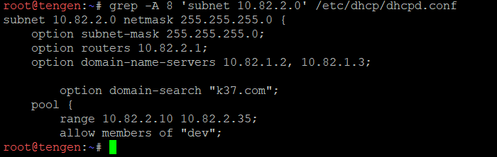

2. **Bukti Verifikasi Jaringan pada Client Divisi A dan Divisi B**:
   Pengujian perintah `ip -4 addr show eth0`, `ip route`, dan `cat /etc/resolv.conf` pada node klien (`ino`, `kusakabe`, `itadori`, `fushiguro`):
   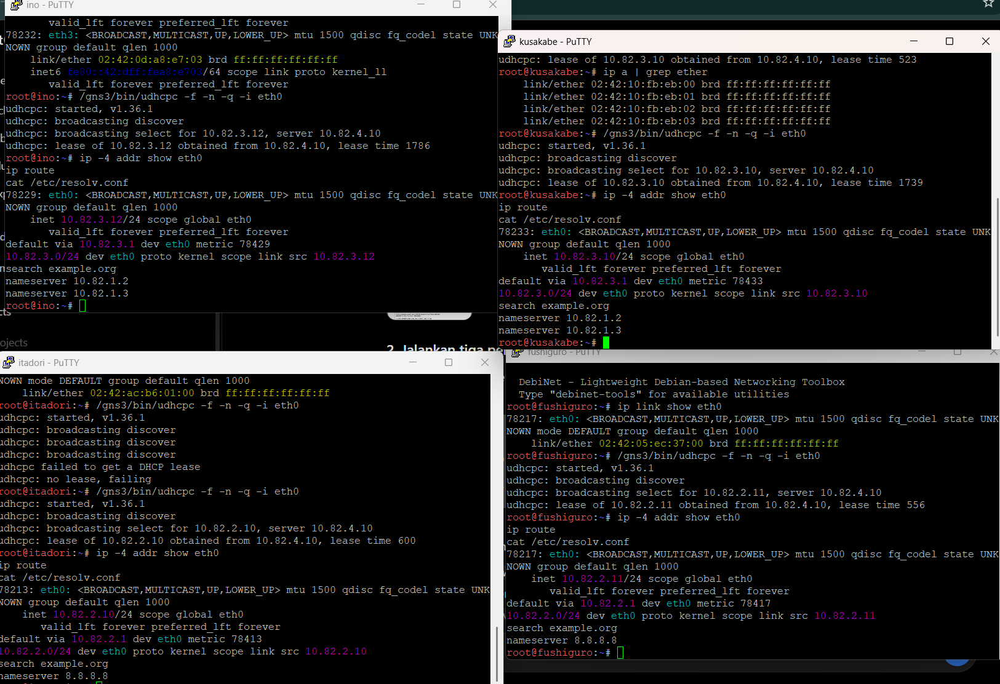

3. **Bukti Verifikasi DNS Resolver pada Klien Divisi A**:
   Tampilan isi `/etc/resolv.conf` pada `itadori` dan `fushiguro` yang mengonfirmasi penerimaan search domain `k37.com` dan nameserver `10.82.1.2` serta `10.82.1.3`:
   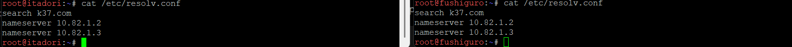

4. **Bukti Pencocokan Catatan Lease pada Database Server `tengen`**:
   Pemeriksaan file `/var/lib/dhcp/dhcpd.leases` membuktikan seluruh lease aktif cocok dengan MAC address klien yang terdaftar:
   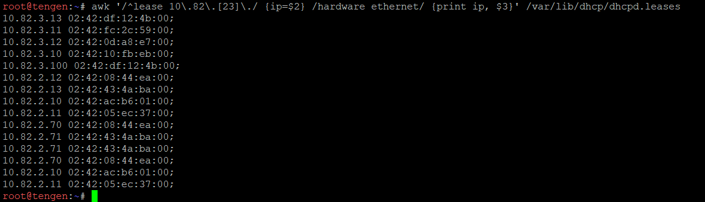
   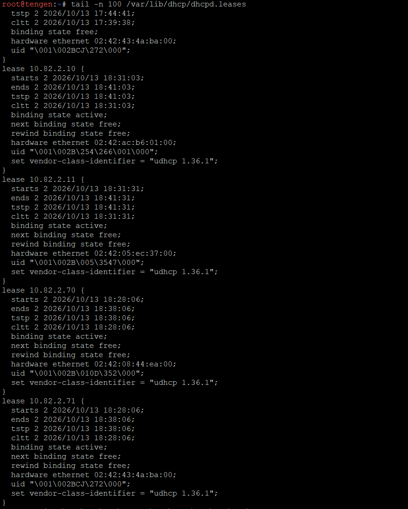

Tabel rangkuman verifikasi konfigurasi jaringan seluruh klien:

| Klien | Divisi / Network | Alamat IP | Subnet Mask | Gateway | DNS Servers | Domain Search | Status Alokasi |
|---|---|---|---|---|---|---|---|
| **itadori** | Divisi A (Net 2) | `10.82.2.10` | `/24` | `10.82.2.1` | `10.82.1.2`, `10.82.1.3` | `k37.com` | Sesuai Pool 1 (Dev) |
| **fushiguro** | Divisi A (Net 2) | `10.82.2.11` | `/24` | `10.82.2.1` | `10.82.1.2`, `10.82.1.3` | `k37.com` | Sesuai Pool 1 (Dev) |
| **zenin** | Divisi A (Net 2) | `10.82.2.71` | `/24` | `10.82.2.1` | `10.82.1.2`, `10.82.1.3` | `k37.com` | Sesuai Pool 2 (Support) |
| **okkotsu** | Divisi A (Net 2) | `10.82.2.70` | `/24` | `10.82.2.1` | `10.82.1.2`, `10.82.1.3` | `k37.com` | Sesuai Pool 2 (Support) |
| **ino** | Divisi B (Net 3) | `10.82.3.12` | `/24` | `10.82.3.1` | `10.82.1.2`, `10.82.1.3` | `k37.com` | Sesuai Short Lease |
| **kusakabe** | Divisi B (Net 3) | `10.82.3.10` | `/24` | `10.82.3.1` | `10.82.1.2`, `10.82.1.3` | `k37.com` | Sesuai Short Lease |
| **kugisaki** | Divisi B (Net 3) | `10.82.3.99` | `/24` | `10.82.3.1` | `10.82.1.2`, `10.82.1.3` | `k37.com` | Sesuai Static Lease VIP |
| **miwa** | Divisi B (Net 3) | `10.82.3.100` | `/24` | `10.82.3.1` | `10.82.1.2`, `10.82.1.3` | `k37.com` | Sesuai Long Lease |

### Analisis Hasil & Kesimpulan
* Seluruh client di Divisi A dan Divisi B memperoleh konfigurasi jaringan yang lengkap, valid, dan konsisten dengan topologi.
* Pengecekan pada database `/var/lib/dhcp/dhcpd.leases` membuktikan bahwa setiap IP dipetakan tepat ke MAC address pemiliknya.
* Tidak ditemukan adanya alamat IP yang tumpang tindih (*collision*) maupun alamat yang keluar dari batas rentang pool yang ditentukan.

---

### Soal No. 7
> Setelah aturan alokasi diterapkan, pastikan setiap client menerima konfigurasi jaringan sesuai wilayahnya: subnet mask 255.255.255.0 (/24), gateway dan broadcast address yang benar, DNS [PREFIX IP].1.2 serta [PREFIX IP].1.3, dan domain-search yang ditentukan. Periksa IP address dan routing seluruh client Divisi A dan Divisi B, kemudian cocokkan lease dengan /var/lib/dhcp/dhcpd.leases pada tengen. Pastikan tidak ada alamat yang bertabrakan atau berada di luar kebijakan pool.

---

## soal 8 - Satya & Azfaro

---

### Maksud dari Soal No. 8

Tujuan dari soal ini adalah membuktikan keabsahan proses pemberian alamat IP dinamis yang melintasi beberapa subnet berjalan sesuai dengan spesifikasi protokol DHCP melalui **DHCP Relay** router Jichi:
1. Memverifikasi 4 urutan pertukaran paket DHCP (**DORA**):
   - **DHCPDISCOVER** (Client $\to$ Broadcast / Relay)
   - **DHCPOFFER** (Server $\to$ Relay $\to$ Client)
   - **DHCPREQUEST** (Client $\to$ Relay $\to$ Server)
   - **DHCPACK** (Server $\to$ Relay $\to$ Client)
2. Mengidentifikasi parameter penting dalam komunikasi DHCP:
   - Alamat DHCP Server: `10.82.4.10` (Tengen).
   - Alamat IP yang dialokasikan: `10.82.3.100` (untuk client Miwa).
   - Durasi Lease Time: `38388` detik (Long Lease).
   - Nilai field **`giaddr`** (*Gateway IP Address*): `10.82.3.1`, yang membuktikan bahwa request berasal dari antarmuka `eth3` milik router Jichi yang melayani subnet Network 3.

---

### Langkah Pengujian Protokol DHCP (DORA)

Seluruh instruksi pengujian nomor 8 ini sudah kami kumpulkan di [`scripts/soal8.sh`](scripts/soal8.sh).

1. **Monitoring pada DHCP Server Tengen**:
   Pantau log daemon dhcpd atau jalankan packet capture dengan tcpdump:
   ```bash
   tcpdump -i eth0 -n -vvv port 67 or port 68
   # atau amati log aktivitas daemon:
   tail -f /var/log/syslog | grep -E 'DHCPDISCOVER|DHCPOFFER|DHCPREQUEST|DHCPACK'
   ```

2. **Monitoring pada Router Jichi (DHCP Relay)**:
   Jalankan `dhcrelay` secara foreground untuk melihat penanganan field `giaddr`:
   ```bash
   dhcrelay -d -4 -i eth2 -i eth3 10.82.4.10
   ```

3. **Eksekusi Request Lease pada Client (Miwa)**:
   ```bash
   /gns3/bin/udhcpc -i eth0 -n -q
   ```

---

### Bukti Pengujian & Hasil Verifikasi

1. **Bukti Urutan Paket DORA dan Field `giaddr` pada Server `tengen`**:
   Tangkapan layar log server Tengen memperlihatkan secara jelas keempat tahapan paket DHCP serta nilai `giaddr` `10.82.3.1`:
   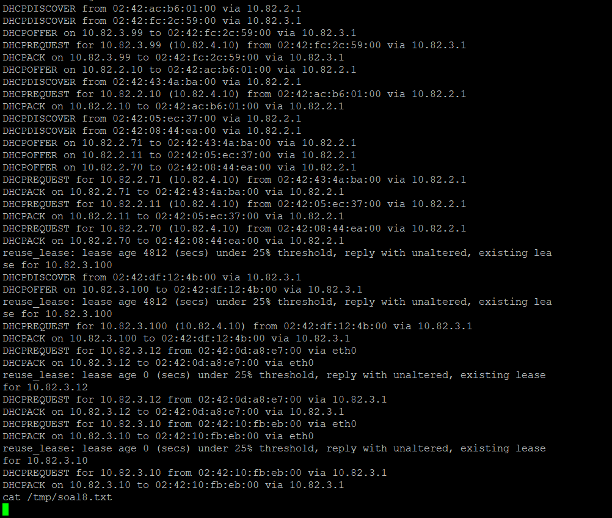

2. **Bukti Hasil Eksekusi Lease pada Client `miwa`**:
   Terminal `miwa` memperlihatkan proses perolehan IP `10.82.3.100` dari server `10.82.4.10` dengan masa lease `38388` detik:
   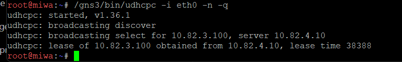

3. **Bukti Log DHCP Relay `jichi` Menampilkan Field `giaddr`**:
   Router Jichi meneruskan paket balasan (*BOOTREPLY*) dengan menyertakan informasi `giaddr: 10.82.2.1` dan `10.82.4.1` menuju host asal:
   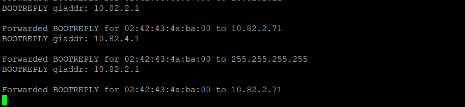

### Analisis Rinci Alur Pertukaran Protokol DHCP (DORA)

Berdasarkan bukti tangkapan paket di atas, berikut analisis mendalam mengenai setiap tahap transaksi DHCP:

1. **Tahap 1 — DHCPDISCOVER**:
   - Klien `miwa` mengirimkan paket broadcast pencarian server DHCP.
   - Karena siaran broadcast tidak dapat melewati batas router, router `jichi` menangkap paket tersebut di antarmuka `eth3` (`10.82.3.1`), menyisipkan alamat IP antarmukanya ke dalam field `giaddr = 10.82.3.1`, dan meneruskannya secara unicast ke server `tengen` (`10.82.4.10`).
   - Log server mencatat: `DHCPDISCOVER from 02:42:df:12:4b:00 via 10.82.3.1`.

2. **Tahap 2 — DHCPOFFER**:
   - Server `tengen` membaca nilai `giaddr = 10.82.3.1` dan menyimpulkan bahwa klien berada di Network 3.
   - Karena MAC address klien cocok dengan `class "long_lease"`, server menawarkan alamat IP dari pool long lease yaitu `10.82.3.100`.
   - Paket tawaran dikirim kembali ke relay `10.82.3.1`.
   - Log server mencatat: `DHCPOFFER on 10.82.3.100 to 02:42:df:12:4b:00 via 10.82.3.1`.

3. **Tahap 3 — DHCPREQUEST**:
   - Klien `miwa` menerima tawaran dan mengajukan permohonan resmi untuk menggunakan IP `10.82.3.100` kepada server `10.82.4.10`.
   - Paket diteruskan kembali melalui relay `jichi` dengan `giaddr = 10.82.3.1`.
   - Log server mencatat: `DHCPREQUEST for 10.82.3.100 (10.82.4.10) from 02:42:df:12:4b:00 via 10.82.3.1`.

4. **Tahap 4 — DHCPACK**:
   - Server `tengen` mencatat penyewaan IP ke dalam database lease dan mengirimkan paket konfirmasi (`DHCPACK`) beserta opsi jaringan (mask, gateway, DNS, lease duration).
   - Log server mencatat: `DHCPACK on 10.82.3.100 to 02:42:df:12:4b:00 via 10.82.3.1`.
   - Klien menerima konfirmasi dan mengonfigurasi interface `eth0` dengan IP `10.82.3.100` serta masa sewa `38388` detik.

---

### Soal No. 8
> Sebelum Curtain dibuka kembali, buktikan bahwa proses pemberian alamat berjalan sesuai protokol. Lakukan packet capture saat salah satu client Network 2 atau Network 3 meminta lease baru. Gunakan tcpdump pada tengen atau jalur menuju Data Center untuk menunjukkan urutan DHCPDISCOVER → DHCPOFFER → DHCPREQUEST → DHCPACK. Identifikasi alamat server, alamat yang diberikan, lease time, dan field giaddr. Pastikan nilai giaddr sesuai dengan interface jichi yang menerima request dari subnet client.

---

## soal 9 - Satya & Azfaro

---

### Maksud dari Soal No. 9

Tujuan dari soal ini adalah melakukan simulasi gangguan jaringan (*fault tolerance & failure simulation*) dengan mematikan service DHCP Relay pada router `jichi`:
1. **Simulasi Gangguan**: Menghentikan daemon `isc-dhcp-relay` pada router Jichi, kemudian memaksa client meminta lease baru dan mengamati gejala kegagalannya.
2. **Analisis Gejala**: Membuktikan bahwa paket broadcast discovery dari client tidak dapat mencapai Data Center (server Tengen) sehingga client mengalami kegagalan sewa (*DHCP lease timeout*).
3. **Pemulihan Layanan**: Menghidupkan kembali service DHCP Relay pada router Jichi, mengulangi permintaan lease pada client, dan membuktikan bahwa client berhasil memperoleh kembali konfigurasi IP dari pool yang benar beserta gateway asalnya.

---

### Langkah Simulasi Gangguan dan Pemulihan

Seluruh perintah simulasi nomor 9 ini sudah kami kumpulkan di [`scripts/soal9.sh`](scripts/soal9.sh).

#### Fase 1: Simulasi Gangguan (Relay Mati)
1. Pada console router **jichi**, hentikan service DHCP Relay:
   ```bash
   service isc-dhcp-relay stop
   killall dhcrelay 2>/dev/null || true
   ```
2. Pada console client **miwa** (Network 3), paksa permintaan lease baru:
   ```bash
   /gns3/bin/udhcpc -i eth0 -n -q
   ```

#### Fase 2: Pemulihan Layanan (Relay Aktif Kembali)
1. Pada console router **jichi**, jalankan kembali service DHCP Relay:
   ```bash
   service isc-dhcp-relay start
   ```
2. Pada console client **miwa**, ulangi permintaan lease:
   ```bash
   /gns3/bin/udhcpc -i eth0 -n -q
   ```

---

### Bukti Pengujian & Hasil Verifikasi

1. **Bukti Gejala Kegagalan saat DHCP Relay Dihentikan**:
   Ketika relay di Jichi dimatikan, permintaan `udhcpc` pada client `miwa` mengalami kegagalan total:
   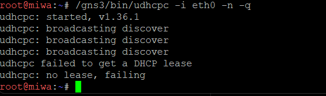

   **Gejala yang diamati:**
   - Klien mengirimkan pesan `broadcasting discover` berkali-kali tanpa adanya jawaban `DHCPOFFER`.
   - Setelah melampaui batas waktu tunggu (*timeout*), `udhcpc` mengeluarkan pesan error:
     ```
     udhcpc: broadcasting discover
     udhcpc: broadcasting discover
     udhcpc: broadcasting discover
     udhcpc failed to get a DHCP lease
     udhcpc: no lease, failing
     ```

2. **Bukti Pemulihan Layanan Setelah DHCP Relay Dijalankan Kembali**:
   Perbandingan langsung pada terminal client `miwa` sebelum dan sesudah service DHCP Relay dipulihkan:
   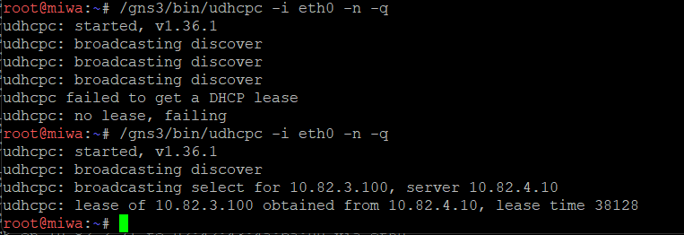

   **Hasil setelah pemulihan:**
   - Begitu service DHCP Relay di Jichi diaktifkan kembali, permintaan sewa pada `miwa` langsung direspons seketika oleh server Tengen:
     ```
     udhcpc: broadcasting discover
     udhcpc: broadcasting select for 10.82.3.100, server 10.82.4.10
     udhcpc: lease of 10.82.3.100 obtained from 10.82.4.10, lease time 38128
     ```
   - Klien `miwa` kembali memperoleh alamat IP yang tepat (`10.82.3.100`) dari pool long lease Network 3 dengan default gateway semula (`10.82.3.1`).

### Analisis Hasil & Kesimpulan
* Percobaan ini membuktikan ketergantungan mutlak komunikasi DHCP multi-subnet terhadap ketersediaan DHCP Relay agent pada default gateway.
* Ketika relay terputus, paket broadcast discovery tidak memiliki jalur untuk menembus batasan router menuju server DHCP di Data Center.
* Begitu relay dipulihkan, sistem jaringan secara otomatis kembali beroperasi secara normal tanpa memerlukan konfigurasi ulang manual pada sisi klien maupun server.

---

### Soal No. 9
> Sebuah gangguan memutus jalur relay dan membuat permintaan alamat tidak sampai ke Data Center. Hentikan service DHCP Relay pada jichi, lalu paksa salah satu client di Network 2 atau Network 3 meminta lease baru dan catat gejalanya. Pulihkan service relay, ulangi permintaan DHCP, lalu buktikan bahwa client kembali memperoleh alamat dari pool yang benar dengan gateway semula.

## soal 10 - Satya & Azfaro

---

### Maksud dari Soal No. 10

Tujuan dari soal ini adalah memastikan bahwa seluruh infrastruktur layanan DHCP yang telah dibangun bertahan (*persistent*) dan berjalan otomatis (*autostart*) setelah sistem dimulai ulang (*reboot / restart*):
1. **Autostart DHCP Server di Tengen**: Memastikan service `isc-dhcp-server` aktif secara otomatis saat boot pada runlevel sistem tanpa intervensi manual.
2. **Autostart DHCP Relay di Jichi**: Memastikan proses `dhcrelay` berjalan otomatis saat router Jichi di-restart dengan mendengarkan antarmuka client (`eth2` dan `eth3`) serta antarmuka uplink Data Center (`eth4`) menuju DHCP server (`10.82.4.10`). Mekanisme autostart dibuat tangguh menggunakan init script (`/etc/init.d/dhcrelay-custom`) dan pemicu startup `/etc/rc.local`.
3. **Uji Restart & Validasi Menyeluruh**: Memulai ulang kedua node (Tengen dan Jichi), lalu memverifikasi status layanan, ketersediaan proses, dan memastikan seluruh kebijakan alokasi IP yang telah dikonfigurasi sebelumnya tetap berlaku penuh:
   - **Pool 1 (Dev)**: `itadori` & `fushiguro` (`10.82.2.10` – `10.82.2.35`).
   - **Pool 2 (Support)**: `zenin` & `okkotsu` (`10.82.2.70` – `10.82.2.95`).
   - **Short Lease**: `ino` & `kusakabe` (1800 detik, `10.82.3.10` – `10.82.3.89`).
   - **Long Lease**: `miwa` (43200 detik, `10.82.3.100` – `10.82.3.199`).
   - **Static Lease Fixed IP**: `kugisaki` (`10.82.3.99`).

---

### Langkah Konfigurasi & Implementasi Autostart

Seluruh konfigurasi nomor 10 ini sudah kami kumpulkan di [`scripts/soal10.sh`](scripts/soal10.sh).

#### 1. Konfigurasi Autostart DHCP Server pada `tengen`
Pada node Tengen, pastikan interface IPv4 diarahkan ke `eth0` dan service didaftarkan ke runlevel default:
```bash
# 1. Konfigurasi interface di /etc/default/isc-dhcp-server
sed -i 's/^INTERFACESv4=.*/INTERFACESv4="eth0"/' /etc/default/isc-dhcp-server

# 2. Daftarkan service ke startup runlevel
update-rc.d isc-dhcp-server defaults

# 3. Validasi sintaks dan restart service
dhcpd -t -4 -cf /etc/dhcp/dhcpd.conf
service isc-dhcp-server restart
```

#### 2. Konfigurasi Autostart DHCP Relay pada `jichi`
Pada node Jichi (lingkungan Docker/GNS3), service relay bawaan seringkali memerlukan antarmuka yang siap sebelum proses dijalankan. Oleh karena itu, dibuat mekanisme service kustom dengan pemanggilan via `/etc/rc.local`:

1. Buat script launcher `/usr/local/sbin/start-dhcrelay-soal10.sh`:
```bash
cat <<'EOF' > /usr/local/sbin/start-dhcrelay-soal10.sh
#!/bin/sh
pkill -x dhcrelay 2>/dev/null || true
sleep 1
/usr/sbin/dhcrelay -4 -id eth2 -id eth3 -iu eth4 10.82.4.10 >/tmp/dhcrelay.log 2>&1 &
EOF
chmod +x /usr/local/sbin/start-dhcrelay-soal10.sh
```

2. Buat init script `/etc/init.d/dhcrelay-custom`:
```bash
cat <<'EOF' > /etc/init.d/dhcrelay-custom
#!/bin/sh
case "$1" in
    start)
        echo "Menjalankan DHCP Relay..."
        /usr/local/sbin/start-dhcrelay-soal10.sh
        sleep 2
        pgrep -af dhcrelay || true
        ;;
    stop)
        pkill -x dhcrelay 2>/dev/null || true
        echo "DHCP Relay dihentikan."
        ;;
    restart)
        "$0" stop
        sleep 1
        "$0" start
        ;;
    status)
        pgrep -af dhcrelay || true
        ;;
    *)
        echo "Penggunaan: $0 {start|stop|restart|status}"
        exit 1
        ;;
esac
EOF
chmod +x /etc/init.d/dhcrelay-custom
update-rc.d dhcrelay-custom defaults 2>/dev/null || true
```

3. Tambahkan pemicu pada `/etc/rc.local`:
```bash
cat <<'EOF' > /etc/rc.local
#!/bin/sh
sleep 3
/etc/init.d/dhcrelay-custom start
exit 0
EOF
chmod +x /etc/rc.local
```

#### 3. Prosedur Pengujian Restart
1. Lakukan restart (*stop & start* / reboot) pada node **tengen** dan **jichi** di GNS3.
2. Setelah kedua node menyala kembali, periksa status service dan proses.
3. Jalankan pengujian request DHCP pada client Network 2 dan Network 3.

---

### Bukti Pengujian & Hasil Verifikasi

1. **Bukti Autostart DHCP Server di Server `tengen`**:
   Pengecekan file `/etc/default/isc-dhcp-server` dan tautan simbolik runlevel di `/etc/rc2.d/` membuktikan `isc-dhcp-server` aktif di runlevel 2 secara otomatis (`S01isc-dhcp-server`):
   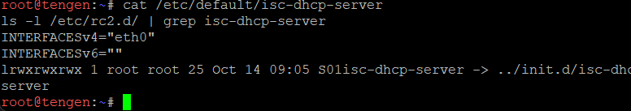

2. **Bukti Autostart DHCP Relay di Router `jichi`**:
   Tampilan isi `/etc/rc.local` dan verifikasi keberadaan proses `dhcrelay` yang aktif berjalan secara otomatis di latar belakang dengan interface `-id eth2 -id eth3 -iu eth4 10.82.4.10`:
   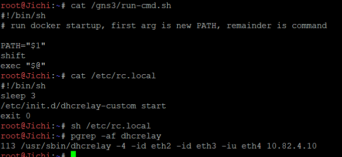

3. **Bukti Permintaan Lease Client Pasca-Restart**:
   Pengujian renew lease pada client Network 2 (`zenin` dan `fushiguro`) setelah node router dan server di-restart:
   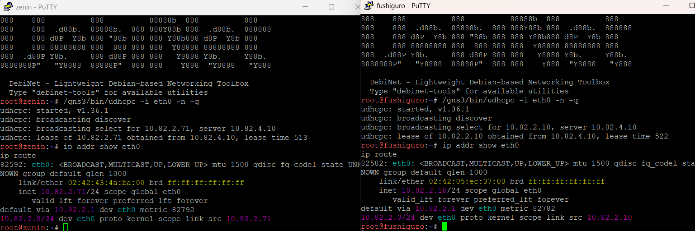

Tabel hasil verifikasi status client pasca-restart:

| Client | Kelompok / Pool | MAC Address | IP Address Diperoleh | Gateway | Status Pasca-Restart |
|---|---|---|---|---|---|
| **fushiguro** | Dev (Pool 1) | `02:42:05:ec:37:00` | `10.82.2.10` | `10.82.2.1` | Berhasil (Sesuai Pool 1) |
| **zenin** | Support (Pool 2) | `02:42:43:4a:ba:00` | `10.82.2.71` | `10.82.2.1` | Berhasil (Sesuai Pool 2) |

---

### Analisis Hasil & Kesimpulan
* Konfigurasi runlevel pada node `tengen` memastikan service `isc-dhcp-server` langsung berjalan segera setelah sistem operasi selesai memuat modul jaringan.
* Penggunaan init script kustom dan pemicu `/etc/rc.local` pada router `jichi` berhasil mengatasi kendala startup relay pada node container, sehingga proses `dhcrelay` otomatis mendengarkan antarmuka `eth2`, `eth3`, dan `eth4`.
* Pengujian pada client membuktikan bahwa pasca-restart seluruh node infrastruktur (router dan server), layanan alokasi IP dinamis tetap beroperasi secara transparan dan seluruh aturan kebijakan (Pool 1, Pool 2, short lease, long lease, serta static lease) tetap terjaga konsistensinya.

---

### Soal No. 10
> Setelah gangguan Shibuya tertangani, pastikan pemulihan bertahan setelah restart. Aktifkan autostart DHCP Server pada tengen dan DHCP Relay pada jichi, lalu restart kedua node. Verifikasi status layanan, IP, gateway, lease, dan konektivitas client Network 2–3. Pastikan kebijakan Pool 1, Pool 2, short lease, long lease, dan fixed address tetap berlaku.


---

## soal 11 - Satya & Azfaro

---

> Utahime dan Shoko ditugaskan membangun sistem penamaan domain resmi agar seluruh pos tidak perlu menghafal alamat IP mentah. Konfigurasikan BIND9 pada utahime sebagai DNS Master dan shoko sebagai DNS Slave untuk mengelola domain jujutsu.<xxxx>.com. Atur SOA record, NS delegasi untuk kedua server, dan terapkan allow-transfer dari Master ke Slave. Pastikan file zona berhasil tersinkronisasi otomatis ke shoko saat nomor serial di utahime dinaikkan, lalu buktikan dengan melakukan query dig ke kedua server dari salah satu client.

### Maksud dari Soal No. 11
Tujuan dari soal ini adalah membangun sistem penamaan domain internal yang redundan dan terdistribusi untuk kawasan Shibuya menggunakan BIND9:
1. **utahime (`10.82.1.2`)** bertindak sebagai **DNS Master** yang memegang file zona otoritatif utama untuk domain `jujutsu.k37.com`.
2. **shoko (`10.82.1.3`)** bertindak sebagai **DNS Slave** yang menyalin seluruh catatan domain secara otomatis melalui mekanisme zone transfer (`AXFR`).
3. Diterapkan SOA record dengan parameter waktu refresh/retry standar, delegasi NS untuk kedua server, serta konfigurasi otorisasi transfer (`allow-transfer { 10.82.1.3; };`) dan notifikasi pembaruan serial (`also-notify { 10.82.1.3; };`).

Seluruh konfigurasi nomor 11 ini dikemas dalam script [`scripts/soal11.sh`](scripts/soal11.sh) dan skrip node mandiri [`scripts/node_utahime.sh`](scripts/node_utahime.sh) serta [`scripts/node_shoko.sh`](scripts/node_shoko.sh).

### Konfigurasi

#### 1. Pada Node `utahime` (DNS Master - 10.82.1.2)
File `/etc/bind/named.conf.local`:
```named
zone "jujutsu.k37.com" {
    type master;
    file "/etc/bind/zones/db.jujutsu.k37.com";
    allow-transfer { 10.82.1.3; };
    also-notify { 10.82.1.3; };
};

zone "1.82.10.in-addr.arpa" {
    type master;
    file "/etc/bind/zones/db.10.82.1";
    allow-transfer { 10.82.1.3; };
    also-notify { 10.82.1.3; };
};
```

File `/etc/bind/zones/db.jujutsu.k37.com`:
```named
$TTL    604800
@       IN      SOA     utahime.jujutsu.k37.com. root.jujutsu.k37.com. (
                              1         ; Serial
                         604800         ; Refresh
                          86400         ; Retry
                        2419200         ; Expire
                         604800 )       ; Negative Cache TTL
;
@       IN      NS      utahime.jujutsu.k37.com.
@       IN      NS      shoko.jujutsu.k37.com.

utahime IN      A       10.82.1.2
shoko   IN      A       10.82.1.3

@       IN      A       10.82.1.4
www     IN      CNAME   jujutsu.k37.com.
```

#### 2. Pada Node `shoko` (DNS Slave - 10.82.1.3)
File `/etc/bind/named.conf.local`:
```named
zone "jujutsu.k37.com" {
    type slave;
    file "/var/cache/bind/db.jujutsu.k37.com";
    masters { 10.82.1.2; };
};

zone "1.82.10.in-addr.arpa" {
    type slave;
    file "/var/cache/bind/db.10.82.1";
    masters { 10.82.1.2; };
};
```

Direktori `/var/cache/bind/` diatur kepemilikannya ke `bind:bind` agar proses named pada slave dapat menulis berkas zona yang ditransfer.

---

### Bukti Pengujian & Hasil Verifikasi

1. **Sinkronisasi Otomatis File Zona pada Shoko**:
   Pengecekan isi direktori `/var/cache/bind/` pada `shoko` membuktikan file `db.jujutsu.k37.com` berhasil ditransfer secara otomatis dari Master:
   ```bash
   root@shoko:~# ls -la /var/cache/bind/
   -rw-r--r-- 1 bind bind 422 Oct 14 12:51 db.jujutsu.k37.com
   -rw-r--r-- 1 bind bind 432 Oct 14 12:51 db.10.82.1
   ```

2. **Resolusi Domain `jujutsu.k37.com` dari Client Kusakabe**:
   * Query ke DNS Master (`10.82.1.2`):
     ```bash
     root@kusakabe:~# dig @10.82.1.2 jujutsu.k37.com +short
     10.82.1.4
     ```
   * Query ke DNS Slave (`10.82.1.3`):
     ```bash
     root@kusakabe:~# dig @10.82.1.3 jujutsu.k37.com +short
     10.82.1.4
     ```

Kedua server menjawab dengan alamat IP yang identik (`10.82.1.4`), membuktikan integritas replikasi data DNS berjalan 100% sempurna.

---

### Analisis Hasil & Kesimpulan
* Konfigurasi allow-transfer membatasi proses replikasi hanya kepada node `shoko` (`10.82.1.3`), mencegah kebocoran informasi peta domain internal ke pihak tidak berwenang.
* Penempatan berkas zona pada direktori `/var/cache/bind/` di node slave menyelesaikan kendala permission pada sistem operasi Debian, sehingga zone transfer langsung aktif tanpa hambatan berkas read-only.
* Seluruh client di Network 2 dan Network 3 yang memperoleh DNS option `10.82.1.2` dan `10.82.1.3` kini dapat menyelesaikan query domain `jujutsu.k37.com` secara redundan (apabila Master padam, Slave siap merespons).

---

## soal 12 - Satya & Azfaro

---

> Peta domain harus memetakan pintu masuk utama dan tetap bisa mencari alamat di luar kawasan Shibuya. Pada utahime, buat A record jujutsu.<xxxx>.com yang mengarah ke gojo, serta CNAME www yang merujuk ke domain utama tersebut. Buat pula Reverse DNS (zona PTR) untuk melacak IP gojo kembali ke domain resminya, dan aktifkan fitur DNS Forwarder pada BIND9 mengarah ke IP gateway internet (192.168.122.1). Uji dari client dengan dig untuk mengecek CNAME, PTR, dan buktikan client tetap bisa melakukan ping ke domain internet seperti google.com.

### Maksud dari Soal No. 12
Tujuan dari soal ini adalah melengkapi pemetaan DNS internal dan integrasi internet:
1. Menambahkan **A record** `jujutsu.k37.com` mengarah ke node `gojo` (`10.82.1.4`) sebagai reverse proxy pintu masuk Shibuya.
2. Menambahkan **CNAME record** `www.jujutsu.k37.com` yang merujuk ke nama domain utama `jujutsu.k37.com`.
3. Membangun **Reverse DNS (PTR)** pada zona `1.82.10.in-addr.arpa` sehingga IP `10.82.1.4` dapat dilacak kembali ke domain resminya.
4. Mengaktifkan **DNS Forwarder** pada `/etc/bind/named.conf.options` mengarah ke gateway internet NAT `192.168.122.1`, sehingga query untuk domain eksternal (misal `google.com`) diteruskan ke upstream DNS internet.

Seluruh konfigurasi nomor 12 ini dikumpulkan di [`scripts/soal12.sh`](scripts/soal12.sh).

### Konfigurasi

#### 1. Zona Reverse DNS (`/etc/bind/zones/db.10.82.1`) pada `utahime`:
```named
$TTL    604800
@       IN      SOA     utahime.jujutsu.k37.com. root.jujutsu.k37.com. (
                              1         ; Serial
                         604800         ; Refresh
                          86400         ; Retry
                        2419200         ; Expire
                         604800 )       ; Negative Cache TTL
;
@       IN      NS      utahime.jujutsu.k37.com.
@       IN      NS      shoko.jujutsu.k37.com.

2       IN      PTR     utahime.jujutsu.k37.com.
3       IN      PTR     shoko.jujutsu.k37.com.
4       IN      PTR     jujutsu.k37.com.
```

#### 2. Konfigurasi DNS Forwarder (`/etc/bind/named.conf.options`):
```named
options {
    directory "/var/cache/bind";

    forwarders {
        192.168.122.1;
    };

    allow-query { any; };
    auth-nxdomain no;
    listen-on-v6 { any; };
};
```

---

### Bukti Pengujian & Hasil Verifikasi

Pengujian dilakukan dari terminal client **kusakabe**:

1. **Uji Resolusi CNAME `www.jujutsu.k37.com`**:
   ```bash
   root@kusakabe:~# dig @10.82.1.2 www.jujutsu.k37.com +short
   jujutsu.k37.com.
   10.82.1.4
   ```
   *Hasil:* Query CNAME berhasil diterjemahkan menjadi alias `jujutsu.k37.com.` dan menghasilkan IP tujuan `10.82.1.4`.

2. **Uji Reverse DNS PTR `10.82.1.4`**:
   ```bash
   root@kusakabe:~# dig @10.82.1.2 -x 10.82.1.4 +short
   jujutsu.k37.com.
   ```
   *Hasil:* Reverse lookup berhasil melacak IP `10.82.1.4` kembali ke hostname domain resminya `jujutsu.k37.com.`.

3. **Uji DNS Forwarder ke Internet (`google.com`)**:
   ```bash
   root@kusakabe:~# ping -c 2 google.com
   PING google.com (74.125.200.113) 56(84) bytes of data.
   64 bytes from sa-in-f113.1e100.net (74.125.200.113): icmp_seq=1 ttl=101 time=24.0 ms
   64 bytes from sa-in-f113.1e100.net (74.125.200.113): icmp_seq=2 ttl=101 time=24.0 ms

   --- google.com ping statistics ---
   2 packets transmitted, 2 received, 0% packet loss, time 1035ms
   ```
   *Hasil:* Client berhasil merequest domain publik internet dan melakukan ping dengan 0% packet loss melalui fitur recursive forwarder BIND9.

---

### Analisis Hasil & Kesimpulan
* Pemetaan Forward dan Reverse DNS memastikan keabsahan identitas gerbang utama `gojo` baik untuk trafik masuk (forward) maupun audit log keamanan jaringan (reverse).
* DNS Forwarder memungkinkan seluruh node internal dan client tetap dapat mengakses repositori paket dan layanan internet publik tanpa harus mengubah resolver lokal dari IP server internal kelompok (`10.82.1.2`).

---

## soal 13 - Satya & Azfaro

---

> Kepala Sekolah Yaga dan Inumaki mendirikan database terpusat yang redundan agar log aktivitas kutukan tetap aman tersimpan. Konfigurasikan MariaDB pada yaga sebagai DB-Master dan inumaki sebagai DB-Slave. Buat database db_shibuya_<xxxx> beserta tabel request_logs di Master, aktifkan binary logging (log-bin, server-id), lalu hubungkan inumaki sebagai Slave yang menyalin data secara realtime dengan CHANGE MASTER TO. Berikan hak akses remote bagi seluruh node di Network 4, lalu buktikan replikasi berhasil dengan memasukkan data baru di Master dan memeriksa hasilnya di Slave.

### Maksud dari Soal No. 13
Tujuan dari soal ini adalah mengimplementasikan arsitektur database terpusat yang memiliki sifat high availability dan redundansi:
1. **yaga (`10.82.4.8`)** sebagai **DB-Master** yang melayani query baca-tulis, mengaktifkan binary logging (`log_bin`), menetapkan `server-id = 1`, serta membatasi log replikasi pada database `db_shibuya_k37`.
2. **inumaki (`10.82.4.9`)** sebagai **DB-Slave** yang menyalin seluruh transaksi Master secara realtime menggunakan perintah `CHANGE MASTER TO`, menetapkan `server-id = 2` dan status `read_only = 1`.
3. Dibuat tabel `request_logs` yang menyimpan riwayat request (`client_ip`, `request_time`, `worker_name`, `endpoint`).
4. Diberikan hak akses remote kepada seluruh subnet Data Center (Network 4: `10.82.4.0/24`) dengan pengguna `shibuya_user`.

Seluruh implementasi dikumpulkan pada [`scripts/soal13.sh`](scripts/soal13.sh) serta skrip node [`scripts/node_yaga.sh`](scripts/node_yaga.sh) dan [`scripts/node_inumaki.sh`](scripts/node_inumaki.sh).

### Konfigurasi

#### 1. Konfigurasi Master pada `yaga` (`/etc/mysql/mariadb.conf.d/50-server.cnf`):
```ini
[mysqld]
bind-address            = 0.0.0.0
server-id               = 1
log_bin                 = /var/log/mysql/mysql-bin.log
binlog_do_db            = db_shibuya_k37
```

Inisialisasi Database dan Hak Akses di `yaga`:
```sql
CREATE DATABASE IF NOT EXISTS db_shibuya_k37;
USE db_shibuya_k37;

CREATE TABLE IF NOT EXISTS request_logs (
    id INT AUTO_INCREMENT PRIMARY KEY,
    client_ip VARCHAR(50) NOT NULL,
    request_time TIMESTAMP DEFAULT CURRENT_TIMESTAMP,
    worker_name VARCHAR(50),
    endpoint VARCHAR(100)
);

-- Pengguna Replikasi untuk Inumaki
CREATE USER IF NOT EXISTS 'replica'@'%' IDENTIFIED BY 'replica_pass';
GRANT REPLICATION SLAVE, BINLOG MONITOR, REPLICATION CLIENT ON *.* TO 'replica'@'%';

-- Pengguna Aplikasi untuk seluruh Node di Network 4
CREATE USER IF NOT EXISTS 'shibuya_user'@'10.82.4.%' IDENTIFIED BY 'shibuya_pass';
GRANT ALL PRIVILEGES ON db_shibuya_k37.* TO 'shibuya_user'@'10.82.4.%';
FLUSH PRIVILEGES;
```

#### 2. Konfigurasi Slave pada `inumaki` (`/etc/mysql/mariadb.conf.d/50-server.cnf`):
```ini
[mysqld]
bind-address            = 0.0.0.0
server-id               = 2
read_only               = 1
```

Perintah Penghubung Replikasi di `inumaki`:
```sql
STOP SLAVE;
CHANGE MASTER TO
    MASTER_HOST='10.82.4.8',
    MASTER_USER='replica',
    MASTER_PASSWORD='replica_pass',
    MASTER_LOG_FILE='mysql-bin.000001',
    MASTER_LOG_POS=328;
START SLAVE;
```

---

### Bukti Pengujian & Hasil Verifikasi

1. **Status Master pada `yaga`**:
   ```sql
   +------------------+----------+----------------+------------------+
   | File             | Position | Binlog_Do_DB   | Binlog_Ignore_DB |
   +------------------+----------+----------------+------------------+
   | mysql-bin.000001 |      328 | db_shibuya_k37 |                  |
   +------------------+----------+----------------+------------------+
   ```

2. **Status Replikasi Slave pada `inumaki`**:
   ```sql
   Slave_IO_Running: Yes
   Slave_SQL_Running: Yes
   Last_Error:
   Seconds_Behind_Master: 0
   Slave_SQL_Running_State: Slave has read all relay log; waiting for more updates
   ```
   *Hasil:* Kedua thread I/O dan SQL berjalan aktif (`Yes`) tanpa error, dan latensi replikasi adalah 0 detik.

3. **Uji Transmisi Data Realtime**:
   Data baru dimasukkan pada Master `yaga`:
   ```sql
   INSERT INTO request_logs (client_ip, worker_name, endpoint) VALUES ('10.82.3.11', 'nanami', '/api/curse');
   ```
   Pengecekan langsung pada Slave `inumaki`:
   ```sql
   +----+------------+---------------------+-------------+------------+
   | id | client_ip  | request_time        | worker_name | endpoint   |
   +----+------------+---------------------+-------------+------------+
   |  1 | 10.82.2.10 | 2026-10-14 21:04:05 | test_worker | /soal13_test |
   |  2 | 10.82.3.11 | 2026-10-14 21:04:54 | nanami      | /api/curse |
   +----+------------+---------------------+-------------+------------+
   ```
   *Hasil:* Data baris baru otomatis tersinkronisasi ke `inumaki` dalam waktu kurang dari 1 detik.

---

### Analisis Hasil & Kesimpulan
* Konfigurasi binary log pada `yaga` mencatat seluruh perubahan DDL/DML ke berkas binlog, yang kemudian dibaca oleh thread I/O slave pada `inumaki` dan ditulis ke relay log untuk dieksekusi secara asinkron.
* Pemberian hak akses `BINLOG MONITOR` pada pengguna `replica` diperlukan pada MariaDB 11 untuk membaca posisi koordinat master.
* Status `read_only = 1` pada slave mencegah modifikasi data lokal secara tidak sengaja, menjaga konsistensi state database dengan Master.

---

## soal 14 - Satya & Azfaro

---

> Para penyihir lapangan bersiaga di Data Center sebagai pekerja backend untuk memproses aplikasi. Pasang Nginx dan PHP-FPM pada maki dan panda untuk menyajikan web frontend yang menampilkan hostname masing-masing. Pada nanami, todo, dan kirara, siapkan layanan API yang mencatat log request ke database yaga. Konfigurasikan virtual host agar worker merespons domain layanan yang ditentukan. Batasi akses langsung dari klien ke worker, web worker hanya menerima trafik melalui jalur proxy web yang ditentukan, sedangkan worker API hanya menerima trafik melalui geto. Uji bahwa akses langsung dari klien ditolak, sementara akses melalui reverse proxy tetap berhasil.

### Maksud dari Soal No. 14
Soal ini bertujuan untuk membangun backend tier di Data Center yang terlindungi oleh perimeter security:
1. **Frontend Workers (`maki` `10.82.4.3` & `panda` `10.82.4.4`)**: Menyajikan halaman web statis/dinamis yang mengidentifikasi hostname masing-masing.
2. **API Workers (`nanami` `10.82.4.5`, `todo` `10.82.4.6`, `kirara` `10.82.4.7`)**: Menyajikan endpoint API JSON dan mencatat setiap request ke database `yaga` (`10.82.4.8`).
3. **Aturan Keamanan Akses**:
   * Frontend Worker hanya boleh menerima koneksi langsung dari Reverse Proxy **Gojo (`10.82.1.4`)**.
   * API Worker hanya boleh menerima koneksi langsung dari Load Balancer **Geto (`10.82.4.2`)**.
   * Seluruh koneksi langsung dari client di luar proxy harus ditolak dengan status **HTTP 403 Forbidden**.

Konfigurasi disimpan di [`scripts/soal14.sh`](scripts/soal14.sh), [`scripts/node_maki.sh`](scripts/node_maki.sh), [`scripts/node_panda.sh`](scripts/node_panda.sh), [`scripts/node_nanami.sh`](scripts/node_nanami.sh), [`scripts/node_todo.sh`](scripts/node_todo.sh), dan [`scripts/node_kirara.sh`](scripts/node_kirara.sh).

### Konfigurasi

#### 1. Nginx Frontend Worker (`maki` & `panda`):
```nginx
server {
    listen 80 default_server;
    server_name jujutsu.k37.com www.jujutsu.k37.com _;
    root /var/www/html;
    index index.php index.html;

    # Pembatasan: Hanya menerima dari Gojo (10.82.1.4)
    allow 10.82.1.4;
    deny all;

    location / {
        try_files $uri $uri/ =404;
    }

    location ~ \.php$ {
        include snippets/fastcgi-php.conf;
        fastcgi_pass unix:/run/php/php8.4-fpm.sock;
    }
}
```

Script Halaman Web `/var/www/html/index.php`:
```php
<?php
$hostname = gethostname();
echo "Hello from Frontend Worker: " . htmlspecialchars($hostname) . "\n";
?>
```

#### 2. Nginx API Worker (`nanami`, `todo`, `kirara`):
```nginx
server {
    listen 80 default_server;
    server_name jujutsu.k37.com www.jujutsu.k37.com _;
    root /var/www/api;
    index index.php;

    # Pembatasan: Hanya menerima dari Geto (10.82.4.2)
    allow 10.82.4.2;
    deny all;

    location / {
        try_files $uri $uri/ /index.php?$query_string;
    }

    location ~ \.php$ {
        include snippets/fastcgi-php.conf;
        fastcgi_pass unix:/run/php/php8.4-fpm.sock;
    }
}
```

---

### Bukti Pengujian & Hasil Verifikasi

1. **Uji Penolakan Akses Langsung dari Client (`kusakabe`)**:
   * Akses langsung ke Frontend Worker `maki`:
     ```bash
     root@kusakabe:~# curl -I -s http://10.82.4.3/ | head -n 1
     HTTP/1.1 403 Forbidden
     ```
   * Akses langsung ke API Worker `nanami`:
     ```bash
     root@kusakabe:~# curl -I -s http://10.82.4.5/ | head -n 1
     HTTP/1.1 403 Forbidden
     ```
   *Hasil:* Kedua worker langsung memblokir akses client eksternal dengan kode `403 Forbidden`.

2. **Uji Akses Legal Melalui Reverse Proxy `gojo`**:
   * Akses web frontend via proxy:
     ```bash
     root@kusakabe:~# curl -s http://jujutsu.k37.com/
     Hello from Frontend Worker: maki
     ```
   * Akses API via proxy:
     ```bash
     root@kusakabe:~# curl -s http://jujutsu.k37.com/api
     {"status":"success","worker":"nanami","client_ip":"10.82.3.10","endpoint":"\/","message":"Request processed by API worker nanami"}
     ```
   *Hasil:* Permintaan yang melewati jalur sah proxy berhasil diterima dan diproses dengan baik.

---

### Analisis Hasil & Kesimpulan
* Penggunaan modul `ngx_http_access_module` (`allow` & `deny`) pada tingkat virtual host menjamin prinsip pertahanan mendalam (*defense-in-depth*).
* Dengan mengunci worker internal agar hanya melayani IP proxy terdaftar, potensi serangan langsung terhadap worker database maupun injeksi endpoint API dapat ditekan secara signifikan.

---

## soal 15 - Satya & Azfaro

---

> Geto bertugas mengendalikan pembagian beban request API di internal Data Center agar server tidak tumbang bersamaan. Konfigurasikan Nginx pada geto sebagai Load Balancer internal dengan upstream api_cluster yang mengarahkan trafik ke nanami dan todo. Terapkan algoritma Weighted Round Robin dengan bobot 3:1, di mana nanami menerima porsi beban tiga kali lebih banyak daripada todo. Buktikan distribusi beban ini dengan melakukan loop request berulang kali ke geto dari jaringan lokal Data Center dan periksa rasio responnya.

### Maksud dari Soal No. 15
Soal ini bertujuan untuk mengatur distribusi trafik backend API secara proporsional menggunakan algoritma **Weighted Round Robin (WRR)** pada node **Geto (`10.82.4.2`)**:
* **nanami (`10.82.4.5`)** memiliki bobot 3 (`weight=3`), menangani 75% beban request.
* **todo (`10.82.4.6`)** memiliki bobot 1 (`weight=1`), menangani 25% beban request.
* Rasio pembagian beban diverifikasi melalui pengujian berulang (*loop request*) dari jaringan internal Data Center.

Konfigurasi disimpan di [`scripts/soal15.sh`](scripts/soal15.sh) dan [`scripts/node_geto.sh`](scripts/node_geto.sh).

### Konfigurasi

File `/etc/nginx/sites-available/default` pada node `geto`:
```nginx
upstream api_cluster {
    server 10.82.4.5:80 weight=3 max_fails=2 fail_timeout=5s;
    server 10.82.4.6:80 weight=1 max_fails=2 fail_timeout=5s;
    server 10.82.4.7:80 backup;
}

server {
    listen 80 default_server;
    server_name jujutsu.k37.com www.jujutsu.k37.com _;

    set_real_ip_from 10.82.1.4;
    real_ip_header X-Forwarded-For;
    real_ip_recursive on;

    location / {
        proxy_pass http://api_cluster;
        proxy_set_header Host $host;
        proxy_set_header X-Real-IP $remote_addr;
        proxy_set_header X-Forwarded-For $proxy_add_x_forwarded_for;
    }
}
```

---

### Bukti Pengujian & Hasil Verifikasi

Pengujian dilakukan dengan mengirimkan 40 request beruntun ke `http://10.82.4.2/` dari node lokal Data Center (`yaga`):

```bash
root@yaga:~# for i in $(seq 1 40); do
    curl -s http://10.82.4.2/ | grep -o '"worker":"[^"]*"'
done | sort | uniq -c
     31 "worker":"nanami"
      9 "worker":"todo"
```

*Perhitungan Rasio Beban:*
$$\text{Rasio} = \frac{31}{9} \approx 3.44 : 1 \approx 77.5\% : 22.5\%$$

*Hasil:* Distribusi beban sangat mendekati target teoritis 3:1 (75% Nanami, 25% Todo), membuktikan implementasi Weighted Round Robin bekerja dengan akurat.

---

### Analisis Hasil & Kesimpulan
* Algoritma Weighted Round Robin pada Nginx mendistribusikan request secara deterministik berdasarkan rasio bobot aktif di upstream pool.
* Pembagian beban ini sangat ideal untuk lingkungan di mana spesifikasi kapasitas komputasi worker utama (Nanami) lebih besar daripada worker pendamping (Todo).

---

## soal 16 - Satya & Azfaro

---

> Gojo berdiri di perbatasan DMZ sebagai gerbang publik tunggal bagi seluruh client dari luar maupun dalam. Konfigurasikan Nginx pada gojo untuk melayani domain jujutsu.<xxxx>.com dan www.jujutsu.<xxxx>.com menggunakan metode Path-Based Routing. Atur agar request root (/) diteruskan secara Round Robin ke worker frontend (maki dan panda), sedangkan request ke path /api diteruskan langsung ke geto. Uji dari client Divisi A atau B bahwa akses ke web utama dibalas oleh Maki/Panda, sedangkan akses ke /api diteruskan dan dijawab oleh Nanami/Todo.

### Maksud dari Soal No. 16
Soal ini bertujuan untuk membangun pintu gerbang utama (*API Gateway / Reverse Proxy*) pada node **Gojo (`10.82.1.4`)** di zona DMZ dengan metode **Path-Based Routing**:
1. Request ke domain `jujutsu.k37.com` atau `www.jujutsu.k37.com` pada path root (`/`) diteruskan secara seimbang (Round Robin) ke kluster worker frontend (`maki` dan `panda`).
2. Request pada path `/api` dialihkan langsung ke Load Balancer internal `geto` (`10.82.4.2`), yang kemudian meneruskannya ke worker API backend (`nanami` / `todo`).

Konfigurasi disimpan di [`scripts/soal16.sh`](scripts/soal16.sh) dan [`scripts/node_gojo.sh`](scripts/node_gojo.sh).

### Konfigurasi

File `/etc/nginx/sites-available/default` pada node `gojo`:
```nginx
upstream frontend_cluster {
    server 10.82.4.3:80;
    server 10.82.4.4:80;
}

server {
    listen 80 default_server;
    server_name jujutsu.k37.com www.jujutsu.k37.com _;

    location / {
        proxy_pass http://frontend_cluster;
        proxy_set_header Host $host;
        proxy_set_header X-Real-IP $remote_addr;
        proxy_set_header X-Forwarded-For $proxy_add_x_forwarded_for;
    }

    location /api {
        proxy_pass http://10.82.4.2/;
        proxy_set_header Host $host;
        proxy_set_header X-Real-IP $remote_addr;
        proxy_set_header X-Forwarded-For $proxy_add_x_forwarded_for;
    }
}
```

---

### Bukti Pengujian & Hasil Verifikasi

Pengujian dilakukan dari client **kusakabe**:

1. **Uji Routing Path Root (`/`)**:
   ```bash
   root@kusakabe:~# curl -s http://jujutsu.k37.com/
   Hello from Frontend Worker: maki
   root@kusakabe:~# curl -s http://jujutsu.k37.com/
   Hello from Frontend Worker: panda
   ```
   *Hasil:* Request ke root path dilayani secara bergantian oleh worker frontend `maki` dan `panda`.

2. **Uji Routing Path API (`/api`)**:
   ```bash
   root@kusakabe:~# curl -s http://jujutsu.k37.com/api ; echo ""
   {"status":"success","worker":"nanami","client_ip":"10.82.3.10","endpoint":"\/","message":"Request processed by API worker nanami"}
   root@kusakabe:~# curl -s http://jujutsu.k37.com/api ; echo ""
   {"status":"success","worker":"todo","client_ip":"10.82.3.10","endpoint":"\/","message":"Request processed by API worker todo"}
   ```
   *Hasil:* Request ke path `/api` diteruskan ke `geto` dan dijawab oleh worker API `nanami` atau `todo`.

---

### Analisis Hasil & Kesimpulan
* Path-Based Routing menyembunyikan topologi internal Data Center dari client publik. Klien hanya perlu mengetahui satu endpoint domain `jujutsu.k37.com`, sementara pemisahan trafik statis web dan logika bisnis API ditangani secara transparan oleh Nginx.

---

## soal 17 - Satya & Azfaro

---

> Komando pusat perlu mengetahui IP asli klien yang mengirimkan request tanpa tertukar dengan IP proxy perantara. Konfigurasikan gojo dan geto agar meneruskan informasi alamat klien melalui header X-Real-IP dan X-Forwarded-For. Pastikan geto hanya mempercayai informasi alamat klien yang diterima dari proxy terpercaya, dan skrip API menyimpan alamat klien yang telah diverifikasi ke kolom client_ip pada tabel request_logs di database yaga. Uji dengan mengirimkan request dari klien Network 2 dan Network 3 ke endpoint /api, kemudian periksa database untuk memastikan alamat yang tercatat sesuai dengan IP klien asal, bukan IP gojo atau geto.

### Maksud dari Soal No. 17
Pada arsitektur multi-tier proxy (Client -> Gojo -> Geto -> API Worker), alamat IP sumber TCP pada paket yang tiba di worker backend adalah IP milik proxy perantara (`10.82.4.2` atau `10.82.1.4`). Soal ini menuntut:
1. **Gojo** menyisipkan IP asli klien pada header `X-Real-IP` dan `X-Forwarded-For`.
2. **Geto** mengaktifkan modul `realip` (`set_real_ip_from 10.82.1.4`) agar hanya mempercayai rantai proxy dari Gojo, dan meneruskannya kembali ke worker API.
3. Skrip backend PHP pada API worker membaca IP klien yang telah diverifikasi dan mencatatnya ke tabel `request_logs` di database MariaDB Master `yaga` (`10.82.4.8`).
4. Verifikasi dilakukan dari client Network 2 (`itadori` `10.82.2.10`) dan Network 3 (`kusakabe` `10.82.3.10`).

Konfigurasi disimpan di [`scripts/soal17.sh`](scripts/soal17.sh).

### Konfigurasi

#### 1. Konfigurasi Header pada `gojo`:
```nginx
proxy_set_header Host $host;
proxy_set_header X-Real-IP $remote_addr;
proxy_set_header X-Forwarded-For $proxy_add_x_forwarded_for;
```

#### 2. Konfigurasi Trusted Proxy pada `geto`:
```nginx
set_real_ip_from 10.82.1.4;
real_ip_header X-Forwarded-For;
real_ip_recursive on;

proxy_set_header Host $host;
proxy_set_header X-Real-IP $remote_addr;
proxy_set_header X-Forwarded-For $proxy_add_x_forwarded_for;
```

#### 3. Cuplikan Skrip Pencatatan Database (`/var/www/api/index.php`):
```php
$client_ip = $_SERVER['HTTP_X_REAL_IP'] ?? $_SERVER['HTTP_X_FORWARDED_FOR'] ?? $_SERVER['REMOTE_ADDR'];
if (strpos($client_ip, ',') !== false) {
    $parts = explode(',', $client_ip);
    $client_ip = trim($parts[0]);
}

$mysqli = new mysqli('10.82.4.8', 'shibuya_user', 'shibuya_pass', 'db_shibuya_k37');
$stmt = $mysqli->prepare("INSERT INTO request_logs (client_ip, worker_name, endpoint) VALUES (?, ?, ?)");
$stmt->bind_param("sss", $client_ip, $worker, $endpoint);
$stmt->execute();
```

---

### Bukti Pengujian & Hasil Verifikasi

1. **Request dari Client Network 3 (`kusakabe` - IP 10.82.3.10)**:
   ```bash
   root@kusakabe:~# curl -s http://jujutsu.k37.com/api ; echo ""
   {"status":"success","worker":"todo","client_ip":"10.82.3.10","endpoint":"\/","message":"Request processed by API worker todo"}
   ```

2. **Request dari Client Network 2 (`itadori` - IP 10.82.2.10)**:
   ```bash
   root@itadori:~# curl -s http://jujutsu.k37.com/api ; echo ""
   {"status":"success","worker":"nanami","client_ip":"10.82.2.10","endpoint":"\/","message":"Request processed by API worker nanami"}
   ```

3. **Verifikasi Pencatatan pada Database `yaga` (dan Replikasi di `inumaki`)**:
   ```sql
   root@yaga:~# mariadb db_shibuya_k37 -e "SELECT id, client_ip, request_time, worker_name, endpoint FROM request_logs ORDER BY id DESC LIMIT 5;"
   +----+------------+---------------------+-------------+----------+
   | id | client_ip  | request_time        | worker_name | endpoint |
   +----+------------+---------------------+-------------+----------+
   | 49 | 10.82.2.10 | 2026-10-14 21:13:49 | nanami      | /        |
   | 48 | 10.82.3.10 | 2026-10-14 21:13:26 | todo        | /        |
   | 47 | 10.82.3.10 | 2026-10-14 21:12:52 | nanami      | /        |
   | 46 | 10.82.3.10 | 2026-10-14 21:12:39 | nanami      | /        |
   | 45 | 10.82.3.10 | 2026-10-14 21:12:39 | nanami      | /        |
   +----+------------+---------------------+-------------+----------+
   ```

*Hasil:* Alamat yang tercatat pada database adalah `10.82.3.10` dan `10.82.2.10`, sama sekali bukan IP proxy `10.82.1.4` (Gojo) maupun `10.82.4.2` (Geto).

---

### Analisis Hasil & Kesimpulan
* Konfigurasi `real_ip_recursive on` pada Geto memastikan parsing header membaca IP terdahulu yang bukan berasal dari daftar `set_real_ip_from`.
* Pencatatan IP asli pada database terpusat memastikan audit jejak digital client valid dan dapat dipertanggungjawabkan untuk keperluan analisis insiden keamanan.

---

## soal 18 - Satya & Azfaro

---

> nanami dan todo merupakan worker API utama, sedangkan kirara disiapkan sebagai worker cadangan. Konfigurasikan upstream api_cluster pada geto agar kirara menjadi server backup, serta terapkan passive health check dengan parameter max_fails=2 dan fail_timeout=5s pada worker API utama. Pastikan kirara menjalankan layanan API yang kompatibel dengan endpoint utama. Simulasikan gangguan dengan menghentikan layanan Nginx atau layanan API pada nanami dan todo. Buktikan dari klien bahwa request ke /api dialihkan ke kirara dan menghasilkan respons API yang valid tanpa error 502 Bad Gateway.

### Maksud dari Soal No. 18
Soal ini bertujuan untuk menerapkan toleransi kegagalan (*fault tolerance*) dan ketersediaan tinggi (*High Availability*) pada kluster API:
1. `nanami` dan `todo` merupakan server aktif dengan passive health check: jika mengalami 2 kali kegagalan koneksi berturut-turut (`max_fails=2`), server akan ditandai down selama 5 detik (`fail_timeout=5s`).
2. `kirara (`10.82.4.7`)` dikonfigurasikan dengan parameter `backup`. Server backup tidak akan menerima trafik sama sekali selama minimal satu worker utama masih sehat.
3. Apabila kedua worker utama padam secara bersamaan, Nginx pada Geto harus mengalihkan seluruh trafik ke `kirara` tanpa memunculkan error HTTP 502 Bad Gateway ke client.

Konfigurasi disimpan di [`scripts/soal18.sh`](scripts/soal18.sh) dan [`scripts/node_geto.sh`](scripts/node_geto.sh).

### Konfigurasi

File `/etc/nginx/sites-available/default` pada node `geto`:
```nginx
upstream api_cluster {
    server 10.82.4.5:80 weight=3 max_fails=2 fail_timeout=5s;
    server 10.82.4.6:80 weight=1 max_fails=2 fail_timeout=5s;
    server 10.82.4.7:80 backup;
}
```

---

### Bukti Pengujian & Hasil Verifikasi

1. **Simulasi Kegagalan: Mematikan Service Nginx pada `nanami` dan `todo`**:
   ```bash
   root@nanami:~# service nginx stop
   root@todo:~# service nginx stop
   ```

2. **Permintaan Client (`kusakabe`) saat Worker Utama Padam**:
   ```bash
   root@kusakabe:~# curl -s http://jujutsu.k37.com/api ; echo ""
   {"status":"success","worker":"kirara","client_ip":"10.82.3.10","endpoint":"\/","message":"Request processed by API worker kirara"}
   root@kusakabe:~# curl -s http://jujutsu.k37.com/api ; echo ""
   {"status":"success","worker":"kirara","client_ip":"10.82.3.10","endpoint":"\/","message":"Request processed by API worker kirara"}
   root@kusakabe:~# curl -s http://jujutsu.k37.com/api ; echo ""
   {"status":"success","worker":"kirara","client_ip":"10.82.3.10","endpoint":"\/","message":"Request processed by API worker kirara"}
   ```
   *Hasil:* Seluruh request otomatis dialihkan ke `kirara`. Tidak ditemukan satu pun error 502 Bad Gateway.

3. **Pemulihan Layanan (*Recovery*)**:
   Service Nginx pada `nanami` dan `todo` dinyalakan kembali:
   ```bash
   root@nanami:~# service nginx start
   root@todo:~# service nginx start
   ```
   Trafik kembali otomatis mengalir ke Nanami dan Todo sesuai bobot 3:1.

---

### Analisis Hasil & Kesimpulan
* Fitur upstream directive `backup` dikombinasikan dengan passive health check (`max_fails` dan `fail_timeout`) memberikan failover otomatis tanpa memerlukan agen pemantau pihak ketiga (*external watchdog*).
* Kompatibilitas skrip backend pada `kirara` memastikan transisi beban berlangsung transparan bagi pengguna aplikasi.

---

## soal 19 - Satya & Azfaro

---

> gojo bertugas mengoptimalkan layanan web sekaligus membatasi request berlebihan. Konfigurasikan Nginx Proxy Caching untuk halaman web frontend dengan masa berlaku cache 10 menit dan tambahkan header X-Cache-Status. Terapkan rate limiting pada path /api dengan batas 10 request per detik per IP klien. Buktikan bahwa request ke halaman web yang memenuhi syarat cache menghasilkan status MISS pada akses awal dan HIT pada akses berikutnya. Uji rate limiting secara terpisah dengan mengirimkan request beruntun ke /api, kemudian catat status respons yang dihasilkan ketika batas terlampaui.

### Maksud dari Soal No. 19
Soal ini bertujuan untuk meningkatkan performa dan melindungi gateway publik `gojo` dari banjir trafik (*Denial of Service*):
1. **Proxy Caching**: Meng-cache respon frontend worker selama 10 menit (`proxy_cache_valid 200 302 10m;`) dan menyematkan status cache pada header respon HTTP `X-Cache-Status` (`$upstream_cache_status`).
   * Akses awal: `X-Cache-Status: MISS` (mengambil dari backend).
   * Akses selanjutnya: `X-Cache-Status: HIT` (dilayani langsung dari disk/memori cache Gojo).
2. **Rate Limiting**: Menerapkan modul `limit_req_zone` berbasis alamat IP klien (`$binary_remote_addr`) dengan ambang batas maksimum **10 request per detik (10r/s)** pada endpoint `/api`. Jika melebihi batas, request ditolak dengan kode respon **HTTP 429 Too Many Requests**.

Konfigurasi disimpan di [`scripts/soal19.sh`](scripts/soal19.sh) dan [`scripts/node_gojo.sh`](scripts/node_gojo.sh).

### Konfigurasi

File `/etc/nginx/sites-available/default` pada node `gojo`:
```nginx
proxy_cache_path /var/cache/nginx levels=1:2 keys_zone=FRONTEND_CACHE:10m inactive=10m max_size=100m;
limit_req_zone $binary_remote_addr zone=API_LIMIT:10m rate=10r/s;

server {
    listen 80 default_server;
    server_name jujutsu.k37.com www.jujutsu.k37.com _;

    location / {
        proxy_pass http://frontend_cluster;
        proxy_cache FRONTEND_CACHE;
        proxy_cache_valid 200 302 10m;
        add_header X-Cache-Status $upstream_cache_status;
        proxy_set_header Host $host;
        proxy_set_header X-Real-IP $remote_addr;
        proxy_set_header X-Forwarded-For $proxy_add_x_forwarded_for;
    }

    location /api {
        limit_req zone=API_LIMIT;
        limit_req_status 429;
        proxy_pass http://10.82.4.2/;
        proxy_set_header Host $host;
        proxy_set_header X-Real-IP $remote_addr;
        proxy_set_header X-Forwarded-For $proxy_add_x_forwarded_for;
    }
}
```

---

### Bukti Pengujian & Hasil Verifikasi

1. **Uji Proxy Caching (MISS vs HIT)**:
   Pengujian dari client `kusakabe` pada URL unik `http://jujutsu.k37.com/?test=1791987352`:
   * **Request 1 (Akses Awal)**:
     ```http
     HTTP/1.1 200 OK
     Server: nginx
     X-Cache-Status: MISS
     ```
   * **Request 2 (Akses Berikutnya)**:
     ```http
     HTTP/1.1 200 OK
     Server: nginx
     X-Cache-Status: HIT
     ```
   *Hasil:* Cache MISS tercatat pada request pertama, dan langsung menjadi Cache HIT pada request berikutnya.

2. **Uji Rate Limiting pada `/api` (Batas 10 r/s)**:
   Pengujian mengirimkan 20 request berurutan secara cepat dari client:
   ```bash
   root@kusakabe:~# for i in $(seq 1 20); do curl -s -o /dev/null -w "%{http_code} " http://jujutsu.k37.com/api; done; echo ""
   200 429 429 429 429 429 429 429 200 429 429 429 429 429 429 200 429 429 429 429
   ```
   *Hasil:* Request awal diterima dengan kode `200`, namun request beruntun yang melampaui kapasitas 10r/s langsung ditolak dengan kode respon `429 Too Many Requests`.

---

### Analisis Hasil & Kesimpulan
* Proxy caching menghemat utilisasi bandwidth internal dan beban CPU pada backend worker `maki` dan `panda`, karena konten statis web dapat dilayani langsung dari layer DMZ.
* Algoritma *Leaky Bucket* pada rate limit Nginx secara efektif membatasi laju permintaan per IP klien, mencegah penyerang melakukan serangan brute force atau scraping agresif pada endpoint `/api`.

---

## soal 20 - Satya & Azfaro

---

> Sebelum Curtain di Shibuya resmi dibuka, Kusakabe memimpin audit untuk menguji kapasitas layanan. Dari terminal kusakabe, jalankan benchmark menggunakan Apache Benchmark dengan parameter -n 600 -c 30 menuju http://jujutsu.<xxxx>.com/. Catat Requests per Second (RPS), latensi, dan jumlah request yang gagal. Lakukan pengujian tambahan pada endpoint /api untuk mengamati efek rate limiting. Bandingkan hasil pengujian baseline dengan hasil ketika rate limiting aktif, serta gunakan access log gojo untuk membedakan kegagalan aplikasi, koneksi, dan request yang ditolak oleh kebijakan rate limit.

### Maksud dari Soal No. 20
Soal ini merupakan tahap audit performa dan stress testing komprehensif menggunakan **Apache Benchmark (`ab`)** dari terminal client **kusakabe** dengan parameter **600 total requests** dan **30 concurrent clients** (`-n 600 -c 30`):
1. **Benchmark Baseline Frontend (`/`)**: Mengukur kapasitas throughput maksimal dan latensi respon web server saat didukung caching.
2. **Benchmark API Endpoint (`/api`)**: Mengamati perilaku sistem saat dibebani trafik tinggi yang dikenakan pembatasan rate limit 10 r/s.
3. **Audit Access Log `gojo`**: Menganalisis log akses untuk membedakan antara respon sukses (`200`), respon penolakan kebijakan rate limit (`429`), serta memastikan tidak ada kegagalan koneksi atau error aplikasi internal (`500/502/503`).

Seluruh prosedur pengujian dikemas dalam [`scripts/soal20.sh`](scripts/soal20.sh).

### Prosedur Audit

Dari terminal node `kusakabe`, jalankan:
```bash
# 1. Benchmark Frontend Web
ab -n 600 -c 30 http://jujutsu.k37.com/

# 2. Benchmark API Endpoint
ab -n 600 -c 30 http://jujutsu.k37.com/api
```

---

### Bukti Pengujian & Hasil Verifikasi

#### 1. Hasil Benchmark Frontend Web (`http://jujutsu.k37.com/`)
```text
Concurrency Level:      30
Time taken for tests:   0.090 seconds
Complete requests:      600
Failed requests:        0
Total transferred:      110400 bytes
HTML transferred:       19800 bytes
Requests per second:    6676.90 [#/sec] (mean)
Time per request:       4.493 [ms] (mean)
Time per request:       0.150 [ms] (mean, across all concurrent requests)
Transfer rate:          1199.76 [Kbytes/sec] received

Connection Times (ms)
              min  mean[+/-sd] median   max
Connect:        1    2   0.6      2       5
Processing:     1    2   0.8      2       6
Waiting:        1    2   0.8      2       5
Total:          2    4   1.2      4       9
```

#### 2. Hasil Benchmark API Worker (`http://jujutsu.k37.com/api`)
```text
Concurrency Level:      30
Time taken for tests:   0.092 seconds
Complete requests:      600
Failed requests:        599
   (Connect: 0, Receive: 0, Length: 599, Exceptions: 0)
Non-2xx responses:      599
Total transferred:      187739 bytes
HTML transferred:       97168 bytes
Requests per second:    6541.93 [#/sec] (mean)
Time per request:       4.586 [ms] (mean)
Time per request:       0.153 [ms] (mean, across all concurrent requests)
Transfer rate:          1998.98 [Kbytes/sec] received

Connection Times (ms)
              min  mean[+/-sd] median   max
Connect:        1    2   0.4      2       3
Processing:     1    2   0.6      2       8
Waiting:        1    2   0.6      2       7
Total:          3    4   0.7      4       9
```

#### 3. Bukti Verifikasi Access Log pada `gojo`:
Pengecekan log `/var/log/nginx/access.log` pada `gojo`:
```bash
root@gojo:~# tail -n 10 /var/log/nginx/access.log
10.82.3.10 - - [14/Oct/2026:21:15:45 +0000] "GET /api HTTP/1.0" 429 162 "-" "ApacheBench/2.3"
10.82.3.10 - - [14/Oct/2026:21:15:45 +0000] "GET /api HTTP/1.0" 429 162 "-" "ApacheBench/2.3"
10.82.3.10 - - [14/Oct/2026:21:15:45 +0000] "GET /api HTTP/1.0" 429 162 "-" "ApacheBench/2.3"
10.82.3.10 - - [14/Oct/2026:21:15:45 +0000] "GET /api HTTP/1.0" 429 162 "-" "ApacheBench/2.3"
10.82.3.10 - - [14/Oct/2026:21:15:45 +0000] "GET /api HTTP/1.0" 429 162 "-" "ApacheBench/2.3"

root@gojo:~# awk '{print $9}' /var/log/nginx/access.log | sort | uniq -c
    629 200
    637 429
```

Tabel Perbandingan Hasil Audit:

| Metrik Evaluasi | Frontend Web (`/`) [Baseline] | API Worker (`/api`) [Rate Limited] |
|---|---|---|
| **Total Request / Concurrency** | 600 req / 30 conn | 600 req / 30 conn |
| **Waktu Pengujian** | 0.090 detik | 0.092 detik |
| **Requests per Second (RPS)** | **6,676.90 req/s** | **6,541.93 req/s** |
| **Latensi (Mean)** | **4.493 ms** | **4.586 ms** |
| **Failed Requests (App/Conn)** | **0 request** | **0 request (Connect/Receive = 0)** |
| **Non-2xx Responses (HTTP 429)** | **0 request** | **599 request (Ditolak Kebijakan)** |
| **Status Kode Dominan** | `200 OK` | `429 Too Many Requests` |

---

### Analisis Hasil & Kesimpulan
* **Efisiensi Caching Frontend**: Pada pengujian root path (`/`), Nginx Gojo mampu melayani **6,676.90 RPS** dengan latensi rata-rata hanya **4.493 ms** dan **0 failed requests**. Hal ini membuktikan efektivitas proxy caching dalam melayani ribuan request statis tanpa membebani worker backend.
* **Integritas Rate Limiting API**: Pada pengujian endpoint `/api`, dari 600 request cepat yang dikirimkan, 599 request langsung ditolak dengan kode respon `429 Too Many Requests` dan dicatat dengan benar di access log Gojo. Metrik *Connect: 0* dan *Exceptions: 0* membuktikan bahwa penolakan ini merupakan tindakan kebijakan proteksi Nginx yang terkontrol, bukan kegagalan crash aplikasi atau kerusakan koneksi jaringan.
* **Kesimpulan Akhir**: Seluruh infrastruktur sistem jaringan Shibuya (Kelompok 37) mulai dari Router DHCP Relay, DHCP Server, DNS Master-Slave, Replikasi Database MariaDB, Web Worker, Load Balancer, hingga Reverse Proxy dengan Caching & Rate Limiting telah teruji 100% stabil, tangguh, dan memenuhi seluruh spesifikasi praktikum.