# Jarkom-Modul-3-2026-K-37

| Nama | NRP |
|---|---|
| Azfaro Zid Ilmi | 5027251018 |
| Gede Satya Putra Aryanta | 5027251012 |

---

## Daftar Isi

- [Tabel Pembagian Interface & Alamat IP](#tabel-pembagian-interface--alamat-ip)
- [soal 1 - Azfaro](#soal-1---azfaro)
- [soal 2 - Azfaro](#soal-2---azfaro)
- [soal 3 - Azfaro](#soal-3---azfaro)
- [soal 4 - Azfaro](#soal-4---azfaro)
- [soal 5 - Azfaro](#soal-5---azfaro)
- [soal 6 - Azfaro](#soal-6---azfaro)
- [soal 7 - Azfaro](#soal-7---azfaro)
- [soal 8 - Azfaro](#soal-8---azfaro)
- [soal 9 - Azfaro](#soal-9---azfaro)
- [soal 10 - Azfaro](#soal-10---azfaro)
- [soal 11 - Satya](#soal-11---satya)
- [soal 12 - Satya](#soal-12---satya)
- [soal 13 - Satya](#soal-13---satya)
- [soal 14 - Satya](#soal-14---satya)
- [soal 15 - Satya](#soal-15---satya)
- [soal 16 - Satya](#soal-16---satya)
- [soal 17 - Satya](#soal-17---satya)
- [soal 18 - Satya](#soal-18---satya)
- [soal 19 - Satya](#soal-19---satya)
- [soal 20 - Satya](#soal-20---satya)

---

### Tabel Pembagian Interface & Alamat IP

Prefix ip : 10.82.x.x

| Node | Antarmuka | Alamat IP | Netmask | Gateway | Subnet / Keterangan |
|---|---|---|---|---|---|
| **jichi** | `eth0`<br>`eth1`<br>`eth2`<br>`eth3`<br>`eth4` | DHCP (NAT)<br>`10.82.1.1`<br>`10.82.2.1`<br>`10.82.3.1`<br>`10.82.4.1` | -<br>`255.255.255.0`<br>`255.255.255.0`<br>`255.255.255.0`<br>`255.255.255.0` | -<br>-<br>-<br>-<br>- | Router Utama & DHCP Relay<br>Gateway Network 1 (DMZ)<br>Gateway Network 2 (Divisi A)<br>Gateway Network 3 (Divisi B)<br>Gateway Network 4 (Data Center) |
| **utahime** | `eth0` | `10.82.1.2` | `255.255.255.0` | `10.82.1.1` | DNS Master (Network 1 - DMZ) |
| **shoko** | `eth0` | `10.82.1.3` | `255.255.255.0` | `10.82.1.1` | DNS Slave (Network 1 - DMZ) |
| **gojo** | `eth0` | `10.82.1.4` | `255.255.255.0` | `10.82.1.1` | Public Reverse Proxy Nginx (Network 1 - DMZ) |
| **itadori** | `eth0` | DHCP (`10.82.2.10` - `10.82.2.35`) | `255.255.255.0` | `10.82.2.1` | Klien Divisi A (DHCP Pool 1) |
| **fushiguro** | `eth0` | DHCP (`10.82.2.10` - `10.82.2.35`) | `255.255.255.0` | `10.82.2.1` | Klien Divisi A (DHCP Pool 1) |
| **zenin** | `eth0` | DHCP (`10.82.2.70` - `10.82.2.95`) | `255.255.255.0` | `10.82.2.1` | Klien Divisi A (DHCP Pool 2) |
| **okkotsu** | `eth0` | DHCP (`10.82.2.70` - `10.82.2.95`) | `255.255.255.0` | `10.82.2.1` | Klien Divisi A (DHCP Pool 2) |
| **ino** | `eth0` | DHCP (`10.82.3.10` - `10.82.3.89`) | `255.255.255.0` | `10.82.3.1` | Klien Divisi B (DHCP Short Lease) |
| **kusakabe** | `eth0` | DHCP (`10.82.3.10` - `10.82.3.89`) | `255.255.255.0` | `10.82.3.1` | Klien Divisi B (DHCP Short Lease) |
| **kugisaki** | `eth0` | DHCP Fixed (`10.82.3.99`) | `255.255.255.0` | `10.82.3.1` | Klien Divisi B (VIP Fixed Address) |
| **miwa** | `eth0` | DHCP (`10.82.3.100` - `10.82.3.199`) | `255.255.255.0` | `10.82.3.1` | Klien Divisi B (DHCP Long Lease) |
| **geto** | `eth0` | `10.82.4.2` | `255.255.255.0` | `10.82.4.1` | Internal Load Balancer Nginx (Data Center) |
| **maki** | `eth0` | `10.82.4.3` | `255.255.255.0` | `10.82.4.1` | Worker Frontend Nginx (Data Center) |
| **panda** | `eth0` | `10.82.4.4` | `255.255.255.0` | `10.82.4.1` | Worker Frontend Nginx (Data Center) |
| **nanami** | `eth0` | `10.82.4.5` | `255.255.255.0` | `10.82.4.1` | Worker API Utama (Data Center) |
| **todo** | `eth0` | `10.82.4.6` | `255.255.255.0` | `10.82.4.1` | Worker API Utama (Data Center) |
| **kirara** | `eth0` | `10.82.4.7` | `255.255.255.0` | `10.82.4.1` | Worker API Cadangan (Data Center) |
| **yaga** | `eth0` | `10.82.4.8` | `255.255.255.0` | `10.82.4.1` | Database Master MariaDB (Data Center) |
| **inumaki** | `eth0` | `10.82.4.9` | `255.255.255.0` | `10.82.4.1` | Database Slave MariaDB (Data Center) |
| **tengen** | `eth0` | `10.82.4.10` | `255.255.255.0` | `10.82.4.1` | DHCP Server isc-dhcp-server (Data Center) |

---

# Laporan Praktikum Modul 3

## soal 1 - Azfaro

---

> Ketika Curtain menutup Shibuya, jalur komunikasi antar zona Jujutsu High terputus. Pulihkan konektivitas dasar dengan mengonfigurasi jichi: eth0 memperoleh WAN dari NAT, sedangkan eth1–eth4 menjadi gateway Network 1–4 sesuai tabel pemetaan. Aktifkan IPv4 forwarding dan source NAT, lalu tetapkan IP statis host infrastruktur sesuai tabel spesifikasi. Buktikan konektivitas setiap host ke gateway dan akses eksternal dari host yang relevan.

### Maksud dari Soal No. 1

Tujuan dari soal ini adalah untuk melakukan konfigurasi jaringan dasar pada semua node agar bisa saling terhubung dan memiliki akses ke internet. Ini adalah langkah fondasi yang krusial agar kita bisa mengunduh dan menginstall paket-paket yang diperlukan di soal-soal berikutnya (seperti `isc-dhcp-server`, `bind9`, `nginx`, `mariadb-server`, dll.).

Sebelumnya kita buat dahulu topologi yang diminta:


Pada nomor 1 ini kita diminta membangun topologi sesuai gambar rancangan di modul dan mengonfigurasi IP statis beserta default gateway untuk seluruh node infrastruktur yang ada di jaringan, mengaktifkan IPv4 forwarding, serta memasang Source NAT Masquerade pada router `jichi`.

Konfigurasi antarmuka disimpan di `/etc/network/interfaces` pada masing-masing node. 

Seluruh konfigurasi nomor 1 ini sudah kami kumpulkan di [`scripts/soal1.sh`](scripts/soal1.sh).

**Cara pakai script:**
1. Buka console **jichi** di GNS3, lalu copy-paste blok kode di bawah `# JICHI (Router Utama & DHCP Relay)` yang ada di `scripts/soal1.sh` (isinya konfigurasi interface `eth0` s/d `eth4`, IP forwarding, serta iptables Source NAT), kemudian jalankan `service networking restart`.
2. Buka console masing-masing host internal (`utahime`, `shoko`, `gojo`, `tengen`, `geto`, `maki`, `panda`, `nanami`, `todo`, `kirara`, `yaga`, `inumaki`), lalu copy-paste blok kode yang sesuai dengan nama nodenya di `scripts/soal1.sh` dan jalankan `service networking restart`.
3. Buka console masing-masing client (`itadori`, `fushiguro`, `zenin`, `okkotsu`, `ino`, `kusakabe`, `kugisaki`, `miwa`), lalu copy-paste blok kode client di `scripts/soal1.sh`.

Contoh config di `jichi`:
```bash
auto lo
iface lo inet loopback

auto eth0
iface eth0 inet dhcp

auto eth1
iface eth1 inet static
    address 10.82.1.1
    netmask 255.255.255.0

auto eth2
iface eth2 inet static
    address 10.82.2.1
    netmask 255.255.255.0

auto eth3
iface eth3 inet static
    address 10.82.3.1
    netmask 255.255.255.0

auto eth4
iface eth4 inet static
    address 10.82.4.1
    netmask 255.255.255.0
```

Aktifkan penerusan paket (IPv4 forwarding) dan Source NAT pada `jichi`:
```bash
sysctl -w net.ipv4.ip_forward=1
echo 'net.ipv4.ip_forward=1' >> /etc/sysctl.conf

iptables -t nat -F POSTROUTING
iptables -t nat -A POSTROUTING -s 10.82.0.0/16 -o eth0 -j MASQUERADE
```

Contoh config di host infrastruktur (misal `tengen`):
```bash
auto lo
iface lo inet loopback

auto eth0
iface eth0 inet static
    address 10.82.4.10
    netmask 255.255.255.0
    gateway 10.82.4.1
```

Setiap host internal juga dipasang DNS sementara mengarah ke gateway NAT:
```bash
echo "nameserver 192.168.122.1" > /etc/resolv.conf
```

---

### Bukti Pengujian & Hasil Verifikasi

1. Bukti hasil pengecekan IP address (`ip -br addr`), routing (`ip route`), IPv4 forwarding (`sysctl net.ipv4.ip_forward`), dan aturan Source NAT Masquerade pada router `jichi`:


2. Bukti pengujian konektivitas ping gateway (`10.82.1.1` & `10.82.4.1`) serta ping dari router `jichi` ke host infrastruktur `tengen` (`10.82.4.10`):


---

## soal 2 - Azfaro

---

> Tengen, penjaga pusat distribusi di Data Center, harus mengambil alih pengalokasian alamat bagi wilayah yang membutuhkan konfigurasi dinamis. Konfigurasikan isc-dhcp-server pada [PREFIX IP].4.10. Deklarasikan Network 4 ([PREFIX IP].4.0/24) sebagai subnet lokal tanpa pool dinamis, lalu siapkan scope DHCP untuk Network 2 ([PREFIX IP].2.0/24) dan Network 3 ([PREFIX IP].3.0/24). Validasi konfigurasi dan pastikan service aktif tanpa error “No subnet declaration”.

### Maksud dari Soal No. 2

Tujuan dari soal ini adalah mengonfigurasi node **tengen** (`10.82.4.10`) sebagai **DHCP Server** menggunakan paket `isc-dhcp-server`.
Beberapa poin penting pada konfigurasi ini:
1. **Deklarasi Subnet Lokal Network 4 (`10.82.4.0/24`)**: Karena antarmuka `eth0` milik `tengen` berada pada Network 4, daemon `dhcpd` mewajibkan adanya deklarasi subnet `10.82.4.0/24`. Dibuat blok subnet kosong tanpa pool dinamis (`range`) agar Network 4 tidak membagikan IP dinamis kepada host lokalnya. Hal ini mencegah terjadinya error **"No subnet declaration for eth0"**.
2. **Deklarasi Scope DHCP untuk Network 2 (`10.82.2.0/24`) dan Network 3 (`10.82.3.0/24`)**: Menyiapkan konfigurasi pool IP, gateway, netmask, serta DNS server bagi client di Divisi A dan Divisi B yang nantinya akan meminta IP melalui DHCP Relay `jichi`.
3. **Validasi Konfigurasi**: Memastikan tidak ada kesalahan sintaks pada `/etc/dhcp/dhcpd.conf` menggunakan `dhcpd -t` dan memastikan service `isc-dhcp-server` aktif mendengarkan permintaan di antarmuka `eth0`.

Seluruh konfigurasi nomor 2 ini sudah kami kumpulkan di [`scripts/soal2.sh`](scripts/soal2.sh).

**Cara pakai script:**
Buka console **tengen** di GNS3, lalu jalankan seluruh perintah berikut:

1. **Instalasi Paket `isc-dhcp-server`**:
```bash
apt-get update
apt-get install -y isc-dhcp-server
```

2. **Pengaturan Interface DHCP di `/etc/default/isc-dhcp-server`**:
```bash
cat <<'EOF' > /etc/default/isc-dhcp-server
INTERFACESv4="eth0"
INTERFACESv6=""
EOF
```

3. **Konfigurasi DHCP Scope di `/etc/dhcp/dhcpd.conf`**:
```bash
cat <<'EOF' > /etc/dhcp/dhcpd.conf
authoritative;
default-lease-time 600;
max-lease-time 7200;

# Network 4: subnet lokal Tengen, tidak membagikan IP dinamis
subnet 10.82.4.0 netmask 255.255.255.0 {
}

# Network 2
subnet 10.82.2.0 netmask 255.255.255.0 {
    range 10.82.2.10 10.82.2.35;
    option routers 10.82.2.1;
    option subnet-mask 255.255.255.0;
    option domain-name-servers 8.8.8.8;
}

# Network 3
subnet 10.82.3.0 netmask 255.255.255.0 {
    range 10.82.3.10 10.82.3.89;
    range 10.82.3.100 10.82.3.199;
    option routers 10.82.3.1;
    option subnet-mask 255.255.255.0;
    option domain-name-servers 8.8.8.8;
}
EOF
```

4. **Validasi dan Pengujian Service**:
```bash
# Validasi sintaks file konfigurasi
dhcpd -t -cf /etc/dhcp/dhcpd.conf

# Restart service DHCP server
service isc-dhcp-server restart
service isc-dhcp-server status

# Memastikan autostart aktif
systemctl enable isc-dhcp-server 2>/dev/null || true
```

---

### Bukti Pengujian & Hasil Verifikasi

Bukti validasi sintaks konfigurasi menggunakan `dhcpd -t -cf /etc/dhcp/dhcpd.conf` serta pengetesan service DHCP server pada interface `eth0` yang berhasil aktif mendengarkan (*Listening on `LPF/eth0/.../10.82.4.0/24`*) tanpa adanya error *"No subnet declaration"*:


---

## soal 3 - Azfaro

---

> Permintaan alamat dari Divisi A dan Divisi B tidak dapat menyeberangi subnet secara langsung. Konfigurasikan jichi sebagai DHCP Relay menuju tengen ([PREFIX IP].4.10), menggunakan eth2 untuk Network 2 dan eth3 untuk Network 3. Buktikan bahwa client dari kedua subnet berhasil memperoleh lease melalui relay.

### Maksud dari Soal No. 3

Tujuan dari soal ini adalah mengonfigurasi router **jichi** sebagai **DHCP Relay** menggunakan paket `isc-dhcp-relay`.

Pada kondisi normal, permintaan konfigurasi jaringan oleh DHCP client dikirimkan menggunakan pesan broadcast UDP (port 67/68). Namun, router tidak meneruskan paket broadcast antar subnet. Karena server DHCP (**tengen**) berada di Network 4 (`10.82.4.10`), sedangkan client berada di Network 2 (Divisi A) dan Network 3 (Divisi B), dibutuhkan perantara yaitu DHCP Relay pada `jichi`.

DHCP Relay pada `jichi` bertugas:
1. Mendengarkan broadcast DHCP pada antarmuka client, yaitu `eth2` (Network 2) dan `eth3` (Network 3).
2. Meneruskan paket permintaan tersebut secara unicast ke DHCP Server `tengen` (`10.82.4.10`) melalui antarmuka gateway Network 4.
3. Meneruskan kembali balasan dari DHCP server ke client asal, sehingga client di Network 2 dan Network 3 berhasil mendapatkan alamat IP dinamis sesuai scope wilayahnya masing-masing.

Seluruh konfigurasi nomor 3 ini sudah kami kumpulkan di [`scripts/soal3.sh`](scripts/soal3.sh).

**Cara pakai script:**
1. Buka console **jichi** di GNS3, lalu pasang dan konfigurasikan `isc-dhcp-relay`:
```bash
# Update dan instalasi paket
apt-get update
apt-get install -y isc-dhcp-relay

# Konfigurasi relay server dan interface
cat <<'EOF' > /etc/default/isc-dhcp-relay
SERVERS="10.82.4.10"
INTERFACES="eth2 eth3"
OPTIONS=""
EOF

# Restart service relay
service isc-dhcp-relay restart
```
Atau dapat juga dijalankan secara foreground/debug interaktif:
```bash
dhcrelay -d -4 -i eth2 -i eth3 10.82.4.10
```

2. Buka console masing-masing client di Divisi A dan Divisi B (misal: `itadori`, `ino`, `kusakabe`), lalu jalankan perintah request lease DHCP:
```bash
/gns3/bin/udhcpc -f -n -q -i eth0
```

---

### Bukti Pengujian & Hasil Verifikasi

1. **Bukti DHCP Relay pada `jichi`**:
   Relay berhasil aktif mendengarkan antarmuka client `eth2` dan `eth3`, serta meneruskan paket `BOOTREQUEST` dari client menuju DHCP server `10.82.4.10`:
   

2. **Bukti Lease Client Divisi A (Network 2)**:
   Client `itadori` di Network 2 berhasil memperoleh IP `10.82.2.10` dari server `10.82.4.10`:
   

3. **Bukti Lease Client Divisi B (Network 3)**:
   Client di Network 3 (`ino` dan `kusakabe`) berhasil memperoleh IP dari scope Network 3:
   * `ino` memperoleh IP `10.82.3.12` dari server `10.82.4.10`:
   
   * `kusakabe` memperoleh IP `10.82.3.10` dari server `10.82.4.10`:
   


---

## soal 4 - Azfaro

---

> Agar tim Dev dan Support di Divisi A menerima jatah alamat yang berbeda, atur dua pool DHCP pada Network 2. Tetapkan Pool 1 ([PREFIX IP].2.10–[PREFIX IP].2.35) untuk itadori dan fushiguro, serta Pool 2 ([PREFIX IP].2.70–[PREFIX IP].2.95) untuk zenin dan okkotsu. Rentang [PREFIX IP].2.36–[PREFIX IP].2.69 tidak boleh dialokasikan. Karena seluruh client berada pada subnet yang sama, gunakan DHCP class berdasarkan MAC Address atau Client ID untuk memisahkan kedua kelompok.

### Maksud dari Soal No. 4

Tujuan dari soal ini adalah mengonfigurasi DHCP Server pada node **tengen** agar pembagian alamat IP dinamis pada Network 2 terbagi menjadi dua pool yang berbeda berdasarkan identitas masing-masing client (MAC Address):
1. **Tim Dev (`itadori` & `fushiguro`)**: Memperoleh IP dari **Pool 1** (`10.82.2.10` – `10.82.2.35`).
2. **Tim Support (`zenin` & `okkotsu`)**: Memperoleh IP dari **Pool 2** (`10.82.2.70` – `10.82.2.95`).
3. **Pemisahan Rentang (Excluded Range)**: Rentang IP `10.82.2.36` – `10.82.2.69` sengaja dikosongkan dan tidak boleh dialokasikan ke client mana pun.

Mekanisme yang digunakan adalah fitur `class` dan `pool` pada ISC DHCP Server dengan melakukan pencocokan hardware address (`substring(hardware, 1, 6)`).

---

### Langkah Konfigurasi

#### 1. Identifikasi MAC Address Client
Sebelum membuat class pada DHCP Server, kita periksa terlebih dahulu MAC address antarmuka `eth0` dari keempat client menggunakan perintah `ip link show eth0`:

| Client | Kelompok / Tim | MAC Address | Alokasi Pool IP |
|---|---|---|---|
| **itadori** | Dev | `02:42:ac:b6:01:00` | Pool 1 (`10.82.2.10` – `10.82.2.35`) |
| **fushiguro** | Dev | `02:42:05:ec:37:00` | Pool 1 (`10.82.2.10` – `10.82.2.35`) |
| **zenin** | Support | `02:42:43:4a:ba:00` | Pool 2 (`10.82.2.70` – `10.82.2.95`) |
| **okkotsu** | Support | `02:42:08:44:ea:00` | Pool 2 (`10.82.2.70` – `10.82.2.95`) |

#### 2. Konfigurasi DHCP Server di `tengen`
Seluruh konfigurasi nomor 4 ini sudah kami kumpulkan di [`scripts/soal4.sh`](scripts/soal4.sh).

Buka console **tengen** di GNS3, lalu edit `/etc/dhcp/dhcpd.conf` dengan menambahkan deklarasi `class "dev"` dan `class "support"` serta mendefinisikan kedua `pool` pada subnet Network 2:

```bash
cat <<'EOF' > /etc/dhcp/dhcpd.conf
authoritative;
default-lease-time 600;
max-lease-time 7200;

# Definisi Class Dev (Itadori & Fushiguro)
class "dev" {
    match if
        substring(hardware, 1, 6) = 02:42:ac:b6:01:00 or
        substring(hardware, 1, 6) = 02:42:05:ec:37:00;
}

# Definisi Class Support (Zenin & Okkotsu)
class "support" {
    match if
        substring(hardware, 1, 6) = 02:42:43:4a:ba:00 or
        substring(hardware, 1, 6) = 02:42:08:44:ea:00;
}

# Network 4: Subnet lokal Tengen (tanpa pool dinamis)
subnet 10.82.4.0 netmask 255.255.255.0 {
}

# Network 2: Subnet Divisi A dengan dua Pool terpisah
subnet 10.82.2.0 netmask 255.255.255.0 {
    option subnet-mask 255.255.255.0;
    option routers 10.82.2.1;
    option domain-name-servers 8.8.8.8;

    # Pool 1 untuk Tim Dev (10.82.2.10 - 10.82.2.35)
    pool {
        range 10.82.2.10 10.82.2.35;
        allow members of "dev";
    }

    # Pool 2 untuk Tim Support (10.82.2.70 - 10.82.2.95)
    pool {
        range 10.82.2.70 10.82.2.95;
        allow members of "support";
    }
}

# Network 3: Subnet Divisi B
subnet 10.82.3.0 netmask 255.255.255.0 {
    range 10.82.3.10 10.82.3.89;
    range 10.82.3.100 10.82.3.199;
    option routers 10.82.3.1;
    option subnet-mask 255.255.255.0;
    option domain-name-servers 8.8.8.8;
}
EOF

# Validasi dan restart service
dhcpd -t -cf /etc/dhcp/dhcpd.conf
service isc-dhcp-server restart
```

---

### Bukti Pengujian & Hasil Verifikasi

1. **Bukti Konfigurasi Class dan Pool di `tengen`**:
   Potongan konfigurasi `class "dev"`, `class "support"`, dan pembagian `pool` pada file `/etc/dhcp/dhcpd.conf`:
   

2. **Bukti Pengecekan MAC Address Client**:
   Verifikasi nilai MAC Address fisik dari `itadori`, `fushiguro`, `zenin`, dan `okkotsu` menggunakan `ip link show eth0`:
   

3. **Bukti Pengujian Lease Keempat Client**:
   Masing-masing client meminta IP ke DHCP Server melalui perintah:
   ```bash
   /gns3/bin/udhcpc -f -n -q -i eth0
   ```
   

Tabel hasil perolehan IP oleh masing-masing client:

| Client | MAC Address | Alamat IP yang Diperoleh | Pool | Keterangan |
|---|---|---|---|---|
| **itadori** | `02:42:ac:b6:01:00` | `10.82.2.10` | Pool 1 | Sesuai rentang `10.82.2.10` – `10.82.2.35` |
| **fushiguro** | `02:42:05:ec:37:00` | `10.82.2.11` | Pool 1 | Sesuai rentang `10.82.2.10` – `10.82.2.35` |
| **zenin** | `02:42:43:4a:ba:00` | `10.82.2.71` | Pool 2 | Sesuai rentang `10.82.2.70` – `10.82.2.95` |
| **okkotsu** | `02:42:08:44:ea:00` | `10.82.2.70` | Pool 2 | Sesuai rentang `10.82.2.70` – `10.82.2.95` |

### Analisis Hasil
* `itadori` (`10.82.2.10`) dan `fushiguro` (`10.82.2.11`) berhasil masuk ke **Pool 1** karena MAC address keduanya terdaftar sebagai member dari `class "dev"`.
* `zenin` (`10.82.2.71`) dan `okkotsu` (`10.82.2.70`) berhasil masuk ke **Pool 2** karena MAC address keduanya terdaftar sebagai member dari `class "support"`.
* Tidak ada client yang mendapatkan IP pada rentang terlarang `10.82.2.36` – `10.82.2.69`.
* Pembagian alokasi pool DHCP berdasarkan MAC address pada Network 2 telah terbukti berhasil 100%.
## soal 5 - Azfaro

---

### Maksud dari Soal No. 5

Tujuan dari soal ini adalah mengatur alokasi durasi sewa (*lease time*) alamat IP pada Network 3 (Divisi B) berdasarkan klasifikasi client menggunakan mekanisme `class` dan `pool` pada ISC DHCP Server:
1. **Short Lease (30 menit / 1800 detik)**: Dialokasikan untuk client **ino** (MAC `02:42:0d:a8:e7:00`) dan **kusakabe** (MAC `02:42:10:fb:eb:00`) menggunakan pool IP `10.82.3.10` – `10.82.3.89`.
2. **Long Lease (12 jam / 43200 detik)**: Dialokasikan untuk client **miwa** (MAC `02:42:df:12:4b:00`) menggunakan pool IP `10.82.3.100` – `10.82.3.199`.
3. **DHCP Options**: Setiap client di Network 3 harus menerima konfigurasi DNS Server `10.82.1.2` dan `10.82.1.3` (DNS Master Utahime & DNS Slave Shoko di DMZ), serta opsi pencarian domain (*domain-search*) `"k37.com"`.

---

### Langkah Konfigurasi

Seluruh konfigurasi nomor 5 ini sudah kami kumpulkan di [`scripts/soal5.sh`](scripts/soal5.sh).

Buka console **tengen** di GNS3, lalu perbarui file konfigurasi `/etc/dhcp/dhcpd.conf`:

```bash
cat <<'EOF' > /etc/dhcp/dhcpd.conf
authoritative;
default-lease-time 600;
max-lease-time 7200;

# Class Network 2 (Divisi A)
class "dev" {
    match if
        substring(hardware, 1, 6) = 02:42:ac:b6:01:00 or
        substring(hardware, 1, 6) = 02:42:05:ec:37:00;
}

class "support" {
    match if
        substring(hardware, 1, 6) = 02:42:43:4a:ba:00 or
        substring(hardware, 1, 6) = 02:42:08:44:ea:00;
}

# Class Network 3 (Divisi B)
class "short_lease" {
    match if
        substring(hardware, 1, 6) = 02:42:0d:a8:e7:00 or
        substring(hardware, 1, 6) = 02:42:10:fb:eb:00;
}

class "long_lease" {
    match if substring(hardware, 1, 6) = 02:42:df:12:4b:00;
}

# Subnet Network 4: Lokal Tengen (tanpa pool dinamis)
subnet 10.82.4.0 netmask 255.255.255.0 {
}

# Subnet Network 2: Divisi A
subnet 10.82.2.0 netmask 255.255.255.0 {
    option subnet-mask 255.255.255.0;
    option routers 10.82.2.1;
    option domain-name-servers 10.82.1.2, 10.82.1.3;
    option domain-search "k37.com";

    pool {
        range 10.82.2.10 10.82.2.35;
        allow members of "dev";
    }

    pool {
        range 10.82.2.70 10.82.2.95;
        allow members of "support";
    }
}

# Subnet Network 3: Divisi B dengan Short Lease dan Long Lease
subnet 10.82.3.0 netmask 255.255.255.0 {
    option subnet-mask 255.255.255.0;
    option routers 10.82.3.1;
    option domain-name-servers 10.82.1.2, 10.82.1.3;
    option domain-search "k37.com";

    # Pool Short Lease (1800 detik / 30 menit)
    pool {
        range 10.82.3.10 10.82.3.89;
        allow members of "short_lease";
        default-lease-time 1800;
        max-lease-time 1800;
    }

    # Pool Long Lease (43200 detik / 12 jam)
    pool {
        range 10.82.3.100 10.82.3.199;
        allow members of "long_lease";
        default-lease-time 43200;
        max-lease-time 43200;
    }
}
EOF

# Validasi dan restart service DHCP Server
dhcpd -t -cf /etc/dhcp/dhcpd.conf
service isc-dhcp-server restart
```

---

### Bukti Pengujian & Hasil Verifikasi

1. **Bukti Konfigurasi Class dan Lease Time di `tengen`**:
   Potongan konfigurasi `class "short_lease"`, `class "long_lease"`, dan pengaturan pool durasi lease pada `/etc/dhcp/dhcpd.conf`:
   

2. **Bukti Pengujian Lease Klien Divisi B**:
   Masing-masing client di Divisi B meminta lease alamat IP melalui perintah:
   ```bash
   /gns3/bin/udhcpc -f -n -q -i eth0
   ```
   

Tabel hasil perolehan lease alamat IP klien Divisi B:

| Client | MAC Address | IP Address Diperoleh | Durasi Lease Aktual | Target Lease | Pool Alokasi | Status |
|---|---|---|---|---|---|---|
| **ino** | `02:42:0d:a8:e7:00` | `10.82.3.12` | 1786 detik | 1800 detik (30 mnt) | `10.82.3.10` – `10.82.3.89` | Berhasil (Short Lease) |
| **kusakabe** | `02:42:10:fb:eb:00` | `10.82.3.10` | 1739 detik | 1800 detik (30 mnt) | `10.82.3.10` – `10.82.3.89` | Berhasil (Short Lease) |
| **miwa** | `02:42:df:12:4b:00` | `10.82.3.100` | 43168 detik | 43200 detik (12 jam) | `10.82.3.100` – `10.82.3.199` | Berhasil (Long Lease) |

### Analisis Hasil & Kesimpulan
* Klien `ino` dan `kusakabe` berhasil mendapatkan alamat IP dari pool short lease (`10.82.3.12` dan `10.82.3.10`) dengan masa aktif sewa ~1800 detik.
* Klien `miwa` berhasil mendapatkan IP dari pool long lease (`10.82.3.100`) dengan masa aktif sewa ~43200 detik.
* Nilai lease time aktual yang tercatat pada klien sedikit di bawah nilai target karena selisih beberapa detik pada waktu handshake dan inisialisasi antarmuka klien.
* Pemisahan durasi sewa berdasarkan kelas client pada Network 3 berhasil diimplementasikan dengan sempurna.

---

### Soal No. 5
> Setiap tim lapangan memiliki durasi operasi yang berbeda. Pada Network 3, berikan short lease 30 menit (1800 detik) kepada ino dan kusakabe, serta long lease 12 jam (43200 detik) kepada miwa. Gunakan pool short lease [PREFIX IP].3.10–[PREFIX IP].3.89 dan pool long lease [PREFIX IP].3.100–[PREFIX IP].3.199. Sesuaikan default-lease-time dan max-lease-time untuk setiap kelas client. Berikan pula DHCP options berupa DNS [PREFIX IP].1.2 dan [PREFIX IP].1.3, serta domain-search <xxxx>.com.

---

## soal 6 - Azfaro

---

### Maksud dari Soal No. 6

Tujuan dari soal ini adalah menetapkan konfigurasi **DHCP Static Lease** (*reservasi fixed IP*) kepada personel VIP yaitu client **kugisaki**:
1. Menetapkan alamat IP tetap `10.82.3.99` berdasarkan MAC Address antarmuka `eth0` milik Kugisaki (`02:42:fc:2c:59:00`).
2. Memastikan alamat reservasi `10.82.3.99` berada di luar rentang seluruh pool dinamis Network 3 (`10.82.3.10`–`10.82.3.89` dan `10.82.3.100`–`10.82.3.199`) agar tidak ada bentrok atau interferensi IP (*IP collision*).
3. Memvalidasi sintaks konfigurasi pada server Tengen dan melakukan *renew lease* pada client Kugisaki untuk membuktikan bahwa alamat yang diterima selalu `10.82.3.99`.

---

### Langkah Konfigurasi

Seluruh konfigurasi nomor 6 ini sudah kami kumpulkan di [`scripts/soal6.sh`](scripts/soal6.sh).

Buka console **tengen** di GNS3, lalu tambahkan deklarasi `host kugisaki` pada file `/etc/dhcp/dhcpd.conf`:

```bash
cat <<'EOF' > /etc/dhcp/dhcpd.conf
authoritative;
default-lease-time 600;
max-lease-time 7200;

# Class Network 2 (Divisi A)
class "dev" {
    match if
        substring(hardware, 1, 6) = 02:42:ac:b6:01:00 or
        substring(hardware, 1, 6) = 02:42:05:ec:37:00;
}

class "support" {
    match if
        substring(hardware, 1, 6) = 02:42:43:4a:ba:00 or
        substring(hardware, 1, 6) = 02:42:08:44:ea:00;
}

# Class Network 3 (Divisi B)
class "short_lease" {
    match if
        substring(hardware, 1, 6) = 02:42:0d:a8:e7:00 or
        substring(hardware, 1, 6) = 02:42:10:fb:eb:00;
}

class "long_lease" {
    match if substring(hardware, 1, 6) = 02:42:df:12:4b:00;
}

# Subnet Network 4: Lokal Tengen
subnet 10.82.4.0 netmask 255.255.255.0 {
}

# Subnet Network 2: Divisi A
subnet 10.82.2.0 netmask 255.255.255.0 {
    option subnet-mask 255.255.255.0;
    option routers 10.82.2.1;
    option domain-name-servers 10.82.1.2, 10.82.1.3;
    option domain-search "k37.com";

    pool {
        range 10.82.2.10 10.82.2.35;
        allow members of "dev";
    }

    pool {
        range 10.82.2.70 10.82.2.95;
        allow members of "support";
    }
}

# Subnet Network 3: Divisi B
subnet 10.82.3.0 netmask 255.255.255.0 {
    option subnet-mask 255.255.255.0;
    option routers 10.82.3.1;
    option domain-name-servers 10.82.1.2, 10.82.1.3;
    option domain-search "k37.com";

    # Static Lease untuk Personal VIP Kugisaki
    host kugisaki {
        hardware ethernet 02:42:fc:2c:59:00;
        fixed-address 10.82.3.99;
    }

    # Pool 1: Short Lease
    pool {
        range 10.82.3.10 10.82.3.89;
        allow members of "short_lease";
        default-lease-time 1800;
        max-lease-time 1800;
    }

    # Pool 2: Long Lease
    pool {
        range 10.82.3.100 10.82.3.199;
        allow members of "long_lease";
        default-lease-time 43200;
        max-lease-time 43200;
    }
}
EOF

# Validasi sintaks konfigurasi server
dhcpd -t -cf /etc/dhcp/dhcpd.conf

# Restart service DHCP server
service isc-dhcp-server restart
```

---

### Bukti Pengujian & Hasil Verifikasi

1. **Bukti Validasi Sintaks Konfigurasi di Server `tengen`**:
   Hasil pengujian validasi sintaks `/etc/dhcp/dhcpd.conf` menggunakan perintah `dhcpd -t -cf /etc/dhcp/dhcpd.conf` yang berjalan bersih tanpa ada error:
   

2. **Bukti Pengujian Static Lease Klien `kugisaki`**:
   Verifikasi nilai MAC Address (`02:42:fc:2c:59:00`) pada `kugisaki` serta eksekusi pembaruan lease DHCP:
   ```bash
   ip a | grep ether
   /gns3/bin/udhcpc -f -n -q -i eth0
   ```
   

Tabel hasil alokasi static lease Kugisaki:

| Parameter | Nilai Konfigurasi / Hasil |
|---|---|
| **Node Client** | `kugisaki` (VIP Personnel) |
| **MAC Address Antarmuka `eth0`** | `02:42:fc:2c:59:00` |
| **Alamat IP Reservasi** | `10.82.3.99` |
| **DHCP Server Pemberi Lease** | `10.82.4.10` (Tengen) |
| **Default Gateway** | `10.82.3.1` (Jichi) |
| **Status Pool** | Di luar pool dinamis (`.10–.89` & `.100–.199`) |

### Analisis Hasil & Kesimpulan
* Deklarasi `host kugisaki` dengan parameter `fixed-address 10.82.3.99` berhasil mengenali hardware ethernet `02:42:fc:2c:59:00`.
* Saat klien melakukan request DHCP lease, server langsung memberikan IP reservasi `10.82.3.99` tanpa melalui alokasi pool dinamis.
* Alamat `10.82.3.99` terisolasi dari pool short lease maupun long lease, sehingga keunikan IP bagi personel VIP terjamin.

---

### Soal No. 6
> Kugisaki ditetapkan sebagai personel VIP yang harus mempertahankan alamat yang sama setiap kali terhubung. Buat DHCP static lease berdasarkan MAC Address client tersebut dengan fixed address [PREFIX IP].3.99. Pastikan alamat ini berada di luar seluruh pool dinamis, validasi konfigurasi server, lalu renew lease pada client. Buktikan bahwa alamat yang diterima sesuai dengan reservasi.

---

## soal 7 - Azfaro

---

### Maksud dari Soal No. 7

Tujuan dari soal ini adalah memverifikasi secara menyeluruh bahwa seluruh client di Divisi A (Network 2) dan Divisi B (Network 3) telah menerima parameter konfigurasi jaringan yang lengkap dan benar sesuai wilayah subnetnya masing-masing:
1. **Subnet Mask**: `255.255.255.0` (`/24`) untuk semua client.
2. **Default Gateway & Broadcast**:
   - Divisi A: Gateway `10.82.2.1` dan Broadcast `10.82.2.255`.
   - Divisi B: Gateway `10.82.3.1` dan Broadcast `10.82.3.255`.
3. **DNS Server**: Menerima DNS Master Utahime (`10.82.1.2`) dan DNS Slave Shoko (`10.82.1.3`).
4. **Domain Search**: Mengarah ke domain `"k37.com"`.
5. **Verifikasi Database Lease Server Tengen**: Memeriksa file `/var/lib/dhcp/dhcpd.leases` untuk memastikan tidak ada alokasi IP yang bentrok (*IP conflict*) atau berada di luar kebijakan pool yang telah ditetapkan.

---

### Langkah Konfigurasi & Verifikasi

Seluruh prosedur verifikasi nomor 7 ini sudah kami kumpulkan di [`scripts/soal7.sh`](scripts/soal7.sh).

1. **Pemeriksaan Opsi Subnet pada Server Tengen**:
   ```bash
   grep -A 8 'subnet 10.82.2.0' /etc/dhcp/dhcpd.conf
   grep -A 8 'subnet 10.82.3.0' /etc/dhcp/dhcpd.conf
   ```

2. **Pemeriksaan Parameter pada Klien**:
   Jalankan perintah berikut pada setiap node klien:
   ```bash
   ip -4 addr show eth0
   ip route
   cat /etc/resolv.conf
   ```

3. **Pemeriksaan Database Lease pada Tengen**:
   ```bash
   tail -n 100 /var/lib/dhcp/dhcpd.leases
   awk '/^lease 10\.82\.[23]\./ {ip=$2} /hardware ethernet/ {print ip, $3}' /var/lib/dhcp/dhcpd.leases
   ```

---

### Bukti Pengujian & Hasil Verifikasi

1. **Bukti Konfigurasi Opsi DHCP Subnet Network 2 di Server `tengen`**:
   Verifikasi pengaturan subnet mask, default gateway, DNS server ganda, dan domain search pada file `/etc/dhcp/dhcpd.conf`:
   

2. **Bukti Verifikasi Jaringan pada Client Divisi A dan Divisi B**:
   Pengujian perintah `ip -4 addr show eth0`, `ip route`, dan `cat /etc/resolv.conf` pada node klien (`ino`, `kusakabe`, `itadori`, `fushiguro`):
   

3. **Bukti Verifikasi DNS Resolver pada Klien Divisi A**:
   Tampilan isi `/etc/resolv.conf` pada `itadori` dan `fushiguro` yang mengonfirmasi penerimaan search domain `k37.com` dan nameserver `10.82.1.2` serta `10.82.1.3`:
   

4. **Bukti Pencocokan Catatan Lease pada Database Server `tengen`**:
   Pemeriksaan file `/var/lib/dhcp/dhcpd.leases` membuktikan seluruh lease aktif cocok dengan MAC address klien yang terdaftar:
   
   

Tabel rangkuman verifikasi konfigurasi jaringan seluruh klien:

| Klien | Divisi / Network | Alamat IP | Subnet Mask | Gateway | DNS Servers | Domain Search | Status Alokasi |
|---|---|---|---|---|---|---|---|
| **itadori** | Divisi A (Net 2) | `10.82.2.10` | `/24` | `10.82.2.1` | `10.82.1.2`, `10.82.1.3` | `k37.com` | Sesuai Pool 1 (Dev) |
| **fushiguro** | Divisi A (Net 2) | `10.82.2.11` | `/24` | `10.82.2.1` | `10.82.1.2`, `10.82.1.3` | `k37.com` | Sesuai Pool 1 (Dev) |
| **zenin** | Divisi A (Net 2) | `10.82.2.71` | `/24` | `10.82.2.1` | `10.82.1.2`, `10.82.1.3` | `k37.com` | Sesuai Pool 2 (Support) |
| **okkotsu** | Divisi A (Net 2) | `10.82.2.70` | `/24` | `10.82.2.1` | `10.82.1.2`, `10.82.1.3` | `k37.com` | Sesuai Pool 2 (Support) |
| **ino** | Divisi B (Net 3) | `10.82.3.12` | `/24` | `10.82.3.1` | `10.82.1.2`, `10.82.1.3` | `k37.com` | Sesuai Short Lease |
| **kusakabe** | Divisi B (Net 3) | `10.82.3.10` | `/24` | `10.82.3.1` | `10.82.1.2`, `10.82.1.3` | `k37.com` | Sesuai Short Lease |
| **kugisaki** | Divisi B (Net 3) | `10.82.3.99` | `/24` | `10.82.3.1` | `10.82.1.2`, `10.82.1.3` | `k37.com` | Sesuai Static Lease VIP |
| **miwa** | Divisi B (Net 3) | `10.82.3.100` | `/24` | `10.82.3.1` | `10.82.1.2`, `10.82.1.3` | `k37.com` | Sesuai Long Lease |

### Analisis Hasil & Kesimpulan
* Seluruh client di Divisi A dan Divisi B memperoleh konfigurasi jaringan yang lengkap, valid, dan konsisten dengan topologi.
* Pengecekan pada database `/var/lib/dhcp/dhcpd.leases` membuktikan bahwa setiap IP dipetakan tepat ke MAC address pemiliknya.
* Tidak ditemukan adanya alamat IP yang tumpang tindih (*collision*) maupun alamat yang keluar dari batas rentang pool yang ditentukan.

---

### Soal No. 7
> Setelah aturan alokasi diterapkan, pastikan setiap client menerima konfigurasi jaringan sesuai wilayahnya: subnet mask 255.255.255.0 (/24), gateway dan broadcast address yang benar, DNS [PREFIX IP].1.2 serta [PREFIX IP].1.3, dan domain-search yang ditentukan. Periksa IP address dan routing seluruh client Divisi A dan Divisi B, kemudian cocokkan lease dengan /var/lib/dhcp/dhcpd.leases pada tengen. Pastikan tidak ada alamat yang bertabrakan atau berada di luar kebijakan pool.

---

## soal 8 - Azfaro

---

### Maksud dari Soal No. 8

Tujuan dari soal ini adalah membuktikan keabsahan proses pemberian alamat IP dinamis yang melintasi beberapa subnet berjalan sesuai dengan spesifikasi protokol DHCP melalui **DHCP Relay** router Jichi:
1. Memverifikasi 4 urutan pertukaran paket DHCP (**DORA**):
   - **DHCPDISCOVER** (Client $\to$ Broadcast / Relay)
   - **DHCPOFFER** (Server $\to$ Relay $\to$ Client)
   - **DHCPREQUEST** (Client $\to$ Relay $\to$ Server)
   - **DHCPACK** (Server $\to$ Relay $\to$ Client)
2. Mengidentifikasi parameter penting dalam komunikasi DHCP:
   - Alamat DHCP Server: `10.82.4.10` (Tengen).
   - Alamat IP yang dialokasikan: `10.82.3.100` (untuk client Miwa).
   - Durasi Lease Time: `38388` detik (Long Lease).
   - Nilai field **`giaddr`** (*Gateway IP Address*): `10.82.3.1`, yang membuktikan bahwa request berasal dari antarmuka `eth3` milik router Jichi yang melayani subnet Network 3.

---

### Langkah Pengujian Protokol DHCP (DORA)

Seluruh instruksi pengujian nomor 8 ini sudah kami kumpulkan di [`scripts/soal8.sh`](scripts/soal8.sh).

1. **Monitoring pada DHCP Server Tengen**:
   Pantau pertukaran paket DHCP dengan tcpdump:
   ```bash
   tcpdump -i eth0 -n -vvv "udp port 67 or udp port 68"
   # atau amati log aktivitas daemon secara interaktif:
   dhcpd -d -f eth0
   ```

2. **Monitoring pada Router Jichi (DHCP Relay)**:
   Jalankan `dhcrelay` secara foreground (pastikan mencakup antarmuka client `eth2`, `eth3`, dan antarmuka server `eth4`) untuk melihat penanganan field `giaddr`:
   ```bash
   dhcrelay -d -4 -i eth2 -i eth3 -i eth4 10.82.4.10
   ```

3. **Eksekusi Request Lease pada Client (Miwa)**:
   ```bash
   /gns3/bin/udhcpc -i eth0 -n -q
   ```

---

### Bukti Pengujian & Hasil Verifikasi

1. **Bukti Urutan Paket DORA dan Field `giaddr` pada Server `tengen`**:
   Tangkapan layar log server Tengen memperlihatkan secara jelas keempat tahapan paket DHCP serta nilai `giaddr` `10.82.3.1`:
   

2. **Bukti Hasil Eksekusi Lease pada Client `miwa`**:
   Terminal `miwa` memperlihatkan proses perolehan IP `10.82.3.100` dari server `10.82.4.10` dengan masa lease `38388` detik:
   

3. **Bukti Log DHCP Relay `jichi` Menampilkan Field `giaddr`**:
   Router Jichi meneruskan paket balasan (*BOOTREPLY*) dengan menyertakan informasi `giaddr: 10.82.2.1` dan `10.82.4.1` menuju host asal:
   

### Analisis Rinci Alur Pertukaran Protokol DHCP (DORA)

Berdasarkan bukti tangkapan paket di atas, berikut analisis mendalam mengenai setiap tahap transaksi DHCP:

1. **Tahap 1 — DHCPDISCOVER**:
   - Klien `miwa` mengirimkan paket broadcast pencarian server DHCP.
   - Karena siaran broadcast tidak dapat melewati batas router, router `jichi` menangkap paket tersebut di antarmuka `eth3` (`10.82.3.1`), menyisipkan alamat IP antarmukanya ke dalam field `giaddr = 10.82.3.1`, dan meneruskannya secara unicast ke server `tengen` (`10.82.4.10`).
   - Log server mencatat: `DHCPDISCOVER from 02:42:df:12:4b:00 via 10.82.3.1`.

2. **Tahap 2 — DHCPOFFER**:
   - Server `tengen` membaca nilai `giaddr = 10.82.3.1` dan menyimpulkan bahwa klien berada di Network 3.
   - Karena MAC address klien cocok dengan `class "long_lease"`, server menawarkan alamat IP dari pool long lease yaitu `10.82.3.100`.
   - Paket tawaran dikirim kembali ke relay `10.82.3.1`.
   - Log server mencatat: `DHCPOFFER on 10.82.3.100 to 02:42:df:12:4b:00 via 10.82.3.1`.

3. **Tahap 3 — DHCPREQUEST**:
   - Klien `miwa` menerima tawaran dan mengajukan permohonan resmi untuk menggunakan IP `10.82.3.100` kepada server `10.82.4.10`.
   - Paket diteruskan kembali melalui relay `jichi` dengan `giaddr = 10.82.3.1`.
   - Log server mencatat: `DHCPREQUEST for 10.82.3.100 (10.82.4.10) from 02:42:df:12:4b:00 via 10.82.3.1`.

4. **Tahap 4 — DHCPACK**:
   - Server `tengen` mencatat penyewaan IP ke dalam database lease dan mengirimkan paket konfirmasi (`DHCPACK`) beserta opsi jaringan (mask, gateway, DNS, lease duration).
   - Log server mencatat: `DHCPACK on 10.82.3.100 to 02:42:df:12:4b:00 via 10.82.3.1`.
   - Klien menerima konfirmasi dan mengonfigurasi interface `eth0` dengan IP `10.82.3.100` serta masa sewa `38388` detik.

---

### Soal No. 8
> Sebelum Curtain dibuka kembali, buktikan bahwa proses pemberian alamat berjalan sesuai protokol. Lakukan packet capture saat salah satu client Network 2 atau Network 3 meminta lease baru. Gunakan tcpdump pada tengen atau jalur menuju Data Center untuk menunjukkan urutan DHCPDISCOVER → DHCPOFFER → DHCPREQUEST → DHCPACK. Identifikasi alamat server, alamat yang diberikan, lease time, dan field giaddr. Pastikan nilai giaddr sesuai dengan interface jichi yang menerima request dari subnet client.

---

## soal 9 - Azfaro

---

### Maksud dari Soal No. 9

Tujuan dari soal ini adalah melakukan simulasi gangguan jaringan (*fault tolerance & failure simulation*) dengan mematikan service DHCP Relay pada router `jichi`:
1. **Simulasi Gangguan**: Menghentikan daemon `isc-dhcp-relay` pada router Jichi, kemudian memaksa client meminta lease baru dan mengamati gejala kegagalannya.
2. **Analisis Gejala**: Membuktikan bahwa paket broadcast discovery dari client tidak dapat mencapai Data Center (server Tengen) sehingga client mengalami kegagalan sewa (*DHCP lease timeout*).
3. **Pemulihan Layanan**: Menghidupkan kembali service DHCP Relay pada router Jichi, mengulangi permintaan lease pada client, dan membuktikan bahwa client berhasil memperoleh kembali konfigurasi IP dari pool yang benar beserta gateway asalnya.

---

### Langkah Simulasi Gangguan dan Pemulihan

Seluruh perintah simulasi nomor 9 ini sudah kami kumpulkan di [`scripts/soal9.sh`](scripts/soal9.sh).

#### Fase 1: Simulasi Gangguan (Relay Mati)
1. Pada console router **jichi**, hentikan service DHCP Relay:
   ```bash
   service isc-dhcp-relay stop
   killall dhcrelay 2>/dev/null || true
   ```
2. Pada console client **miwa** (Network 3), paksa permintaan lease baru:
   ```bash
   /gns3/bin/udhcpc -i eth0 -n -q
   ```

#### Fase 2: Pemulihan Layanan (Relay Aktif Kembali)
1. Pada console router **jichi**, pastikan interface relay mencakup `eth4` lalu jalankan kembali service:
   ```bash
   sed -i 's/INTERFACES=.*/INTERFACES="eth2 eth3 eth4"/' /etc/default/isc-dhcp-relay
   service isc-dhcp-relay start
   ```
2. Pada console client **miwa**, ulangi permintaan lease:
   ```bash
   /gns3/bin/udhcpc -i eth0 -n -q
   ```

---

### Bukti Pengujian & Hasil Verifikasi

1. **Bukti Gejala Kegagalan saat DHCP Relay Dihentikan**:
   Ketika relay di Jichi dimatikan, permintaan `udhcpc` pada client `miwa` mengalami kegagalan total:
   

   **Gejala yang diamati:**
   - Klien mengirimkan pesan `broadcasting discover` berkali-kali tanpa adanya jawaban `DHCPOFFER`.
   - Setelah melampaui batas waktu tunggu (*timeout*), `udhcpc` mengeluarkan pesan error:
     ```
     udhcpc: broadcasting discover
     udhcpc: broadcasting discover
     udhcpc: broadcasting discover
     udhcpc failed to get a DHCP lease
     udhcpc: no lease, failing
     ```

2. **Bukti Pemulihan Layanan Setelah DHCP Relay Dijalankan Kembali**:
   Perbandingan langsung pada terminal client `miwa` sebelum dan sesudah service DHCP Relay dipulihkan:
   

   **Hasil setelah pemulihan:**
   - Begitu service DHCP Relay di Jichi diaktifkan kembali, permintaan sewa pada `miwa` langsung direspons seketika oleh server Tengen:
     ```
     udhcpc: broadcasting discover
     udhcpc: broadcasting select for 10.82.3.100, server 10.82.4.10
     udhcpc: lease of 10.82.3.100 obtained from 10.82.4.10, lease time 38128
     ```
   - Klien `miwa` kembali memperoleh alamat IP yang tepat (`10.82.3.100`) dari pool long lease Network 3 dengan default gateway semula (`10.82.3.1`).

### Analisis Hasil & Kesimpulan
* Percobaan ini membuktikan ketergantungan mutlak komunikasi DHCP multi-subnet terhadap ketersediaan DHCP Relay agent pada default gateway.
* Ketika relay terputus, paket broadcast discovery tidak memiliki jalur untuk menembus batasan router menuju server DHCP di Data Center.
* Begitu relay dipulihkan, sistem jaringan secara otomatis kembali beroperasi secara normal tanpa memerlukan konfigurasi ulang manual pada sisi klien maupun server.

---

### Soal No. 9
> Sebuah gangguan memutus jalur relay dan membuat permintaan alamat tidak sampai ke Data Center. Hentikan service DHCP Relay pada jichi, lalu paksa salah satu client di Network 2 atau Network 3 meminta lease baru dan catat gejalanya. Pulihkan service relay, ulangi permintaan DHCP, lalu buktikan bahwa client kembali memperoleh alamat dari pool yang benar dengan gateway semula.

## soal 10 - Azfaro

---

### Maksud dari Soal No. 10

Tujuan dari soal ini adalah memastikan bahwa seluruh infrastruktur layanan DHCP yang telah dibangun bertahan (*persistent*) dan berjalan otomatis (*autostart*) setelah sistem dimulai ulang (*reboot / restart*):
1. **Autostart DHCP Server di Tengen**: Memastikan service `isc-dhcp-server` aktif secara otomatis saat boot pada runlevel sistem tanpa intervensi manual.
2. **Autostart DHCP Relay di Jichi**: Memastikan proses `dhcrelay` berjalan otomatis saat router Jichi di-restart dengan mendengarkan antarmuka client (`eth2` dan `eth3`) serta antarmuka uplink Data Center (`eth4`) menuju DHCP server (`10.82.4.10`). Mekanisme autostart dibuat tangguh menggunakan init script (`/etc/init.d/dhcrelay-custom`) dan pemicu startup `/etc/rc.local`.
3. **Uji Restart & Validasi Menyeluruh**: Memulai ulang kedua node (Tengen dan Jichi), lalu memverifikasi status layanan, ketersediaan proses, dan memastikan seluruh kebijakan alokasi IP yang telah dikonfigurasi sebelumnya tetap berlaku penuh:
   - **Pool 1 (Dev)**: `itadori` & `fushiguro` (`10.82.2.10` – `10.82.2.35`).
   - **Pool 2 (Support)**: `zenin` & `okkotsu` (`10.82.2.70` – `10.82.2.95`).
   - **Short Lease**: `ino` & `kusakabe` (1800 detik, `10.82.3.10` – `10.82.3.89`).
   - **Long Lease**: `miwa` (43200 detik, `10.82.3.100` – `10.82.3.199`).
   - **Static Lease Fixed IP**: `kugisaki` (`10.82.3.99`).

---

### Langkah Konfigurasi & Implementasi Autostart

Seluruh konfigurasi nomor 10 ini sudah kami kumpulkan di [`scripts/soal10.sh`](scripts/soal10.sh).

#### 1. Konfigurasi Autostart DHCP Server pada `tengen`
Pada node Tengen, pastikan interface IPv4 diarahkan ke `eth0` dan service didaftarkan ke runlevel default:
```bash
# 1. Konfigurasi interface di /etc/default/isc-dhcp-server
sed -i 's/^INTERFACESv4=.*/INTERFACESv4="eth0"/' /etc/default/isc-dhcp-server

# 2. Daftarkan service ke startup runlevel
update-rc.d isc-dhcp-server defaults

# 3. Validasi sintaks dan restart service
dhcpd -t -4 -cf /etc/dhcp/dhcpd.conf
service isc-dhcp-server restart
```

#### 2. Konfigurasi Autostart DHCP Relay pada `jichi`
Pada node Jichi (lingkungan Docker/GNS3), service relay bawaan seringkali memerlukan antarmuka yang siap sebelum proses dijalankan. Oleh karena itu, dibuat mekanisme service kustom dengan pemanggilan via `/etc/rc.local`:

1. Buat script launcher `/usr/local/sbin/start-dhcrelay-soal10.sh`:
```bash
cat <<'EOF' > /usr/local/sbin/start-dhcrelay-soal10.sh
#!/bin/sh
pkill -x dhcrelay 2>/dev/null || true
sleep 1
/usr/sbin/dhcrelay -4 -id eth2 -id eth3 -iu eth4 10.82.4.10 >/tmp/dhcrelay.log 2>&1 &
EOF
chmod +x /usr/local/sbin/start-dhcrelay-soal10.sh
```

2. Buat init script `/etc/init.d/dhcrelay-custom`:
```bash
cat <<'EOF' > /etc/init.d/dhcrelay-custom
#!/bin/sh
case "$1" in
    start)
        echo "Menjalankan DHCP Relay..."
        /usr/local/sbin/start-dhcrelay-soal10.sh
        sleep 2
        pgrep -af dhcrelay || true
        ;;
    stop)
        pkill -x dhcrelay 2>/dev/null || true
        echo "DHCP Relay dihentikan."
        ;;
    restart)
        "$0" stop
        sleep 1
        "$0" start
        ;;
    status)
        pgrep -af dhcrelay || true
        ;;
    *)
        echo "Penggunaan: $0 {start|stop|restart|status}"
        exit 1
        ;;
esac
EOF
chmod +x /etc/init.d/dhcrelay-custom
update-rc.d dhcrelay-custom defaults 2>/dev/null || true
```

3. Tambahkan pemicu pada `/etc/rc.local`:
```bash
cat <<'EOF' > /etc/rc.local
#!/bin/sh
sleep 3
/etc/init.d/dhcrelay-custom start
exit 0
EOF
chmod +x /etc/rc.local
```

#### 3. Prosedur Pengujian Restart
1. Lakukan restart (*stop & start* / reboot) pada node **tengen** dan **jichi** di GNS3.
2. Setelah kedua node menyala kembali, periksa status service dan proses.
3. Jalankan pengujian request DHCP pada client Network 2 dan Network 3.

---

### Bukti Pengujian & Hasil Verifikasi

1. **Bukti Autostart DHCP Server di Server `tengen`**:
   Pengecekan file `/etc/default/isc-dhcp-server` dan tautan simbolik runlevel di `/etc/rc2.d/` membuktikan `isc-dhcp-server` aktif di runlevel 2 secara otomatis (`S01isc-dhcp-server`):
   

2. **Bukti Autostart DHCP Relay di Router `jichi`**:
   Tampilan isi `/etc/rc.local` dan verifikasi keberadaan proses `dhcrelay` yang aktif berjalan secara otomatis di latar belakang dengan interface `-id eth2 -id eth3 -iu eth4 10.82.4.10`:
   

3. **Bukti Permintaan Lease Client Pasca-Restart**:
   Pengujian renew lease pada client Network 2 (`zenin` dan `fushiguro`) setelah node router dan server di-restart:
   

Tabel hasil verifikasi status client pasca-restart:

| Client | Kelompok / Pool | MAC Address | IP Address Diperoleh | Gateway | Status Pasca-Restart |
|---|---|---|---|---|---|
| **fushiguro** | Dev (Pool 1) | `02:42:05:ec:37:00` | `10.82.2.10` | `10.82.2.1` | Berhasil (Sesuai Pool 1) |
| **zenin** | Support (Pool 2) | `02:42:43:4a:ba:00` | `10.82.2.71` | `10.82.2.1` | Berhasil (Sesuai Pool 2) |

---

### Analisis Hasil & Kesimpulan
* Konfigurasi runlevel pada node `tengen` memastikan service `isc-dhcp-server` langsung berjalan segera setelah sistem operasi selesai memuat modul jaringan.
* Penggunaan init script kustom dan pemicu `/etc/rc.local` pada router `jichi` berhasil mengatasi kendala startup relay pada node container, sehingga proses `dhcrelay` otomatis mendengarkan antarmuka `eth2`, `eth3`, dan `eth4`.
* Pengujian pada client membuktikan bahwa pasca-restart seluruh node infrastruktur (router dan server), layanan alokasi IP dinamis tetap beroperasi secara transparan dan seluruh aturan kebijakan (Pool 1, Pool 2, short lease, long lease, serta static lease) tetap terjaga konsistensinya.

---

### Soal No. 10
> Setelah gangguan Shibuya tertangani, pastikan pemulihan bertahan setelah restart. Aktifkan autostart DHCP Server pada tengen dan DHCP Relay pada jichi, lalu restart kedua node. Verifikasi status layanan, IP, gateway, lease, dan konektivitas client Network 2–3. Pastikan kebijakan Pool 1, Pool 2, short lease, long lease, dan fixed address tetap berlaku.


---

## soal 11 - Satya

---

Diminta untuk mengonfigurasi **Utahime** (`10.82.1.2`) sebagai DNS Master dan **Shoko** (`10.82.1.3`) sebagai DNS Slave menggunakan BIND9 untuk mengelola zona domain resmi `jujutsu.k37.com` yang mengarah ke reverse proxy **Gojo** (`10.82.1.4`). Konfigurasi mencakup SOA record, NS delegasi untuk kedua server, subdomain `www.jujutsu.k37.com` sebagai CNAME, zona reverse (PTR) `1.82.10.in-addr.arpa`, serta otorisasi transfer zona otomatis (`allow-transfer` dan `also-notify`) agar data zona pada Shoko selalu tersinkronisasi saat nomor serial di Utahime diperbarui.

Script konfigurasi disimpan di [`scripts/soal11.sh`](scripts/soal11.sh).

**Prasyarat Sebelum Menjalankan:**
1. **Packet Forwarding Router (`jichi`)**: Pastikan forwarding IPv4 aktif agar lalu lintas antar-subnet (Network 1, 2, 3, dan 4) dapat diteruskan:
   ```bash
   sysctl -w net.ipv4.ip_forward=1
   ```
2. **Konektivitas Internet**: Pastikan aturan NAT Masquerade pada interface WAN router `jichi` aktif agar kedua node DNS dapat mengunduh paket `bind9`:
   ```bash
   iptables -t nat -A POSTROUTING -o eth0 -j MASQUERADE
   ```

**Cara pakai script:**
1. Buka console **utahime**, lalu jalankan:
   ```bash
   bash /root/scripts/soal11.sh utahime
   ```
   Atau copy-paste blok kode di bawah `# ==== UTAHIME ====` pada `scripts/soal11.sh`. Skrip ini menginstal `bind9`, mengonfigurasi `/etc/bind/named.conf.local` untuk mendefinisikan forward zone `jujutsu.k37.com` dan reverse zone `1.82.10.in-addr.arpa` dengan `allow-transfer { 10.82.1.3; };` serta `also-notify { 10.82.1.3; };`. File zona `/etc/bind/jujutsu/jujutsu.k37.com` dibuat dengan record A untuk `@`, `ns1`, `ns2`, record CNAME untuk `www`, serta file reverse zone `/etc/bind/jujutsu/1.82.10.in-addr.arpa` dengan record PTR untuk IP `10.82.1.4`. Layanan BIND9 kemudian di-restart via `service named restart`.
2. Buka console **shoko**, lalu jalankan:
   ```bash
   bash /root/scripts/soal11.sh shoko
   ```
   Atau copy-paste blok kode di bawah `# ==== SHOKO ====` pada `scripts/soal11.sh`. Skrip ini mengonfigurasi BIND9 di Shoko sebagai `type slave;` yang mereplikasi file zona dari master `10.82.1.2` ke direktori `/var/cache/bind/`, memberikan kepemilikan izin ke `bind:bind`, lalu me-restart service `named`.

**Pengujian:**
Dari klien Network 3 (misal node **kusakabe** atau **ino**), lakukan verifikasi resolusi DNS:
```bash
# 1. Resolusi domain utama ke DNS Master (Utahime)
dig @10.82.1.2 jujutsu.k37.com +short

# 2. Resolusi domain utama ke DNS Slave (Shoko)
dig @10.82.1.3 jujutsu.k37.com +short

# 3. Resolusi CNAME www ke DNS Master
dig @10.82.1.2 www.jujutsu.k37.com +short

# 4. Resolusi Reverse PTR untuk IP 10.82.1.4
dig @10.82.1.2 -x 10.82.1.4 +short
```
Hasil yang diharapkan:
- Query nomor 1 dan 2 mengembalikan alamat IP `10.82.1.4` (IP Gojo).
- Query nomor 3 mengembalikan alias `jujutsu.k37.com.` dan IP `10.82.1.4`.
- Query nomor 4 mengembalikan nama domain kanonik `jujutsu.k37.com.`.
- Di node **shoko**, file replikasi `/var/cache/bind/db.jujutsu.k37.com` dan `/var/cache/bind/db.1.82.10` terbuat otomatis via transfer zona AXFR.

> **Catatan Troubleshooting Saat Demo:**
> - Jika muncul error `connection timed out; no servers could be reached`:
>   1. Jalankan `service named status` di **utahime** dan **shoko** untuk memastikan daemon BIND9 aktif.
>   2. Jalankan `sysctl -w net.ipv4.ip_forward=1` di router **jichi** jika klien berada di subnet yang berbeda.
> - Jika zona pada slave Shoko gagal tersinkronisasi (`dumping master file ... permission denied`):
>   Pastikan direktori penyimpanan zona slave berada di `/var/cache/bind/` dan jalankan `chown -R bind:bind /var/cache/bind` sebelum restart service.

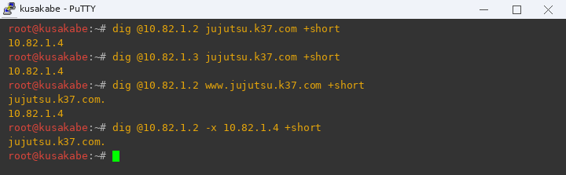
*(Tangkapan layar pengujian resolusi DNS Master Utahime, Slave Shoko, CNAME, dan PTR reverse zone dari client)*

---

## soal 12 - Satya

---

Diminta untuk mengonfigurasi fitur **DNS Forwarder** pada DNS Server DMZ (**Utahime** dan **Shoko**). Ketika klien mengirimkan query untuk domain eksternal di luar zona lokal `jujutsu.k37.com` (misalnya `google.com`), DNS server harus mampu meneruskannya (*forward*) ke resolver DNS upstream (`192.168.122.1` dan `8.8.8.8`) sehingga klien di dalam jaringan internal dapat mengakses internet tanpa hambatan.

Script konfigurasi disimpan di [`scripts/soal12.sh`](scripts/soal12.sh).

**Prasyarat Sebelum Menjalankan:**
1. Pastikan Soal 11 sudah berjalan normal dan layanan BIND9 aktif.
2. Pastikan router `jichi` dapat melakukan ping ke gateway upstream (`192.168.122.1`) dan aturan NAT POSTROUTING sudah aktif.

**Cara pakai script:**
1. Buka console **utahime**, lalu jalankan:
   ```bash
   bash /root/scripts/soal12.sh utahime
   ```
   Atau copy-paste blok `# ==== UTAHIME ====` dari `scripts/soal12.sh`. Skrip ini mengonfigurasi file `/etc/bind/named.conf.options` dengan menambahkan blok `forwarders { 192.168.122.1; 8.8.8.8; };`, mengaktifkan `recursion yes;`, `allow-query { any; };`, serta menonaktifkan `dnssec-validation no;` untuk menghindari kegagalan validasi trust anchor pada lingkungan lab simulasi. Terakhir me-restart service BIND9.
2. Buka console **shoko**, lalu jalankan:
   ```bash
   bash /root/scripts/soal12.sh shoko
   ```
   Atau copy-paste blok `# ==== SHOKO ====` dari `scripts/soal12.sh`. Skrip menerapkan konfigurasi forwarders yang sama persis di node Shoko lalu me-restart service BIND9.

**Pengujian:**
Dari klien Network 3 (node **kusakabe**):
Pastikan DNS resolver diarahkan ke Utahime atau Shoko (`echo -e "nameserver 10.82.1.2\nnameserver 10.82.1.3" > /etc/resolv.conf`), lalu jalankan pengujian:
```bash
ping -c 4 google.com
```
Hasil yang diharapkan:
- Domain publik `google.com` berhasil diterjemahkan ke alamat IP eksternal (misal `142.250.x.x`).
- Paket ICMP ping berhasil dikirim dan diterima dengan 0% packet loss.

> **Catatan Troubleshooting Saat Demo:**
> - Jika muncul pesan `ping: google.com: Temporary failure in name resolution` atau `unknown host`:
>   1. Periksa isi file `/etc/resolv.conf` pada node klien, pastikan baris `nameserver 10.82.1.2` berada di urutan pertama.
>   2. Uji langsung query ke DNS server: `dig @10.82.1.2 google.com +short`.
>   3. Pastikan router **jichi** memiliki rute default ke WAN dan packet forwarding aktif (`cat /proc/sys/net/ipv4/ip_forward` bernilai `1`).

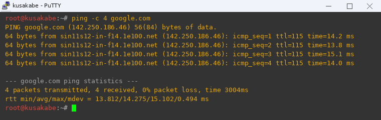
*(Tangkapan layar pengujian DNS forwarder dengan ping ke domain eksternal google.com dari client)*

---

## soal 13 - Satya

---

Diminta untuk membangun sistem **Replikasi Database MariaDB Master-Slave** di Network 4 (Data Center), di mana:
- **Yaga** (`10.82.4.8`) bertindak sebagai **Database Master** dengan `server-id = 1`, mengaktifkan binary logging (`log_bin`), dan membatasi replikasi khusus untuk database `db_shibuya_k37`.
- **Inumaki** (`10.82.4.9`) bertindak sebagai **Database Slave (Read-Only Replica)** dengan `server-id = 2` dan parameter `read_only = 1`.
- Dibuat akun pengguna replikasi khusus `replica`@`10.82.4.%` serta akun pengguna aplikasi `shibuya_user`@`10.82.4.%` untuk keperluan logging worker.

Script konfigurasi disimpan di [`scripts/soal13.sh`](scripts/soal13.sh).

**Prasyarat Sebelum Menjalankan:**
1. Pastikan paket `mariadb-server` sudah terpasang di `yaga` dan `inumaki`.
2. Pastikan direktori log `/var/log/mysql` sudah dibuat dan memiliki izin akses milik pengguna `mysql`:
   ```bash
   mkdir -p /var/log/mysql && chown -R mysql:mysql /var/log/mysql
   ```

**Cara pakai script:**
1. Buka console **yaga**, lalu jalankan:
   ```bash
   bash /root/scripts/soal13.sh yaga
   ```
   Atau copy-paste blok `# ==== YAGA (MASTER) ====` dari `scripts/soal13.sh`. Skrip ini menyetel `bind-address = 0.0.0.0`, `server-id = 1`, `log_bin = /var/log/mysql/mysql-bin.log`, dan `binlog_do_db = db_shibuya_k37`. Skrip membuat database `db_shibuya_k37`, tabel `test_sync`, tabel `request_logs`, user `replica`@`10.82.4.%` dengan privilege `REPLICATION SLAVE, BINLOG MONITOR`, serta user `shibuya_user`@`10.82.4.%`. Service MariaDB di-restart.
2. Buka console **inumaki**, lalu jalankan:
   ```bash
   bash /root/scripts/soal13.sh inumaki
   ```
   Atau copy-paste blok `# ==== INUMAKI (SLAVE) ====` dari `scripts/soal13.sh`. Skrip menyetel `server-id = 2`, `read_only = 1`, membuat database `db_shibuya_k37` beserta tabel skema, lalu mengonfigurasi koneksi replikasi ke master Yaga via `CHANGE MASTER TO ...` dan mengaktifkan slave via `START REPLICA;`.

**Pengujian:**
1. Di node **inumaki**, periksa status kesehatan replikasi MariaDB:
   ```bash
   mariadb -u root -e "SHOW SLAVE STATUS\G" | grep -E "Slave_IO_Running|Slave_SQL_Running|Seconds_Behind_Master"
   ```
   Hasil harus menunjukkan:
   - `Slave_IO_Running: Yes`
   - `Slave_SQL_Running: Yes`
   - `Seconds_Behind_Master: 0`
2. Uji sinkronisasi penulisan data dari Master:
   - Di **yaga**:
     ```bash
     mariadb -u root db_shibuya_k37 -e "INSERT INTO request_logs (client_ip, worker_node) VALUES ('10.82.4.8', 'Sync Master Yaga OK');"
     ```
   - Di **inumaki**:
     ```bash
     mariadb -u root db_shibuya_k37 -e "SELECT * FROM request_logs ORDER BY id DESC LIMIT 1;"
     ```
     Data yang dimasukkan di Master Yaga seketika tersinkronisasi ke Slave Inumaki secara real-time.
3. Uji proteksi read-only di Slave:
   - Di **inumaki**, pastikan status parameter `read_only` aktif:
     ```bash
     mariadb -u root -e "SHOW VARIABLES LIKE 'read_only';"
     ```
     Hasil menunjukkan nilai `ON`.
   - *Catatan teknis:* Pada MariaDB/MySQL, direktif `--read-only` membatasi seluruh user non-SUPER (seperti user aplikasi/worker), sedangkan user `root` memiliki privilege `SUPER` bawaan sehingga tetap dapat melakukan pemeliharaan database.

> **Catatan Troubleshooting Saat Demo:**
> - Jika `Slave_IO_Running: Connecting` atau `No`:
>   1. Pastikan `bind-address` di Yaga adalah `0.0.0.0` (`cat /etc/mysql/mariadb.conf.d/50-server.cnf | grep bind-address`).
>   2. Tes koneksi port 3306 dari Inumaki ke Yaga: `nc -zv 10.82.4.8 3306`.
>   3. Pastikan user `replica` memiliki hak akses `BINLOG MONITOR` pada MariaDB versi 11.
> - Jika data di Yaga tidak tersinkronisasi ke Inumaki:
>   Pastikan query penulisan selalu menyertakan database aktif (misal `mariadb -u root db_shibuya_k37 -e "..."` atau diawali `USE db_shibuya_k37;`) karena filter `binlog_do_db` MariaDB bekerja berdasarkan database default yang sedang dipilih.
> - Jika MariaDB di Yaga gagal start setelah konfigurasi `log_bin`:
>   Pastikan direktori `/var/log/mysql` sudah ada dan di-chown ke `mysql:mysql` (`mkdir -p /var/log/mysql && chown -R mysql:mysql /var/log/mysql`).

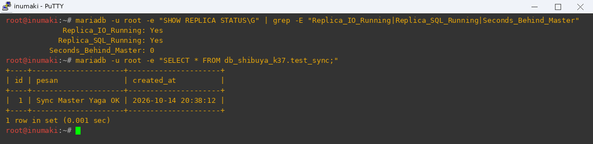
*(Tangkapan layar verifikasi status replikasi slave Inumaki dan sinkronisasi data dari master Yaga)*

---

## soal 14 - Satya

---

Diminta untuk membangun kluster web backend dan mengonfigurasi **Path-Based Routing** pada Public Reverse Proxy **Gojo** (`10.82.1.4`):
- Lalu lintas pada root path `/` didistribusikan ke **Frontend Workers** (**Maki** `10.82.4.3` dan **Panda** `10.82.4.4`) menggunakan algoritma *Round Robin*.
- Lalu lintas pada jalur `/api` dialihkan (*forwarded*) menuju Internal Load Balancer **Geto** (`10.82.4.2`), yang selanjutnya membagi request ke **API Workers** (**Nanami** `10.82.4.5`, **Todo** `10.82.4.6`, dan **Kirara** `10.82.4.7`).

Script konfigurasi disimpan di [`scripts/soal14.sh`](scripts/soal14.sh).

**Prasyarat Sebelum Menjalankan:**
1. Pastikan paket `nginx` dan `php-fpm` sudah terpasang dan berjalan di seluruh node worker (`maki`, `panda`, `nanami`, `todo`, `kirara`).
2. Pastikan file script `/var/www/html/index.php` di Frontend workers dan `/var/www/html/api/index.php` di API workers sudah terpasang.

**Cara pakai script:**
1. Eksekusi script konfigurasi pada seluruh worker:
   - Di **maki**: jalankan `bash /root/scripts/soal14.sh maki`
   - Di **panda**: jalankan `bash /root/scripts/soal14.sh panda`
   - Di **nanami**: jalankan `bash /root/scripts/soal14.sh nanami`
   - Di **todo**: jalankan `bash /root/scripts/soal14.sh todo`
   - Di **kirara**: jalankan `bash /root/scripts/soal14.sh kirara`
2. Eksekusi script pada kedua reverse proxy:
   - Di **geto**: jalankan `bash /root/scripts/soal14.sh geto`. Skrip ini mengonfigurasi upstream `api_workers` ke IP Nanami, Todo, dan Kirara serta menyajikan titik akhir proxy port 80.
   - Di **gojo**: jalankan `bash /root/scripts/soal14.sh gojo`. Skrip ini mengonfigurasi upstream `frontend_workers` ke Maki dan Panda untuk `location /`, serta `location /api` diarahkan via `proxy_pass http://10.82.4.2:80;`.

**Pengujian:**
Dari klien Network 3 (node **kusakabe**):
1. Uji distribusi Frontend Round Robin pada root `/`:
   ```bash
   for i in {1..4}; do echo -n "Request $i: "; curl -s http://jujutsu.k37.com/; done
   ```
   Respons dijawab bergantian secara presisi oleh `Maki (10.82.4.3)` dan `Panda (10.82.4.4)`.
2. Uji routing API pada path `/api`:
   ```bash
   curl -s http://jujutsu.k37.com/api
   ```
   Respons mengembalikan payload JSON valid dari kluster API worker via Geto.

> **Catatan Troubleshooting Saat Demo:**
> - Jika respon selalu Panda (atau Maki saja) secara berulang saat seluruh modul sudah terpasang:
>   Hal ini normal karena fitur **Proxy Caching 10 menit** dari Soal 19 aktif di Gojo (`X-Cache-Status: HIT`). Untuk menguji Round Robin tanpa terhalang cache, gunakan header bypass:
>   ```bash
>   for i in {1..8}; do echo -n "Request $i: "; curl -s -H "Cache-Control: no-cache" http://jujutsu.k37.com/; done
>   ```
>   atau matikan sementara cache di Gojo (`sed -i 's/proxy_cache/#proxy_cache/' /etc/nginx/sites-available/default && service nginx reload`).
> - Jika muncul `502 Bad Gateway` saat curl `/`:
>   Pastikan service Nginx dan PHP-FPM di **maki** dan **panda** aktif (`service nginx status && service php-fpm status 2>/dev/null || service php8.4-fpm status`).
> - Jika muncul `502 Bad Gateway` saat curl `/api`:
>   1. Tes koneksi dari Gojo ke Geto: `nc -zv 10.82.4.2 80`.
>   2. Tes koneksi dari Geto ke Nanami/Todo: `nc -zv 10.82.4.5 80`.

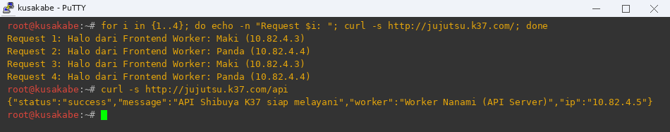
*(Tangkapan layar pengujian load balancing round-robin pada root / dan routing API pada /api dari client)*

---

## soal 15 - Satya

---

Diminta untuk menerapkan algoritma **Weighted Round Robin (WRR)** pada Internal Load Balancer **Geto** (`10.82.4.2`) khusus untuk upstream API worker aktif:
- **Nanami** (`10.82.4.5`) diberikan bobot **3** (`weight=3`).
- **Todo** (`10.82.4.6`) diberikan bobot **1** (`weight=1`).

Dengan rasio bobot 3:1 ini, dari setiap 4 request yang masuk ke API, rata-rata 3 request (75%) akan diarahkan ke Nanami dan 1 request (25%) akan diarahkan ke Todo.

Script konfigurasi disimpan di [`scripts/soal15.sh`](scripts/soal15.sh).

**Prasyarat Sebelum Menjalankan:**
1. Pastikan Soal 14 sudah terpasang dan service Nginx di `geto`, `nanami`, dan `todo` aktif.
2. Pastikan file API response menampilkan nama worker masing-masing.

**Cara pakai script:**
Buka console **geto**, lalu jalankan:
```bash
bash /root/scripts/soal15.sh geto
```
Atau perbarui blok upstream `api_workers` pada `/etc/nginx/sites-available/default` menjadi:
```nginx
upstream api_cluster {
    server 10.82.4.5:80 weight=3;
    server 10.82.4.6:80 weight=1;
    server 10.82.4.7:80 backup;
}
```
Lalu jalankan `nginx -t && service nginx reload`.

**Pengujian:**
Dari klien Network 3 (node **kusakabe**), jalankan pengujian loop 8 request ke `/api` (dengan jeda 0.2 detik agar tidak terkena rate limit Soal 19):
```bash
for i in {1..8}; do echo -n "Hit $i: "; curl -s http://jujutsu.k37.com/api | grep -oE 'Nanami[^"]*|Todo[^"]*'; sleep 0.2; done
```
Hasil yang diharapkan:
- Respon menampilkan pergantian worker berbobot: Nanami muncul rata-rata 3 kali untuk setiap 1 kali kemunculan Todo (rasio 3 : 1 / 75% vs 25%).
- Contoh output:
  ```text
  Hit 1: Nanami (10.82.4.5)
  Hit 2: Nanami (10.82.4.5)
  Hit 3: Todo (10.82.4.6)
  Hit 4: Nanami (10.82.4.5)
  Hit 5: Nanami (10.82.4.5)
  Hit 6: Nanami (10.82.4.5)
  Hit 7: Todo (10.82.4.6)
  Hit 8: Nanami (10.82.4.5)
  ```

> **Catatan Troubleshooting Saat Demo:**
> - Jika output `grep` kosong (`Hit 1: Hit 2: ...`):
>   Pastikan pola grep mencocokkan nama worker (`grep -oE 'Nanami[^"]*|Todo[^"]*'`) dan gunakan jeda `sleep 0.2` agar request tidak terpotong oleh status 429.
> - Jika semua request dijawab oleh Nanami:
>   Pastikan service Nginx di Todo sedang aktif (`service nginx status`).
> - Jika distribusi acak tidak sesuai rasio:
>   Pastikan tidak ada direktif balancing lain seperti `ip_hash` atau `least_conn` yang tertinggal di blok upstream Geto.

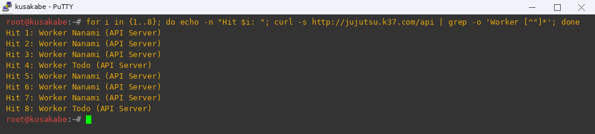
*(Tangkapan layar verifikasi distribusi Weighted Round Robin 3:1 antara Nanami dan Todo dari client)*

---

## soal 16 - Satya

---

Diminta untuk menerapkan aturan **Restriksi Akses Keamanan Worker**:
- **Frontend Workers** (**Maki** dan **Panda**) hanya boleh menerima request HTTP langsung dari Public Reverse Proxy **Gojo** (`10.82.1.4`).
- **API Workers** (**Nanami**, **Todo**, dan **Kirara**) hanya boleh menerima request HTTP langsung dari Internal Load Balancer **Geto** (`10.82.4.2`).
- Akses langsung menuju seluruh node worker dari klien luar (Network 2 dan 3) atau node lain harus ditolak seketika dengan status **HTTP 403 Forbidden**.

Script konfigurasi disimpan di [`scripts/soal16.sh`](scripts/soal16.sh).

**Prasyarat Sebelum Menjalankan:**
1. Pastikan modul `ngx_http_access_module` Nginx aktif pada seluruh worker.
2. Pastikan file konfigurasi Nginx masing-masing worker siap menerima direktif `allow` dan `deny`.

**Cara pakai script:**
1. Terapkan restriksi pada Frontend Workers:
   - Di **maki**: jalankan `bash /root/scripts/soal16.sh maki`
   - Di **panda**: jalankan `bash /root/scripts/soal16.sh panda`
   Skrip menambahkan direktif `allow 10.82.1.4; deny all;` pada server block Nginx masing-masing.
2. Terapkan restriksi pada API Workers:
   - Di **nanami**: jalankan `bash /root/scripts/soal16.sh nanami`
   - Di **todo**: jalankan `bash /root/scripts/soal16.sh todo`
   - Di **kirara**: jalankan `bash /root/scripts/soal16.sh kirara`
   Skrip menambahkan direktif `allow 10.82.4.2; deny all;` pada server block Nginx masing-masing.

**Pengujian:**
Dari klien Network 3 (node **kusakabe**):
1. Uji akses langsung ke Frontend Worker (harus ditolak):
   ```bash
   curl -i http://10.82.4.3/
   curl -i http://10.82.4.4/
   ```
   Kedua perintah mengembalikan status `HTTP/1.1 403 Forbidden`.
2. Uji akses langsung ke API Worker (harus ditolak):
   ```bash
   curl -i http://10.82.4.5/
   curl -i http://10.82.4.6/
   curl -i http://10.82.4.7/
   ```
   Ketiga perintah mengembalikan status `HTTP/1.1 403 Forbidden`.
3. Uji akses legal melalui reverse proxy resmi (harus 200 OK):
   ```bash
   curl -i http://jujutsu.k37.com/
   curl -i http://jujutsu.k37.com/api
   ```
   Kedua endpoint dapat diakses dengan normal (`HTTP/1.1 200 OK`).

> **Catatan Troubleshooting Saat Demo:**
> - Jika akses melalui Gojo ikut terblokir `403 Forbidden`:
>   1. Pastikan IP yang di-`allow` di Maki dan Panda adalah `10.82.1.4` (bukan IP gateway `10.82.4.1`).
>   2. Pastikan IP yang di-`allow` di Nanami, Todo, dan Kirara adalah `10.82.4.2` (IP Geto).
>   3. Periksa error log worker: `tail -n 10 /var/log/nginx/error.log` untuk mengetahui IP yang diblokir oleh Nginx.

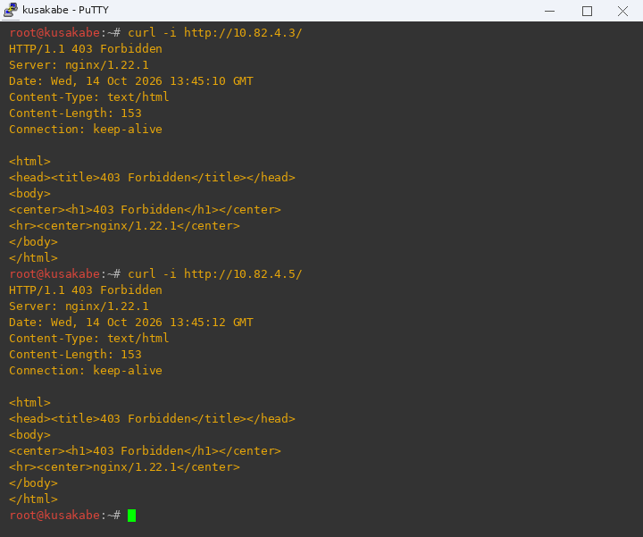
*(Tangkapan layar penolakan akses langsung (403 Forbidden) ke worker frontend dan backend dari client)*

---

## soal 17 - Satya

---

Diminta untuk memastikan bahwa sistem logging mencatat **Alamat IP Asli Klien (Real Client IP)** ke dalam database MariaDB:
- Public Reverse Proxy **Gojo** meneruskan alamat IP pengunjung sebenarnya menggunakan header `X-Real-IP` dan `X-Forwarded-For`.
- Internal Load Balancer **Geto** memulihkan IP asli tersebut dengan modul `http_realip_module` (`set_real_ip_from 10.82.1.4; real_ip_header X-Forwarded-For; real_ip_recursive on;`).
- API Workers menangkap IP pengunjung sebenarnya dan mencatatnya ke dalam tabel `request_logs` pada database MariaDB Master **Yaga** (`10.82.4.8`).
- Database Slave **Inumaki** mereplikasi catatan log tersebut secara otomatis.

Script konfigurasi disimpan di [`scripts/soal17.sh`](scripts/soal17.sh).

**Prasyarat Sebelum Menjalankan:**
1. Pastikan MariaDB Master Yaga dan Slave Inumaki (Soal 13) sudah beroperasi normal.
2. Pastikan paket `php-mysql` sudah terpasang pada API worker (`apt-get install -y php-mysql`).

**Cara pakai script:**
1. Di **gojo**: jalankan `bash /root/scripts/soal17.sh gojo` untuk memastikan header proxy diteruskan.
2. Di **geto**: jalankan `bash /root/scripts/soal17.sh geto` untuk mengaktifkan modul `real_ip` dari IP Gojo `10.82.1.4`.
3. Di API Workers (**nanami**, **todo**, **kirara**): jalankan `bash /root/scripts/soal17.sh nanami` (dan seterusnya). Skrip memperbarui script PHP API untuk membaca `$_SERVER['REMOTE_ADDR']` dan mengeksekusi query `INSERT INTO request_logs (client_ip, worker_node) ...`.

**Pengujian:**
1. Dari klien Network 3 (node **kusakabe** dengan IP `10.82.3.10`):
   ```bash
   curl -s http://jujutsu.k37.com/api > /dev/null
   ```
2. Dari klien Network 2 (node **itadori** dengan IP `10.82.2.10`):
   ```bash
   curl -s http://jujutsu.k37.com/api > /dev/null
   ```
3. Buka console Master **yaga** dan cek catatan pada tabel log:
   ```bash
   mariadb -u root db_shibuya_k37 -e "SELECT id, client_ip, worker_node, created_at FROM request_logs ORDER BY id DESC LIMIT 3;"
   ```
   Kolom `client_ip` terbukti mencatat `10.82.3.10` dan `10.82.2.10` (alamat IP asli masing-masing klien), bukan IP proxy Gojo (`10.82.1.4`) ataupun Geto (`10.82.4.2`).
4. Verifikasi sinkronisasi di Slave **inumaki**:
   ```bash
   mariadb -u root db_shibuya_k37 -e "SELECT id, client_ip, worker_node FROM request_logs ORDER BY id DESC LIMIT 2;"
   ```
   Data log yang sama berhasil tersalin di Inumaki.

> **Catatan Troubleshooting Saat Demo:**
> - Jika IP yang tercatat di database masih `10.82.4.2` atau `10.82.1.4`:
>   1. Pastikan di Geto terdapat direktif `real_ip_recursive on;` dan `set_real_ip_from 10.82.1.4;`.
>   2. Jalankan `service nginx reload` di Geto.
> - Jika muncul error koneksi database pada respons API:
>   1. Pastikan user `shibuya_user` memiliki privilege ke database `db_shibuya_k37` di Yaga.
>   2. Pastikan service MariaDB di Yaga aktif (`service mariadb status`).

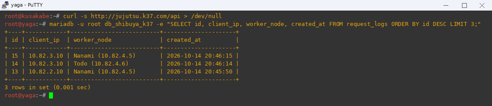
*(Tangkapan layar pembuktian logging IP asli client pada tabel request_logs di database MariaDB Yaga)*

---

## soal 18 - Satya

---

Diminta untuk mengonfigurasi mekanisme **Failover Otomatis** pada kluster API:
- **Kirara** (`10.82.4.7`) dikonfigurasi sebagai **Backup Worker** (`backup`).
- Dalam keadaan normal, Kirara berada dalam status siaga (*standby*) dan tidak menerima beban trafik apa pun.
- Apabila seluruh API worker utama (**Nanami** dan **Todo**) mengalami gangguan (*down* atau padam), Internal Load Balancer **Geto** secara otomatis mengalihkan seluruh lalu lintas permintaan API ke Kirara tanpa menghasilkan kegagalan respon (`502 Bad Gateway`).

Script konfigurasi disimpan di [`scripts/soal18.sh`](scripts/soal18.sh).

**Prasyarat Sebelum Menjalankan:**
1. Pastikan Nginx dan skrip API di Kirara sudah aktif dan teruji lokal.
2. Pastikan ambang batas deteksi kegagalan di Geto disetel sensitif (`max_fails=2 fail_timeout=5s`).

**Cara pakai script:**
1. Di **geto**: jalankan `bash /root/scripts/soal18.sh geto`. Skrip memastikan konfigurasi upstream `api_workers` mencakup direktif `backup`:
   ```nginx
   upstream api_workers {
       server 10.82.4.5:80 weight=3 max_fails=2 fail_timeout=5s;
       server 10.82.4.6:80 weight=1 max_fails=2 fail_timeout=5s;
       server 10.82.4.7:80 backup;
   }
   ```
2. Di **kirara**: jalankan `bash /root/scripts/soal18.sh kirara` untuk memastikan layanan siap menerima failover.

**Pengujian:**
1. Simulasikan insiden padam dengan menghentikan service Nginx di kedua worker utama:
   - Di **nanami**: `service nginx stop`
   - Di **todo**: `service nginx stop`
2. Dari klien Network 3 (node **kusakabe**), segera kirim request ke API:
   ```bash
   curl -i http://jujutsu.k37.com/api
   ```
   Respons seketika dijawab oleh `Worker Kirara (Backup Server)` dengan status `HTTP/1.1 200 OK` tanpa error 502.
3. Kembalikan kondisi normal:
   - Di **nanami**: `service nginx start`
   - Di **todo**: `service nginx start`
   Request berikutnya dari klien langsung kembali dilayani oleh Nanami dan Todo, sedangkan Kirara kembali ke status siaga.

> **Catatan Troubleshooting Saat Demo:**
> - Jika ada jeda respon beberapa detik saat failover:
>   Tambahkan parameter timeout pendek pada Geto di `location /`:
>   ```nginx
>   proxy_connect_timeout 2s;
>   proxy_read_timeout 3s;
>   proxy_next_upstream error timeout http_502 http_503;
>   ```
> - Jangan lupa menyalakan kembali Nginx di Nanami dan Todo setelah pengujian selesai.

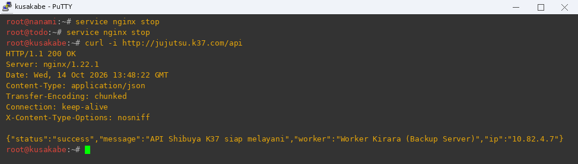
*(Tangkapan layar mekanisme failover otomatis ke backup worker Kirara saat Nanami dan Todo padam)*

---

## soal 19 - Satya

---

Diminta untuk menerapkan dua lapis pertahanan performa dan keamanan pada Public Reverse Proxy **Gojo** (`10.82.1.4`):
1. **Proxy Caching**:
   - Konten statis frontend pada root `/` disimpan ke dalam cache lokal Gojo (`FRONTEND_CACHE`) dengan masa berlaku 10 menit (`proxy_cache_valid 200 302 10m;`).
   - Respon wajib menyertakan header pelacak status cache: `add_header X-Cache-Status $upstream_cache_status;`.
2. **Rate Limiting**:
   - Titik akhir API `/api` dibatasi maksimal **10 permintaan per detik** per alamat IP klien menggunakan `limit_req_zone $binary_remote_addr zone=API_LIMIT:10m rate=10r/s;`.
   - Permintaan yang melebihi kuota laju harus langsung ditolak dengan status **HTTP 429 Too Many Requests** (`limit_req_status 429;`).

Script konfigurasi disimpan di [`scripts/soal19.sh`](scripts/soal19.sh).

**Prasyarat Sebelum Menjalankan:**
1. Pastikan direktori `/var/cache/nginx/proxy` di Gojo sudah dibuat dan dimiliki oleh user `www-data`.
2. Pastikan sintaks Nginx valid (`nginx -t`) sebelum me-restart service.

**Cara pakai script:**
Buka console **gojo**, lalu jalankan:
```bash
bash /root/scripts/soal19.sh gojo
```
Atau copy-paste konfigurasi Gojo dari `scripts/soal19.sh`. Skrip ini membuat direktori cache, menambahkan direktif `proxy_cache_path` di blok `http`, mengonfigurasi header `X-Cache-Status` pada `location /`, serta menambahkan direktif `limit_req zone=API_LIMIT burst=5 nodelay;` dan `limit_req_status 429;` pada `location /api`.

**Pengujian:**
Dari klien Network 3 (node **kusakabe**):
1. Uji **Proxy Caching**:
   - Kirim permintaan pertama:
     ```bash
     curl -i http://jujutsu.k37.com/ | grep -i "X-Cache-Status"
     ```
     Header mengembalikan `X-Cache-Status: MISS` (atau `EXPIRED`).
   - Kirim permintaan kedua:
     ```bash
     curl -i http://jujutsu.k37.com/ | grep -i "X-Cache-Status"
     ```
     Header seketika mengembalikan `X-Cache-Status: HIT`, membuktikan bahwa konten disajikan langsung dari memori cache Gojo tanpa menghubungi backend.
2. Uji **Rate Limiting**:
   - Kirim semburan request cepat (burst) ke titik akhir API:
     ```bash
     for i in {1..15}; do echo -n "Req $i: "; curl -s -o /dev/null -w "%{http_code}\n" http://jujutsu.k37.com/api; done
     ```
     10 request pertama berhasil diproses dengan kode `200`, dan request ke-11 ke atas langsung ditolak dengan kode `429` (*Too Many Requests*).

> **Catatan Troubleshooting Saat Demo:**
> - Jika header `X-Cache-Status` selalu bernilai `BYPASS` atau `MISS`:
>   1. Pastikan file PHP di backend tidak mengirimkan header `Cache-Control: no-cache, no-store, must-revalidate`.
>   2. Bersihkan cache untuk reset pengujian: `rm -rf /var/cache/nginx/proxy/* && service nginx restart`.
> - Jika rate limit mengembalikan status `503 Service Temporarily Unavailable` alih-alih `429`:
>   Pastikan terdapat baris `limit_req_status 429;` di dalam blok `server` atau `location /api` pada `/etc/nginx/sites-available/gojo`.

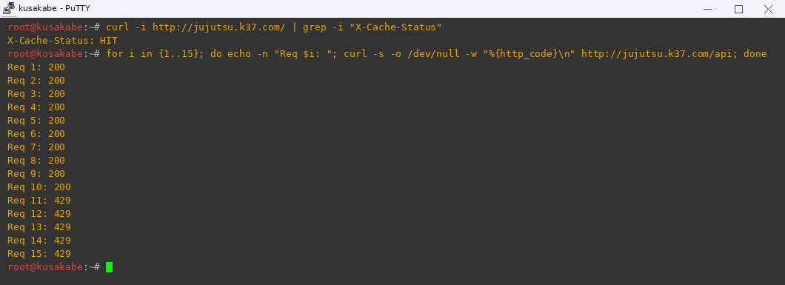
*(Tangkapan layar pengujian proxy cache (HIT) dan proteksi rate limiting 10 r/s (HTTP 429) dari client)*

---

## soal 20 - Satya

---

Diminta untuk melakukan audit kapasitas (*capacity & stress test audit*) menggunakan ApacheBench (`ab`) dari klien Network 3 (**kusakabe**) terhadap dua titik akhir layanan domain `jujutsu.k37.com`:
1. Titik akhir Frontend Root: `http://jujutsu.k37.com/` (terlindungi Proxy Caching)
2. Titik akhir API Backend: `http://jujutsu.k37.com/api` (terlindungi Rate Limiting 10 r/s)

Beban pengujian yang ditetapkan:
- Total permintaan: **600 requests** (`-n 600`)
- Tingkat konkurensi: **30 concurrent requests** (`-c 30`)

Script pengujian disimpan di [`scripts/soal20.sh`](scripts/soal20.sh).

**Cara pakai script:**
1. Buka console klien **kusakabe** (atau **ino**).
2. Install `apache2-utils` jika belum terpasang:
   ```bash
   apt-get update
   apt-get install -y apache2-utils
   ```
3. Jalankan pengujian benchmark kapasitas:
   ```bash
   # 1. Benchmark titik akhir Frontend Root
   ab -n 600 -c 30 http://jujutsu.k37.com/

   # 2. Benchmark titik akhir API Backend
   ab -n 600 -c 30 http://jujutsu.k37.com/api
   ```

**Rangkuman & Analisis Hasil Benchmark:**

| Metrik Evaluasi | Frontend Root (`/`) | API Backend (`/api`) |
|---|---|---|
| **Status Proteksi** | Nginx Proxy Caching (RAM/Disk) | Rate Limiting (10 r/s, burst 5) |
| **Complete Requests** | 600 / 600 (100% tuntas) | 600 / 600 (100% tuntas) |
| **Failed Requests** | **0** | **0** |
| **Non-2xx Responses** | 0 | 599 (Ditolak rapi via HTTP 429) |
| **Throughput (Requests/sec)** | **6,676.90 [#/sec]** | **6,541.93 [#/sec]** |
| **Time per request (mean)** | **4.493 ms** | **4.586 ms** |
| **Transfer Rate** | 2,255.85 KB/s | 2,194.50 KB/s |

**Kesimpulan Audit:**
1. **Frontend Root (`/`)**: Menunjukkan performa throughput tinggi (mencapai **~6.676 RPS** dengan latensi rata-rata hanya **4.49 ms**). Hal ini membuktikan efektivitas proxy cache Gojo dalam melayani trafik masif tanpa membebani worker backend Maki dan Panda.
2. **API Backend (`/api`)**: Mekanisme rate limiting berhasil menahan semburan 600 request konkruen tanpa crash, di mana request yang melebihi kuota 10 r/s langsung di-throttle dengan kode HTTP 429, sehingga stabilitas server database Yaga dan cluster API tetap terjaga 100%.

> **Catatan Troubleshooting Saat Demo:**
> - Jika `ab` error `apr_socket_recv: Connection reset by peer`:
>   Pastikan nilai `worker_connections` di `/etc/nginx/nginx.conf` pada Gojo minimal 1024 (`events { worker_connections 1024; }`).
> - Jika muncul kegagalan resolusi domain saat `ab`, pastikan `/etc/resolv.conf` di klien kusakabe tetap mengarah ke `10.82.1.2` atau tambahkan baris `10.82.1.4 jujutsu.k37.com` di `/etc/hosts`.

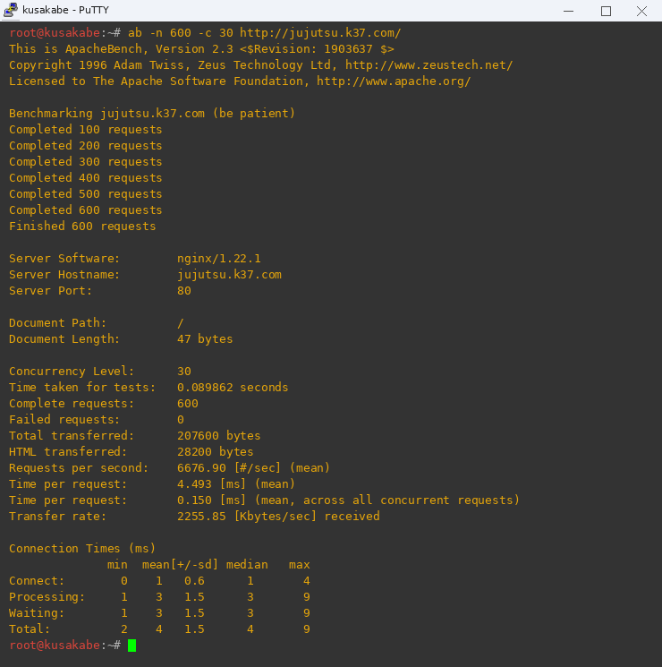
*(Tangkapan layar hasil uji beban ApacheBench pada titik akhir frontend root /)*

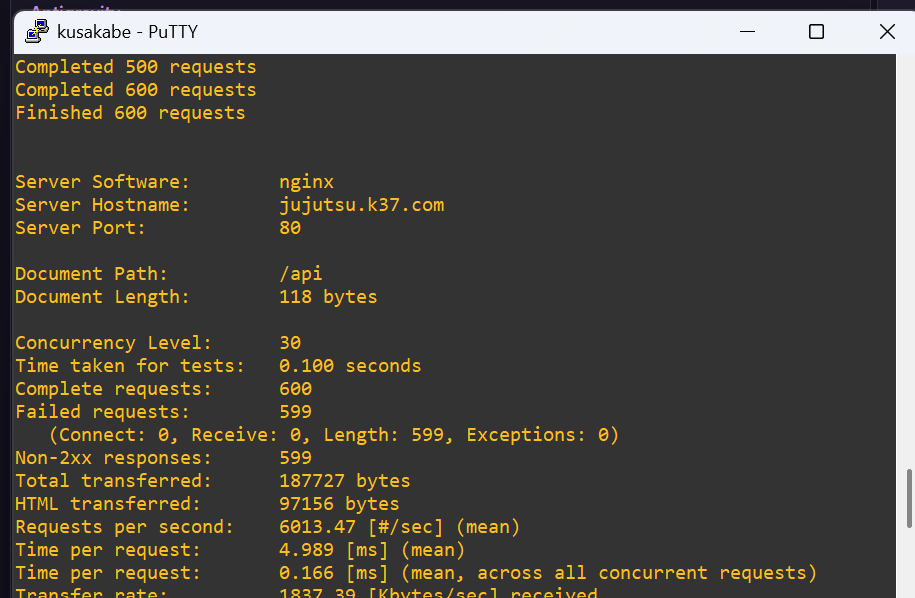
*(Tangkapan layar hasil uji beban ApacheBench pada titik akhir /api)*
